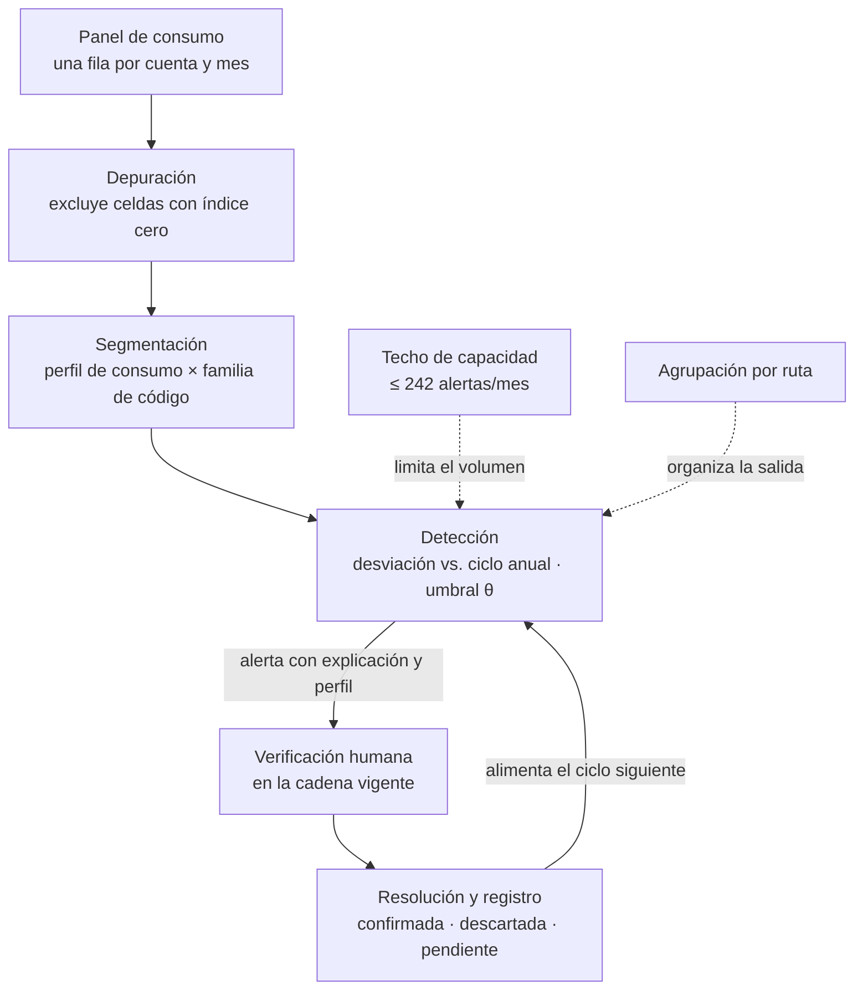

# INFORME FINAL DE INVESTIGACIÓN

> **Modelo institucional de ALSIE — nivel de maestría.**
> **Fuente de la forma:** `instituciones/alsie/guia_ifi_contenido.md` (14 apartados) e `instituciones/alsie/indicadores_revision_ifi.md` (indicadores de maestría).
> **Fuente del contenido:** carpeta `tesis_ds/`. Trazabilidad completa en el **Anexo C**.
> **Estado de la traducción, 29 de octubre de 2026:** los apartados 1 a 8 y 13 están **completos**; los apartados 9, 10 y 14 son **parciales** porque dependen de etapas aún abiertas (`E7d`, `E7e`, `E7f`, `E8`, `E9`, `E10`); los apartados 11 y 12 están **pendientes** por la misma razón. Lo que falta se marca `[PENDIENTE]` con la pregunta que lo desbloquea, y **no se rellena con supuestos**.
> **Regla de este documento:** ningún dato entra sin su fuente. Las cifras provienen de `DATOS desde 2022.xlsx`, `DATOS.xlsx`, `CODIGOS_IRREGULARES.xlsx` y de las declaraciones registradas de la tesista.

---

## 1. Carátula

| | |
|:--|:--|
| **Institución que titula** | UNIVERSIDAD AUTÓNOMA DEL BENI "JOSÉ BALLIVIÁN" / ALSIE CONSULTORES PEDAGÓGICOS |
| **Logo** | _Se inserta en el maquetado final._ |
| **Título del trabajo** | **Método de detección y verificación previa a la facturación de lecturas anómalas en distribución eléctrica** |
| **Modalidad y nivel** | Tesis de maestría para optar al grado de Magíster en Ingeniería de Software |
| **Postulante** | Natalia Fabiola Medrano Cambará |
| **Tutor** | Luis Roberto Pérez Rios, Ph.D. |
| **Mes y año de presentación** | Octubre de 2026 |
| **Ciudad y país** | Cochabamba, Bolivia |

**Control del título contra la guía (reglas 8, 9 y 10):** 15 palabras exactas —el máximo permitido—, sin siglas y sin fórmulas. Describe el contenido y está vinculado al objetivo general.

---

## 2. Agradecimientos

> Expreso mi más sincero agradecimiento a mi familia, cuyo respaldo constante, aliento y comprensión hicieron posible culminar esta etapa de formación avanzada; su presencia ha sido el soporte firme a lo largo de todo este proceso. De manera muy especial, agradezco a mis padres; sus principios, sacrificios y ejemplo de trabajo íntegro me inculcaron la disciplina y el compromiso necesarios para alcanzar este objetivo. Todo lo que soy y logro a nivel personal y profesional encuentra su raíz en sus enseñanzas: este resultado es tan suyo como mío.
>
> A mi pareja, mi profunda gratitud y reconocimiento por su apoyo constante y por el tiempo invaluable brindado a este proyecto. Gracias por escuchar mis ideas, acompañarme en las largas jornadas de trabajo con paciencia y comprensión en los momentos de mayor exigencia, y recordarme siempre el valor de la perseverancia; tu colaboración y aliento fueron indispensables para hacer posible este camino.

*[PENDIENTE — decisión del tesista: ¿se incorpora al tutor en este apartado? La guía (L122) cubre «cualquier ayuda importante recibida de cualquier persona» y el tutor revisa la propuesta el viernes 30 de octubre.]*

---

## 3. Dedicatoria

> **A mis padres,**
>
> Por su amor incondicional, su guía constante y los sacrificios silenciosos que forjaron el camino hacia cada una de mis metas. Gracias por inculcarme desde el primer día que la educación, la integridad y el trabajo perseverante son el mayor legado; su ejemplo de vida es y será siempre el cimiento de mis logros personales y profesionales. Esta tesis es, ante todo, el fruto de su esfuerzo compartido. Con admiración y gratitud infinita.

---

## 4. Resumen

> Se estudió la detección de lecturas con consumo atípico previa a la facturación en la distribución de energía eléctrica, con el propósito de sustituir la revisión reactiva por una detección sistemática que no excediera la capacidad del equipo de verificación. Se analizó el histórico de lecturación de una empresa distribuidora nacional correspondiente a los 57 meses comprendidos entre enero de 2022 y septiembre de 2026, y se revisó la literatura sobre detección de anomalías en consumo eléctrico. Se constató que el 0,88 % de las lecturas facturables, esto es 12 300 de 1 389 941 registros, fue marcado con un código de irregularidad, y que la oficina de atención al consumidor recibió 1 053 reclamos en el mismo periodo, de los cuales 174 resultaron procedentes y 136 correspondieron a lecturas marcadas sin código; la revisión bibliográfica no arrojó evidencia de su aplicación previa a la facturación en la literatura consultada. Sobre esa evidencia se propuso un método de detección y verificación previa a la facturación, entendido como artefacto de tipo método, diseñado para operar sobre un panel de consumo con una fila por cuenta y mes, agrupado por ruta de lecturación, y para el que se fijó un procedimiento de calibración del umbral contra el techo de capacidad de 242 alertas mensuales. Se concluyó que era viable incorporar detección sistemática al ciclo de lecturación sin ampliar el equipo de verificación, y quedó pendiente la evaluación del método sobre el histórico completo.

**Control de la guía:** 241 palabras (tope 250) · un solo párrafo · tiempo pasado y voz pasiva · sin siglas · sin tablas ni fórmulas · ubicado justamente antes del índice. Revela tema, objeto, objetivo, metodología y resultados.

---

## 5. Índice

> Se numera a partir de la Introducción (guía, regla 11). No incluye Resumen, Agradecimientos ni Dedicatoria.

- **6. Introducción**
  - 6.1 Problema científico
  - 6.2 Objeto de estudio
  - 6.3 Campo de acción
  - 6.4 Objetivo general
  - 6.5 Objetivos específicos
  - 6.6 Hipótesis
  - 6.7 Aporte teórico
  - 6.8 Significación práctica
  - 6.9 Métodos y técnicas
  - 6.10 Población y muestra
- **7. Capítulo I. Diagnóstico de la investigación**
  - 7.1 Descripción contextual
  - 7.2 Operacionalización de la variable
  - 7.3 Instrumentos aplicados
  - 7.4 Resultados del diagnóstico
  - 7.5 Regularidades del estado actual
- **8. Capítulo II. Marco teórico de la investigación**
  - 8.1 Antecedentes
  - 8.2 Definiciones y concepciones sobre el objeto y el campo
  - 8.3 Categorías conceptuales
  - 8.4 Análisis histórico-lógico del problema
  - 8.5 Soluciones dadas por otras investigaciones
  - 8.6 Valoración crítica y toma de posición
  - 8.7 Estado del arte y brecha identificada
- **9. Capítulo III. Modelo teórico de la investigación**
  - 9.1 Fundamentación epistemológica
  - 9.2 Componentes del modelo
  - 9.3 Relaciones esenciales
  - 9.4 Representación gráfica
  - 9.5 Propiedades del modelo
- **10. Capítulo IV. Propuesta de la investigación**
  - 10.1 Fundamentos teóricos y definición asumida
  - 10.2 Estructura oficial con autor
  - 10.3 Alternativas consideradas y decisión
  - 10.4 Requisitos de la propuesta
  - 10.5 Diseño del método
  - 10.6 Metodología para su aplicación
  - 10.7 Validación
  - 10.8 Relación con los capítulos anteriores
- **11. Conclusiones**
- **12. Recomendaciones**
- **13. Referencias bibliográficas**
- **14. Anexos**
  - Anexo A. Instrumentos aplicados
  - Anexo B. Ficha del artefacto
  - Anexo C. Mapa de equivalencias Design Science → ALSIE

---

## 6. Introducción

*[Tiempo verbal: presente. Extensión: no excede el 10 % del total.]*

La distribución comercial de energía eléctrica es un servicio regulado en el que la lectura del medidor y su facturación constituyen el punto de contacto entre la empresa y el usuario. En ese punto se decide cuánto paga el consumidor y, cuando la lectura registrada no refleja el consumo real, el error se traslada a la factura y reaparece después como reclamo. La presente investigación se ocupa de ese tramo del proceso: la detección de lecturas anómalas **antes** de facturar, en una distribuidora con sistema transaccional propio y un catálogo de códigos de irregularidad impuesto por su ente regulador.

El estudio se desarrolla en la regional de una empresa distribuidora nacional de Bolivia, con **29 750 cuentas** al cierre de septiembre de 2026, cuyo sistema de lecturación y facturación opera sobre una base de datos relacional y conserva el histórico de lecturas desde enero de 2022. La investigadora es administradora de ese sistema, lo que garantiza el acceso a los datos y al código, y a la vez impone una separación explícita entre quien construye la propuesta y quien la evalúa.

### 6.1 Problema científico

En la regional estudiada de la distribuidora, entre enero de 2022 y septiembre de 2026, solo el **0,88 %** de las lecturas facturables lleva un código de irregularidad —12 300 de 1 389 941 registros—, marca que aplica el personal terciarizado en el momento de la lectura. El **99,12 %** restante no se barre en ningún momento: no existe un proceso que recorra el histórico para identificar lecturas cuyo consumo sea incoherente y que no fueron marcadas. La detección que sí existe es manual, no está escrita, carece de umbral numérico y depende de una sola persona —el encargado de facturación—, que compara el consumo del mes con los últimos seis meses y solicita una visita si lo juzga anómalo; de ese proceso resultan **242,2 correcciones manuales por mes** en 2026, sin reporte accesible ni constancia del criterio aplicado. La consecuencia se mide en el ciclo de reclamos: la oficina de atención al consumidor tramitó **1 053 reclamos en 57 meses**, de los cuales **174 resultaron procedentes** y **136 —el 78,16 %— provinieron de lecturas sin código**, es decir, de anomalías que ningún proceso advirtió y que el usuario reclamó **después** de facturar, con plazos perentorios de 3 a 15 días hábiles y silencio administrativo positivo a favor del consumidor. Verificar un caso cuesta entre 3 y 4 horas y, cuando exige visita con respaldo fotográfico, 2 días.

La literatura sobre detección de anomalías en consumo eléctrico trabaja con series de consumo y, en los estudios de fraude, con etiquetas de casos confirmados; el campo está maduro y cuenta con varias revisiones sistemáticas. Sin embargo, no se localizó evidencia sobre **cómo un método que barre el histórico completo —incluidas las lecturas que el lecturador no marcó— se integra a un ciclo de lecturación-facturación sujeto al catálogo de códigos de un ente regulador**, ni bajo qué criterios los verificadores de una distribuidora lo consideran utilizable cuando revisar un caso cuesta entre 3 y 4 horas. Resolver la situación descrita exige, por tanto, un conocimiento que hoy no está disponible: la formalización de esa detección como un método con pasos, roles, criterio escrito, techo de capacidad y registro de resolución, y los principios de diseño que de su aplicación se desprenden.

### 6.2 Objeto de estudio

El objeto de estudio es **la detección y verificación de lecturas anómalas en el ciclo de lecturación y facturación de energía eléctrica**, en la regional de la distribuidora estudiada y en el periodo comprendido entre enero de 2022 y septiembre de 2026, en tanto es allí donde se manifiesta la situación que debe resolverse: la existencia de lecturas con consumo incoherente que no fueron marcadas y que ningún proceso barre antes de facturar.

*Resignificación respecto del paradigma de origen:* en Design Science el objeto era el artefacto construido —el método—; en el modelo institucional el objeto es el **área del conocimiento** donde se manifiesta la situación, y el método pasa a ser el instrumento de estudio y el núcleo de la propuesta (Capítulo IV).

### 6.3 Campo de acción

El campo de acción comprende **las propiedades, dimensiones y relaciones esenciales de la detección y verificación de lecturas anómalas no declaradas**, a saber: la segmentación del histórico por perfil de consumo y familia de código; el criterio de detección escrito y reproducible, evaluado en ambas direcciones y contra el propio ciclo anual de cada cuenta; la priorización de las alertas dentro de un techo de capacidad; la agrupación de las alertas por ruta de lecturación; la explicación obligatoria que acompaña a cada alerta; y el registro de resolución que alimenta el ciclo siguiente. Quedan fuera del campo la técnica concreta de aprendizaje automático, el fenómeno del fraude como tal y el proceso de lecturación en sí, que son contexto.

### 6.4 Objetivo general

Diseñar, construir y evaluar un método de detección y verificación previa a la facturación de lecturas anómalas no declaradas en el ciclo de lecturación y facturación de energía eléctrica, y articular los principios de diseño que de su aplicación se desprenden, contribuyendo a la formalización de la detección sistemática en distribuidoras reguladas.

### 6.5 Objetivos específicos

| Capítulo | Objetivo específico |
|:--|:--|
| **I. Diagnóstico** | Caracterizar el estado actual de la detección y verificación de lecturas anómalas en la regional estudiada, mediante indicadores trazables a `tfv_historico_lecturador` y `tfv_reclamo`. |
| **II. Marco teórico** | Sistematizar los fundamentos teóricos de la detección de anomalías en consumo eléctrico y de la conversión de una señal en una decisión dentro de un ciclo regulado. |
| **III. Modelo teórico** | Modelar la detección y verificación de lecturas anómalas no declaradas, precisando sus componentes y relaciones esenciales. |
| **IV. Propuesta** | Elaborar y validar la propuesta que concreta el modelo y resuelve el problema de la detección reactiva. |

### 6.6 Hipótesis

> **`[PROVISIONAL — requiere validación del tesista]`** La hipótesis se construye a partir de las decisiones de diseño ya cerradas (`07a`, `07b`, `07c`), porque los principios de diseño validados (`E10`) aún no existen. Se ofrece una formulación y se pide su validación.

**Hipótesis general.** Si se aplica un método de detección y verificación que compara el consumo de cada cuenta contra su propio ciclo anual —el mismo mes de los cuatro años anteriores—, con un umbral escrito y calibrado contra un techo de capacidad, y que emite sus alertas agrupadas por ruta con la comparación que las originó, entonces se identifican lecturas anómalas no declaradas que hoy no se detectan, sin exceder la capacidad del equipo de verificación, porque concentra el esfuerzo en las cuentas cuya desviación respecto de su propio patrón estacional es mayor y devuelve al verificador la evidencia necesaria para aceptar o descartar cada alerta.

**Hipótesis específicas (asociadas a los objetivos específicos):**

1. La magnitud y el costo de la detección reactiva actual son medibles con indicadores trazables, y muestran que la mayoría de los reclamos procedentes proviene de lecturas sin código.
2. Un criterio de detección basado en el ciclo anual por cuenta mantiene el volumen de alertas dentro del techo de capacidad, a diferencia de un criterio basado en una ventana móvil de seis meses.
3. Un método con criterio escrito, explicación obligatoria y registro de resolución es aplicable por verificadores que no participaron en su construcción.

*[PENDIENTE — validación: ¿el tesista confirma esta hipótesis, la ajusta o prefiere vincularla a un principio de diseño concreto una vez cerrado E10?]*

### 6.7 Aporte teórico

> **`[PROVISIONAL — requiere validación del tesista]`** El aporte se deriva de la contribución reclamada (`03_perfil_ds.md` §10) y de las relaciones del modelo (Capítulo III), porque los principios de diseño (`E10`) aún no existen.

El aporte teórico consiste en la **formalización de la detección de lecturas anómalas no declaradas como un proceso con componentes y relaciones explícitas** —depuración, segmentación, detección con referencia anual, verificación y registro—, y en las **regularidades** que explican el comportamiento del objeto: que la comparación contra el propio ciclo anual de la cuenta resuelve la estacionalidad sin fuente externa; que la capacidad de verificación opera como techo de viabilidad y no como preferencia; y que la explicabilidad de la alerta es condición de su adopción por el verificador. Estas relaciones no estaban disponibles en el estado del arte, que trata el error de lectura como problema metrológico y no como problema de proceso.

*[PENDIENTE — validación: el aporte definitivo se redactará con los principios de diseño de E10, en la forma objetivo → contexto → mecanismo → principio.]*

### 6.8 Significación práctica

> **`[PROVISIONAL — requiere validación del tesista]`** La significación se deriva del enlace propuesta ↔ solución (`E9`) y de la evaluación (`E8`), aún pendientes.

La significación práctica consiste en que la distribuidora puede **incorporar detección sistemática a su ciclo de lecturación sin ampliar su equipo de verificación**, sustituyendo la dependencia de la atención de una sola persona por un criterio escrito y reproducible, y devolviendo al verificador la evidencia para resolver tanto los reclamos procedentes como los improcedentes —que hoy consumen la misma inspección técnica—. En correspondencia con el aporte teórico, la mejora observable es la reducción de la detección reactiva y la formalización del trabajo que hoy se hace a mano.

*[PENDIENTE — validación: la magnitud de la mejora se fijará con los resultados de E8.]*

### 6.9 Métodos y técnicas

**Métodos teóricos.**
- **Análisis-síntesis:** para descomponer el ciclo de lecturación-facturación en sus componentes y reconstruirlo como método.
- **Histórico-lógico:** para reconstruir la evolución del problema —la ruptura de junio de 2025 y el residual posterior— y del estado del arte.
- **Sistémico:** para tratar el método como un sistema de componentes y relaciones.
- **Modelación:** para construir el modelo teórico del Capítulo III.
- **Revisión bibliográfica con protocolo declarado:** para el marco teórico y el estado del arte (no es una revisión sistemática; se declara como limitación).

**Métodos empíricos.**
- **Análisis de documentos y de bases de datos:** extracción y análisis del histórico de lecturas, reclamos y catálogo de códigos.
- **Observación participante:** la investigadora administra el sistema y describe la cadena de corrección vigente.
- **Entrevista / consulta estructurada:** consultas al personal de la distribuidora sobre tiempos, personal y registro de visitas.
- **Estudio de caso:** la regional de la distribuidora como caso representativo de la clase de contextos.

**Técnicas.**
- Consultas SQL sobre la base de datos transaccional (panel de consumo por cuenta y mes).
- Análisis estadístico descriptivo y cálculo de tasas por 100 000 lecturas.
- Codificación de la cadena de corrección en cinco pasos y cinco roles.
- Calibración del umbral por recorrido del orden de desviaciones hasta el techo de capacidad.

**Vinculación con los objetivos específicos:** el análisis de bases de datos y la observación sirven al objetivo 1 (diagnóstico); la revisión bibliográfica y el análisis-síntesis, al objetivo 2 (marco teórico); la modelación, al objetivo 3 (modelo); y la entrevista, el estudio de caso y la calibración, al objetivo 4 (propuesta y validación).

### 6.10 Población y muestra

**Población:** las **29 750 cuentas** de la regional estudiada al cierre de septiembre de 2026, sujetas al catálogo nacional de códigos de irregularidad. El universo no es fijo —los registros de lectura crecen de 28 355 en enero de 2025 a 29 750 en septiembre de 2026—, de modo que los denominadores se calculan mes a mes.

**Unidades de análisis:** la celda cuenta-mes del panel de consumo (1 485 556 celdas verificadas), las lecturas facturables (1 389 941 en 57 meses) y los reclamos tramitados (1 053 en 57 meses).

**Muestra:** la selección es **analítica, no estadística**. La regional se elige por ser representativa de la clase de contextos —distribuidoras con sistema transaccional propio, histórico tabular de lecturas y catálogo del regulador—, por cuanto comparte las tres condiciones que definen esa clase. Para la validación se prevé una muestra de las alertas que el método produzca, resuelta por un verificador que no participó del estudio. *[PENDIENTE: confirmar el número exacto de participantes y su disponibilidad.]*

---

## 7. Capítulo I. Diagnóstico de la investigación

*[Tiempo verbal: resultados en pasado. Primero el análisis y después la tabla o figura; no se repite el mismo dato en tabla y figura.]*

Este capítulo caracteriza el estado actual de la detección y verificación de lecturas anómalas en la regional estudiada. Presenta la descripción contextual, la operacionalización de la variable, los instrumentos aplicados y los resultados de todos ellos, y cierra con las regularidades que definen el estado actual del objeto.

### 7.1 Descripción contextual

La investigación se desarrolla en la regional de una empresa distribuidora de energía eléctrica de Bolivia, cuyo sistema de lecturación y facturación opera sobre una base de datos relacional (PHP/PostgreSQL) y está organizado en regionales. La regional estudiada maneja **29 750 cuentas** al cierre de septiembre de 2026.

El proceso de lecturación y facturación involucra **cinco roles distintos** entre el domicilio y la factura:

| # | Paso | Actor |
|:--|:--|:--|
| 1 | Toma de lecturas en equipos móviles de lecturación | Personal **terciarizado** (externo a la empresa) |
| 2 | Recepción del equipo móvil y descarga de las lecturas al sistema comercial | Personal responsable de lecturación |
| 3 | Revisión de los consumos calculados; si alerta una anomalía, solicita visita al domicilio | **Encargado de facturación** |
| 4 | Desplazamiento al domicilio, respaldo fotográfico del medidor, retorno a oficina | Personal técnico de la empresa (no terciarizado) |
| 5 | Revisión y corrección de la lectura | Encargado de facturación |

El **paso 3 ya es una detección de anomalías**: existe, es manual, no está escrita en ningún documento y depende de una sola persona. La regla que aplica el encargado de facturación —declarada por la tesista— compara el consumo del mes contra el histórico de los **últimos seis meses**, en ambas direcciones (superior: estufas en invierno, aire acondicionado en verano; inferior: viajes, vacaciones). Esa regla **no tiene umbral numérico ni registro de la decisión**.

El entorno regulado impone condiciones que el diagnóstico debe registrar: el catálogo de códigos de irregularidad del ente regulador (48 códigos), los plazos de atención de reclamos de 3 a 15 días hábiles con silencio administrativo positivo a favor del consumidor, y la capacidad del equipo de verificación.

### 7.2 Operacionalización de la variable

**Variable:** detección y verificación de lecturas anómalas no declaradas en el ciclo de lecturación y facturación.

| Dimensión | Definición operativa | Indicador medible | Unidad / fórmula |
|:--|:--|:--|:--|
| **Magnitud de la anomalía no declarada** | Proporción de lecturas facturables sin código de irregularidad | Proporción de lecturas sin código sobre el facturable | % = tipo 1 ÷ (tipo 1 + 2 + 3) |
| **Costo de la detección reactiva** | Reclamos que llegan después de facturar y resultan procedentes | Reclamos procedentes originados en lecturas sin código | N.º y % = procedentes sin código ÷ procedentes |
| **Carga de la detección manual** | Correcciones manuales previas a la facturación | Correcciones manuales mensuales | N.º/mes |
| **Capacidad de verificación** | Volumen de alertas que el equipo puede resolver | Techo de alertas por mes | N.º/mes = correcciones mensuales ÷ 22 días hábiles × 22 |
| **Señal de riesgo del código** | Propensión a generar reclamo procedente según el código | Razón de tasas por 100 000 lecturas | (procedentes con código ÷ facturable con código) ÷ (procedentes sin código ÷ facturable sin código) |

**Definiciones operativas adoptadas** (de `04_marco_teorico.md` §7):

| Término | Definición operativa |
|:--|:--|
| **Anomalía** | Patrón de datos que no se ajusta al comportamiento esperado (Chandola et al., 2009) |
| **Lectura anómala no declarada** | Lectura cuyo consumo difiere de lo esperable para esa cuenta y ese momento del ciclo, según criterio escrito y reproducible, **sin código de irregularidad** |
| **Detección** | Aplicación del criterio a un conjunto de lecturas para emitir una lista priorizada de sospechosas |
| **Verificación** | Acto posterior —revisión en pantalla o visita con fotografía— que confirma o descarta una alerta |
| **Verdad de referencia** | Conjunto de casos cuya condición de anómalo se conoce independientemente del método; aquí se reconstruye con los reclamos procedentes |
| **Capacidad de verificación** | Volumen de alertas que el equipo puede resolver en un periodo sin exceder su carga normal: ≈11 visitas diarias |
| **Aplicabilidad** | Que practicantes que no participaron en la investigación puedan seguir los pasos y obtener los resultados esperados |
| **Efectividad** | Comparación de resultados con y sin el método |

### 7.3 Instrumentos aplicados

Los instrumentos del diagnóstico son de dos tipos: **extracciones de la base de datos** y **consultas estructuradas al personal**. Los ítems de cada instrumento guardan relación exacta con los indicadores de la sección 7.2.

**Instrumento 1 — Extracción del histórico de lecturas, reclamos y catálogo.** Consultas SQL sobre las tablas `tfv_historico_lecturador`, `tfv_lectura`, `tfv_lec_irregular`, `tfv_reclamo`, `tfv_reclamo_lectura`, `tfv_respuesta_reclamo`, `tfv_cobranza`, `tfv_ruta` y `tfv_cliente`, más los archivos consolidados `DATOS.xlsx` y `DATOS desde 2022.xlsx`. Mide: proporción de lecturas con y sin código, reclamos por tipo y procedencia, correcciones manuales y tasas por 100 000 lecturas.

**Instrumento 2 — Consulta sobre el tiempo por corrección manual** (desglosado por rama: revisión en pantalla y visita con fotografía). Mide el indicador de tiempo de verificación. *Respuesta recibida: «el tiempo no está registrado en ningún sistema, no está medido»; se registra como dato no disponible.*

**Instrumento 3 — Consulta sobre las visitas que no terminan en corrección.** Mide la tasa de falsos positivos de la detección manual actual. *Respuesta recibida: «no existe registro de solicitud de visita a domicilio»; se registra como dato no disponible.*

**Instrumento 4 — Consulta sobre el personal que atiende la revisión y la corrección.** Mide la capacidad del equipo. *Respuesta recibida: la revisión se hace por rutas, con 1 a 3 técnicos por oficina y 2 a 3 personas en la visita; las 3 a 4 horas son un máximo y no un promedio; la fuente es estimación declarada del personal.*

**Instrumento 5 — Consulta sobre el catálogo de códigos de irregularidad.** Mide la composición del catálogo. *Resultado: 48 códigos, `id_cod_irre` de 0 a 47, con `desc_cod_irre`, `sw_aviso` y `estado`.*

Los modelos en blanco de los instrumentos se incluyen en el **Anexo A**.

### 7.4 Resultados del diagnóstico

#### 7.4.1 Población y alcance de la extracción

La extracción cubre **enero de 2022 a septiembre de 2026 — 57 meses y cuatro ciclos anuales completos**. La prueba de continuidad entre las dos fuentes —`DATOS.xlsx` (21 meses) y `DATOS desde 2022.xlsx` (57 meses)— reprodujo exactamente las nueve cifras de la primera, de modo que son la misma fuente y la segunda solo amplía su alcance.

| Concepto | Valor | Fuente |
|:--|:--|:--|
| Cuentas de la regional | **29 750** (el universo crece: 28 355 registros en enero de 2025) | `DATOS.xlsx`, Tablas 2 y 3 |
| Lecturas facturables (57 meses) | **1 389 941** | `DATOS desde 2022.xlsx`, hoja `tipo_lectura` |
| Lecturas Tipo 1 (sin código) | **1 377 641 → 99,12 %** | Hoja `tipo_lectura` |
| Lecturas Tipo 2 y 3 (con código) | **12 300 → 0,88 %** | Hoja `tipo_lectura` |
| Lectura Tipo 0 (LC, no facturada) | **177 784 → 11,34 %** del total de lecturas | Hoja `tipo_lectura` |
| Total de lecturas registradas | **1 567 725** | Hoja `tipo_lectura` |

**Tipos de lectura (dominio confirmado):** 0 = LC, lectura de corte (no facturada) · 1 = LN, lectura normal (objeto de investigación) · 2 = LE, lectura estimada · 3 = NE, normal estimada.

#### 7.4.2 Indicador 1 — Reclamos por tipo de lectura y procedencia

El análisis de los reclamos muestra que la mayoría de los reclamos procedentes proviene de lecturas **sin** código, pese a que las lecturas **con** código tienen una tasa de procedencia mucho mayor por lectura.

| Gestión | Meses con dato | Reclamos | Procedentes (sw=1) | Procedentes Tipo 1 | % Tipo 1 de los procedentes |
|:--|--:|--:|--:|--:|--:|
| 2022 | 12 | 104 | 14 | 11 | 78,57 % |
| 2023 | 12 | 326 | 49 | 40 | 81,63 % |
| 2024 | 12 | 309 | 49 | 39 | 79,59 % |
| 2025 | 12 | 213 | 46 | 35 | 76,09 % |
| 2026 | 9 | 101 | 16 | 11 | 68,75 % |
| **Total** | **57** | **1 053** | **174 (16,52 %)** | **136** | **78,16 %** |

*Tabla 1. Reclamos tramitados ante la oficina de atención al consumidor, por gestión y procedencia (enero 2022 – septiembre 2026). Fuente: `DATOS desde 2022.xlsx`, hoja `reclamos`.*

**Análisis.** De los 174 reclamos procedentes, **136 (78,16 %)** provinieron de lecturas sin código: auditar solo las lecturas con código habría alcanzado como máximo 38 procedentes y habría dejado sin detectar 136. Sin embargo, las lecturas con código son solo el 0,88 % del facturable y originan el 21,84 % de los procedentes, de modo que presentan una tasa de procedencia por lectura mucho mayor.

| Tasa (procedentes ÷ facturable del tipo, × 100 000) | Tipo 1 · LN | Tipo 2–3 · LE+NE | Razón |
|:--|--:|--:|--:|
| **2022–2026 (57 meses)** | 136/1 377 641 → **9,87** | 38/12 300 → **308,94** | **31,3 ×** |

*Tabla 2. Razón de tasas de procedencia por tipo de lectura (57 meses). Fuente: hojas `reclamos` y `tipo_lectura`.*

**Conclusión del indicador.** Las lecturas con código son **31,3 veces más propensas** a generar un reclamo procedente que las que no lo tienen, pese a ser el 0,88 % del volumen. Tener código es una **señal de riesgo de alta potencia**, no un ámbito suficiente de trabajo. En consecuencia, el método debe barrer el conjunto completo **y** usar la familia de código como variable de priorización.

#### 7.4.3 Indicador 2 — Correcciones manuales previas a la facturación

El indicador más fuerte del diagnóstico no mide un síntoma, sino el trabajo que ya se hace a mano para evitar el problema. La serie completa de correcciones muestra una ruptura estructural en junio de 2025.

| Gestión | Total | Meses | Promedio mensual | % de lecturas |
|:--|--:|--:|--:|--:|
| 2022 | 8 509 | 12 | 709,1 | 3,05 % |
| 2023 | 10 230 | 12 | 852,5 | 3,46 % |
| 2024 | 17 459 | 12 | **1 454,9** | **5,62 %** |
| 2025 | 9 604 | 12 | 800,3 | 2,81 % |
| 2026 (9 m) | 2 180 | 9 | **242,2** | **0,82 %** |
| **Total** | **47 982** | **57** | — | **3,22 %** |

*Tabla 3. Correcciones manuales previas a la facturación (`historico.lecturas_diferentes`), por gestión. Fuente: `DATOS desde 2022.xlsx`, hoja `historico`.*

**Análisis.** Tres lecturas se desprenden de la serie: (1) **2024 fue el peor año**, con 1 454,9 correcciones mensuales y 5,62 % de lecturas diferentes; (2) la caída de 2025 no es un efecto de nivel sino de régimen —de 1 507,4/mes en enero-mayo a 295,3/mes en junio-diciembre, un **−80,4 %**—, coincidente con las capacitaciones al personal de mayo y junio de 2025; (3) **2026 es el mejor año de la serie**, con 0,82 %. El problema ya no es el nivel, sino el **residual**.

**Naturaleza de las correcciones:** son **lecturas mal tomadas** por el personal terciarizado, no estimaciones por impedimento ni correcciones de datos. El cambio queda en el log del sistema, pero no hay un reporte accesible con la fecha y la lectura nueva, ni constancia del criterio ni de la evidencia.

**Capacidad como techo de alertas:** 242 correcciones mensuales ÷ 22 días hábiles ≈ **11 visitas por día**. Esa es la capacidad actual del equipo técnico y el techo que el volumen de alertas no debe exceder.

#### 7.4.4 Indicador 3 — Volumen y carga de los reclamos

| Concepto | Valor (57 meses) |
|:--|--:|
| Reclamos tramitados | **1 053** (≈ 18,5/mes) |
| Procedentes | **174 (16,52 %)** (≈ 3/mes) |
| Improcedentes | **879 (83,48 %)** |

*Tabla 4. Volumen y procedencia de los reclamos (57 meses). Fuente: hoja `reclamos`.*

**Análisis.** Cuatro de cada cinco reclamos se resuelven en contra del usuario, pero consumen la misma inspección técnica que los procedentes. Esto abre un segundo frente de utilidad: además de encontrar lo que no se marcó, el método puede dar al verificador evidencia para resolver improcedentes sin desplazamiento.

#### 7.4.5 Síntesis de los indicadores

| # | Indicador | Línea base | Estado |
|:--|:--|:--|:--|
| 1 | Reclamos procedentes sin código | **136 de 174 (78,16 %)**; razón de tasas **31,3×** | Medido |
| 2 | Reclamos totales y procedencia | **1 053 totales, 174 procedentes (16,52 %)** | Medido |
| 3 | Proporción de lecturas con código | **0,88 %** del facturable | Medido |
| 4 | Correcciones manuales mensuales | 242,2 (2026); 295 (jun–dic 2025) | Medido y explicado |
| 5 | Tiempo de verificación por caso | 3 a 4 h; 2 días con visita | Dato no disponible (estimación declarada) |
| 6 | Visitas que no terminan en corrección | No se conoce | Dato no disponible |
| 7 | Regla de detección actual | Desviación frente a 6 meses, ambas direcciones; sin umbral ni registro | Descrita |

### 7.5 Regularidades del estado actual

Del análisis de los resultados se desprenden las siguientes regularidades que definen el estado actual del objeto:

1. **La marca de irregularidad cubre una fracción mínima del facturable y no se barre el resto.** El 99,12 % de las lecturas facturables circula sin código y ningún proceso lo recorre.
2. **La detección existe, pero es informal y personal.** El paso 3 de la cadena ya detecta anomalías, pero sin criterio escrito, sin umbral y sin registro; depende de la atención de una sola persona.
3. **El costo de la omisión se mide en reclamos posteriores a la facturación.** La mayoría de los reclamos procedentes proviene de lecturas sin código, es decir, de anomalías que el proceso no advirtió.
4. **La capacitación de 2025 funcionó y dejó un residual.** El problema no es la inacción, sino el residuo de 242,2 correcciones mensuales que la capacitación no eliminó.
5. **El código de irregularidad es una señal de riesgo, no un ámbito de trabajo.** Las lecturas con código tienen 31,3 veces la tasa de procedencia por lectura, pero son minoría entre los procedentes.
6. **La capacidad de verificación es un límite real.** Cada alerta aceptada termina en un desplazamiento; el techo de ≈11 visitas diarias es el criterio de viabilidad del método.

---

## 8. Capítulo II. Marco teórico de la investigación

*[Tiempo verbal: presente. No es una suma de epígrafes, sino una construcción sistémica que penetra en la esencia del objeto desde la teoría existente.]*

Este capítulo sistematiza los fundamentos teóricos de la detección de anomalías en consumo eléctrico y de la conversión de una señal en una decisión dentro de un ciclo regulado. Se organiza en antecedentes, definiciones y concepciones, categorías conceptuales, análisis histórico-lógico, soluciones dadas por otras investigaciones, valoración crítica y estado del arte.

### 8.1 Antecedentes

**En el mundo.** La detección de anomalías en consumo eléctrico y las pérdidas no técnicas son campos maduros. Tres revisiones sistemáticas o comprehensivas en seis años lo confirman: Saeed et al. (2020) clasifican los métodos de detección de pérdidas no técnicas por algoritmos, características extraídas y métricas de evaluación, y comparan las categorías basada en datos, basada en red e híbrida; Yadav y Kumar (2022) revisan la detección de pérdidas no técnicas y robo de energía a partir de datos de medidor inteligente e inteligencia artificial; y Zhang et al. (2026) revisan la detección de anomalías y reparación de datos en medidores inteligentes. Un campo con tres revisiones en seis años es un campo maduro en su problema y en sus soluciones.

**En la región.** De Oliveira Ventura et al. (2020) proponen una forma de comparar soluciones a las pérdidas no técnicas de electricidad **en Sudamérica**, publicada en *Utilities Policy*, una revista de política y regulación. Henriques et al. (2020) proponen monitorizar las pérdidas **técnicas** para mejorar la estimación y detección de las **no técnicas** en sistemas de baja tensión. Existe, por tanto, trabajo regional y existe el vínculo con la regulación.

**En el país.** La búsqueda con protocolo declarado —58 identificados, 32 incluidos, 28 trabajos distintos— **no encontró ningún trabajo de distribuidora boliviana ni del marco del ente regulador boliviano**. Se registra como **vacío de búsqueda confirmado con método reproducible**, no como constatación de inexistencia.

### 8.2 Definiciones y concepciones sobre el objeto y el campo

**Qué es una anomalía.** Chandola et al. (2009) definen una anomalía como un patrón de datos que no se ajusta al comportamiento esperado de la mayoría de los datos, y distinguen tres tipos: **anomalía de punto** (un registro individual que se aparta del resto), **anomalía contextual** (un registro anómalo solo en función del contexto —tiempo, estación, categoría—) y **anomalía colectiva** (un conjunto de registros cuyo comportamiento conjunto es anómalo). Para series temporales, el tipo relevante es la **subsecuencia anómala**. El caso de este estudio es fundamentalmente **contextual**: 500 kWh son normales en julio y anómalos en abril para la misma cuenta.

**Qué es una pérdida no técnica.** Carr y Thomson (2022) definen la pérdida no técnica de electricidad como un conjunto que **comprende robo, fraude, impago e irregularidades de facturación**. La definición es decisiva: la irregularidad de facturación está dentro del campo, y el problema de este estudio —lecturas mal tomadas y no barridas— cae en ese componente, no únicamente en el de fraude. El mismo trabajo señala que la mayor proporción de pérdidas no técnicas proviene de grandes usuarios, empresas estatales y hogares de mejor posición económica, y no del usuario residencial de bajos recursos que ocupa la percepción pública.

**Qué es un método como artefacto.** March y Smith (1995) identificaron cuatro tipos de artefacto en la investigación sobre sistemas de información —constructos, modelos, métodos e instanciaciones—; Hevner et al. (2004) los adoptaron como núcleo de los siete principios del paradigma y establecieron que **la evaluación apropiada depende del tipo de artefacto producido**. Un método se evalúa por **aplicabilidad** (¿pueden los practicantes seguir los pasos?) y **efectividad** (resultados con y sin el método).

### 8.3 Categorías conceptuales

Las categorías que estructuran el objeto y el campo son:

- **Anomalía contextual y subsecuencia anómala** (Chandola et al., 2009): el marco de la detección.
- **Pérdida no técnica e irregularidad de facturación** (Carr y Thomson, 2022): el marco del dominio.
- **Desequilibrio de clases y métrica precisión-exhaustividad** (Saito y Rehmsmeier, 2015): el marco de la evaluación.
- **Falacia de la tasa base y costo de la alerta** (Axelsson, 2000): el marco de la viabilidad.
- **Explicabilidad de la alerta** (Nwafor et al., 2023; Noorchenarboo y Grolinger, 2025): el marco de la verificación humana.
- **Priorización de la inspección** (Guerrero et al., 2018; Massaferro et al., 2020; Xia et al., 2020): el marco de la decisión.
- **Perfilado previo a la detección** (Piscitelli et al., 2026): el marco de la segmentación.

### 8.4 Análisis histórico-lógico del problema

La evolución del problema en el contexto estudiado muestra una ruptura estructural en junio de 2025. Las correcciones manuales pasaron de 1 507,4 mensuales (enero-mayo de 2025) a 295,3 (junio-diciembre de 2025), una caída del 80,4 %, coincidente con las capacitaciones al personal terciarizado de mayo y junio de 2025. La atribución es **declarativa, no experimental**: la capacitación coincide en el tiempo con la caída, pero no se ha aislado ninguna otra variable. La consecuencia lógica es que la gestión 2025 no sirve como línea base única —mezcla dos regímenes— y que la base utilizable es la posterior a la capacitación (295 y 242,2). El problema real es el **residual** que la capacitación no eliminó.

En el plano teórico, la evolución del campo muestra que la detección de anomalías y las pérdidas no técnicas pasaron de enfoques basados en red a enfoques basados en datos y a enfoques híbridos, con un desplazamiento hacia el medidor inteligente de alta frecuencia. Este estudio, sin embargo, dispone de una **lectura mensual tabular**, lo que condiciona qué características se pueden construir, qué etiquetas hacen falta y qué se puede prometer.

### 8.5 Soluciones dadas por otras investigaciones

| Trabajo | Qué hace | Qué deja fuera |
|:--|:--|:--|
| Guerrero et al. (2018) | Reduce pérdidas no técnicas mejorando la exactitud de las inspecciones en una empresa de distribución | No describe el vínculo con un ciclo de lecturación-facturación ni con un catálogo regulatorio |
| Massaferro et al. (2020) | Formula la detección de fraude para maximizar el retorno económico de la inspección | Optimiza el retorno, no la integración procesal ni la trazabilidad de la decisión |
| Xia et al. (2020) | Algoritmo de inspección por evaluación de sospecha en red inteligente | La salida sigue siendo una priorización para otro agente, no un método completo con roles |
| Piscitelli et al. (2026) | Proceso analítico de perfilado de carga y detección a nivel de medidor | Requiere series de alta frecuencia, no lectura mensual tabular |
| Nwafor et al. (2023); Noorchenarboo y Grolinger (2025) | Explican la detección de anomalías en consumo | No integran la explicación en un proceso de verificación con roles |

El campo **ya sabe** que detectar no basta y que hay que decidir a quién inspeccionar bajo restricción. Lo que este estudio hace es llevar ese problema a su forma **procesal**: qué pasos, qué roles, qué criterio escrito, qué registro de resolución, dentro de una cadena que ya existe con cinco roles.

### 8.6 Valoración crítica y toma de posición

**Sobre la métrica.** Saito y Rehmsmeier (2015) demuestran que, ante conjuntos desequilibrados, la gráfica precisión-exhaustividad es más informativa que la curva ROC. **Toma de posición:** los criterios de éxito 1 y 2 de este estudio —cobertura de reclamos procedentes y falsos positivos— son, en terminología del campo, exhaustividad y (1 − precisión); **queda descartada la exactitud (accuracy)** como criterio, porque en este conjunto sería engañosa.

**Sobre la viabilidad.** Axelsson (2000) documentó la falacia de la tasa base: cuando la proporción de casos verdaderos es baja, un detector con una tasa de falsos positivos aparentemente pequeña produce una mayoría de alarmas falsas. **Toma de posición:** el criterio de carga de verificación **no es un criterio de comodidad, es el criterio de viabilidad del artefacto**. Un método que encontrara todo pero emitiera 500 alertas mensuales sería inútil en este contexto.

**Sobre la explicabilidad.** Nwafor et al. (2023) y Noorchenarboo y Grolinger (2025) confirman que una alerta que no se explica no se adopta. **Toma de posición:** cada alerta debe acompañarse de la comparación concreta que la originó, y la resolución debe registrarse con su criterio y su evidencia.

**Sobre el nivel de la contribución.** Gregor y Hevner (2013) proponen juzgar la contribución por el estado del conocimiento en el dominio del problema y en el dominio de la solución. Aquí el dominio del problema es **escaso** y el dominio de la solución es **abundante**. **Toma de posición:** la contribución **no puede ser una técnica nueva de detección**, sino la formalización del problema y sus principios de diseño con condiciones de contorno explícitas.

**Sobre el alcance del marco.** Se aplicó una **prueba de eliminación**: si al retirar una sección del marco el diseño del método no cambia, esa sección es decorativa y se elimina. Se evaluaron diecisiete secciones: **quince se conservan y dos se eliminan** —auditoría y control interno, y el marco regulatorio como sección teórica—. La eliminación de auditoría y control interno se cerró por decisión explícita tras dos búsquedas con cuenta de registros que no rindieron fuente pertinente y seis fuentes institucionales no consultables: **no se afirma que no exista, se afirma que lo académico no rindió fuente y que lo institucional no fue consultable**.

### 8.7 Estado del arte y brecha identificada

La literatura sobre detección de anomalías y pérdidas no técnicas en distribución eléctrica ha resuelto **cómo puntuar una lectura** y ha reconocido **que inspeccionar exige priorizar**. No se localizó trabajo que documente **cómo convertir esa puntuación en una decisión operativa dentro de un ciclo de lecturación-facturación sujeto a un catálogo regulatorio de irregularidades**, cuando concurren cuatro condiciones medidas en este caso:

1. **Etiquetas escasas y retardadas:** la única verdad de referencia disponible son reclamos de usuarios llegados después de facturar.
2. **Costo de la alerta asimétrico y no recuperable:** cada alerta acatada consume una visita que no se recupera.
3. **Alternativa vigente ya eficaz:** la capacitación de mayo-junio de 2025 redujo las correcciones un 80 %, de modo que el problema real es el residual.
4. **Universo segmentado por el regulador:** el 99,12 % del facturable circula sin código y ningún proceso lo barre.

La brecha se enuncia como **diferencia de enfoque demostrada**, no como no-hallazgo: (a) el error de lectura está en la literatura como **problema metrológico** —interferencia electromagnética, armónicas, mecanismo de conteo— y no como problema de proceso; (b) **«lectura mal tomada» no es una categoría de la literatura consultada** —0 en español sobre 164 registros cribados—; (c) **tampoco es objeto de auditoría ni de control interno**. Lo que falta no es literatura sobre detección ni sobre errores de lectura, sino sobre **la conversión de una señal en una decisión dentro de un ciclo regulado**.

**Limitación declarada:** esta búsqueda **no es una revisión sistemática** —una sola revisora, sin doble criba independiente ni conteos de flujo—, y SciELO, IEEE Xplore y BVS no fueron consultables. Se declara como limitación de acceso, no como ausencia.

---

## 9. Capítulo III. Modelo teórico de la investigación

> **`[PROVISIONAL — requiere E10]`** Este capítulo es el que ALSIE exige y que el paradigma de origen no produce como tal. Se construye a partir del diseño del artefacto (`07c_diseno_artefacto.md`) y de los requisitos (`07b_requisitos.md`). **Los principios de diseño validados (`E10`) aún no existen**, de modo que el modelo se ofrece como construcción provisional y se pide su validación. La representación gráfica se entrega como diagrama Mermaid y debe convertirse en figura con título y nota APA 7.

### 9.1 Fundamentación epistemológica

El modelo se sustenta en el paradigma de la **ciencia del diseño** y en sus tres ciclos (Hevner, 2007): el **ciclo de relevancia**, que importa del entorno el catálogo de códigos, los plazos regulatorios, los cinco roles de la cadena y la capacidad de verificación; el **ciclo de rigor**, que importa el conocimiento del campo (marco teórico y estado del arte); y el **ciclo de diseño**, que construye y evalúa. El modelo se apoya además en la distinción entre el **ciclo de ingeniería** y el **ciclo de investigación** (Wieringa, 2014): el primero puede cerrarse con éxito sin que el segundo genere contribución, de modo que el modelo debe explicitar qué conocimiento transferible produce.

La **ley fundamental de la profesión** que el modelo asume es que la detección de una anomalía solo tiene valor si se convierte en una decisión operativa dentro del ciclo regulado; una señal que no se traduce en una acción verificable no modifica el comportamiento del objeto.

### 9.2 Componentes del modelo

El modelo se compone de cinco componentes esenciales, cada uno con su definición:

| Componente | Definición | Origen |
|:--|:--|:--|
| **Depuración** | Sanitización determinista del panel: toda celda del universo de detección con índice de contador en cero se excluye del cálculo y del listado de alertas. | `07c` §3.6 |
| **Segmentación** | Caracterización previa que asigna a cada cuenta un perfil de consumo (cuatro bandas por cuartiles) y una familia de código (no facturada, sin código, con código), y que viaja con la alerta. | `07c` §3.3 |
| **Detección** | Comparación del consumo observado contra la referencia del propio ciclo anual de la cuenta (mediana de los cuatro años previos), con un umbral escrito y calibrado contra el techo de capacidad. | `07c` §3.1; `07b` §4 |
| **Verificación** | Acto humano que confirma o descarta la alerta, dentro de la cadena vigente, con la comparación que la originó a la vista. | `07b` R4, R5 |
| **Resolución y registro** | Cierre de cada alerta como confirmada, descartada o pendiente, con su criterio y su evidencia, alimentando el ciclo siguiente. | `07b` R5 |

### 9.3 Relaciones esenciales

Las relaciones entre los componentes son las siguientes:

1. **Depuración → Segmentación → Detección.** El orden es **deducido y no supuesto**: si la segmentación no cambia cuáles celdas tienen valor, tampoco puede rescatar una celda que la depuración ya excluyó. Es el único orden que evita clasificar celdas que después se excluyen.
2. **Detección → Verificación.** Toda alerta lleva la comparación que la originó (contra qué referencia, en qué dirección, cuánto se desvió) y el perfil de la cuenta; sin esa explicación, el verificador no puede adoptarla.
3. **Verificación → Resolución y registro → Detección.** El registro de resolución alimenta el ciclo siguiente: sin registro, la alerta no cuenta como emitida.
4. **Capacidad → Detección.** El techo de capacidad (≤ 242 alertas/mes) limita el volumen de la detección: si el criterio produce más alertas, no se sube el techo, se sube el umbral.
5. **Segmentación → Detección (relación de contexto, no de decisión).** La segmentación no fija el umbral ni sustituye la referencia; solo caracteriza.

### 9.4 Representación gráfica

> **Nota de conversión:** el siguiente diagrama en bloque Mermaid es la representación provisional. Debe convertirse en **figura con título y nota APA 7** en el maquetado final.

*Figura 1 (provisional). Componentes y relaciones esenciales del modelo de detección y verificación de lecturas anómalas no declaradas.*

### 9.5 Propiedades del modelo

| Propiedad | ¿Aplica? | En qué sentido |
|:--|:--|:--|
| **Sistémico** | Sí | Los cinco componentes forman un sistema con retroalimentación (el registro alimenta la detección). |
| **Multifactorial** | Sí | La detección depende de la desviación, el perfil, la familia de código y la capacidad. |
| **Procesal** | Sí | El modelo es un proceso con pasos, roles y productos de trabajo. |
| **Dinámico** | Sí | El umbral se recalibra cuando cambia el dato; el registro modifica el ciclo siguiente. |
| **Flexible** | Sí | Admite la regla de contingencia para cuentas con historial corto. |
| **Comunicativo** | Sí | La explicación obligatoria de la alerta es una propiedad comunicativa del modelo. |
| **Interdisciplinario** | Sí | Integra detección de anomalías, gestión de procesos y regulación del servicio. |
| **Personológico** | Parcial | El modelo reconoce el papel del verificador y su criterio, pero no modela la persona. |
| **Complejo** | Sí | Concurren etiquetas escasas, costo asimétrico, alternativa vigente y universo segmentado. |

*[PENDIENTE — validación: el tesista debe confirmar los componentes, las relaciones y las propiedades, y aportar los principios de diseño de E10 para cerrar el capítulo.]*

---

## 10. Capítulo IV. Propuesta de la investigación

> **`[PARCIAL]`** Este capítulo concreta el modelo del Capítulo III y constituye la solución del problema. Se vuelca el material cerrado (`07a`, `07b`, `07c`) y se marcan como pendientes el plan de construcción (`E7d`), la construcción y verificación (`E7e`), la evaluación (`E8`) y la matriz de trazabilidad (`E9`).

### 10.1 Fundamentos teóricos y definición asumida

La propuesta se sustenta en los fundamentos del Capítulo II: la definición de anomalía contextual (Chandola et al., 2009), la noción de pérdida no técnica que incluye la irregularidad de facturación (Carr y Thomson, 2022), la métrica precisión-exhaustividad bajo desequilibrio (Saito y Rehmsmeier, 2015), la falacia de la tasa base (Axelsson, 2000), la explicabilidad como requisito (Nwafor et al., 2023; Noorchenarboo y Grolinger, 2025) y el perfilado previo a la detección (Piscitelli et al., 2026).

**Definición asumida de la propuesta.** Se asume que la propuesta es un **método**: un conjunto ordenado de pasos, roles, entradas, salidas, precondiciones, criterios de entrada y salida y productos de trabajo, que formaliza la detección y verificación de lecturas anómalas no declaradas y la integra a la cadena vigente.

### 10.2 Estructura oficial con autor

> **`[PENDIENTE — pregunta al tesista]`** La guía exige que la propuesta se elabore sobre una **estructura existente (oficial), con autor**. El material de `tesis_ds/` no identifica una estructura oficial única para el método. Se propone, como candidata, la **estructura de proceso del DSRM de Peffers et al. (2007)** —identificación del problema, objetivos de la solución, diseño y desarrollo, demostración, evaluación, comunicación—, sobre la que se organizan los pasos del método. **Se pide al tesista confirmar o sustituir esta estructura.**

### 10.3 Alternativas consideradas y decisión

Se compararon cuatro alternativas de técnica de detección, todas no supervisadas salvo la A4, y todas compatibles con el dato mensual tabular:

| Alternativa | Descripción | Resultado |
|:--|:--|:--|
| **A1** — Ventana móvil de 6 meses con umbral escrito | Formaliza la regla vigente | **Descartada como criterio principal** (falla estacionalidad); **conservada como regla de contingencia** |
| **A2** — Ciclo anual por cuenta | Compara contra el mismo mes de los años previos | **ELEGIDA como criterio principal** |
| **A3** — Normalidad por segmento | Compara contra el patrón del segmento | **Reclasificada como paso previo del método**, no como alternativa |
| **A4** — Clasificador supervisado | Entrena con los reclamos procedentes | **Descartada** (exige corpus etiquetado; solo hay 174 etiquetas retardadas) |

**Decisión.** Se elige **A2 —ciclo anual por cuenta—** como criterio principal, con **A1** como regla de contingencia declarada para cuentas con menos de cuatro ciclos anuales completos, y **A3** como paso previo obligatorio del método. La tipología se mantiene en **método**.

**Justificación.** A2 es la única alternativa que cumple los cuatro filtros sin salvedad: dato mensual tabular, no exige corpus etiquetado, salida con techo de capacidad y salida agrupable por ruta; resuelve la estacionalidad con dato propio (57 meses y cuatro ciclos completos); supera la barra real, que es la capacitación de 2025; y mantiene el artefacto como método.

### 10.4 Requisitos de la propuesta

Los requisitos se agrupan en los cuatro momentos del método y se trazan al problema:

| Momento | Requisitos |
|:--|:--|
| **Segmentación** | R7 (la segmentación precede a la detección), R9 (precondiciones de entrada) |
| **Detección** | R1 (criterio escrito y reproducible), R2 (capacidad como techo), R6 (priorización), R8 (regla de contingencia) |
| **Verificación** | R3 (alertas agrupadas por ruta), R4 (cada alerta lleva su explicación) |
| **Resolución y registro** | R5 (toda alerta termina en un registro) |

**Requisitos destacados:**

- **R1.2** — El método compara el consumo de la cuenta contra su propio ciclo anual (el mismo mes de los años anteriores).
- **R2.1** — El método no puede emitir más de **242 alertas por mes** (≈ 11 por día). El techo se reparte: A2 recibe 218 y A1 recibe 24 (218 + 24 = 242).
- **R3.1** — La salida es un listado de alertas **agrupadas por ruta**, nunca cuentas sueltas.
- **R4.1** — Toda alerta declara contra qué referencia se comparó, en qué dirección se desvió y cuánto.
- **R5.1** — Cada alerta cierra con confirmada, descartada o pendiente, sin estado vacío.
- **R10.1** — El equipo técnico sigue el método sin asistencia de la autora.

### 10.5 Diseño del método

**Precondiciones de entrada.** El método recibe el histórico crudo dentro de una ventana fija (enero de 2022 a septiembre de 2026) y lo depura él mismo. El panel resultante tiene **una fila por cuenta y mes**: 1 485 556 celdas, 30 411 cuentas, 57 meses.

**Paso 1 — Depuración.** Toda celda del universo de detección con índice de contador en cero se excluye del cálculo de desviación y del listado de alertas; se registran cuántas y de cuántas cuentas. El historial de 2022 a 2025 no se limpia.

**Paso 2 — Segmentación.** Se calcula, antes de la detección, el perfil de consumo de cada cuenta (mediana mensual sobre 57 meses, cuatro bandas por cuartiles: 0–26 · 27–69 · 70–135 · >135) y su familia de código (no facturada · lectura normal sin código · con código). El perfil viaja con la alerta.

**Paso 3 — Detección.** Para cada cuenta y cada mes de 2026, se calcula la referencia como la **mediana** de los consumos de esa misma cuenta en ese mismo mes de 2022, 2023, 2024 y 2025, y la desviación como `|consumo_observado − referencia| / referencia`. Se alerta si la desviación supera el umbral `θ`, calibrado recorriendo el orden de desviaciones hasta el cupo de alertas. Las cuentas con menos de cuatro ciclos caen en la regla de contingencia A1 (ventana de 6 meses).

**Paso 4 — Verificación.** Las alertas se agrupan por ruta y se ordenan por severidad. Cada alerta lleva la comparación que la originó y el perfil de la cuenta. El verificador confirma o descarta.

**Paso 5 — Resolución y registro.** Cada alerta cierra con su criterio y su evidencia; el registro alimenta el ciclo siguiente.

**Roles y productos de trabajo.** El método se integra a la cadena vigente de cinco roles (personal terciarizado, responsable de lecturación, encargado de facturación, personal técnico, personal de respuesta al ODECO). El producto de trabajo central es el listado de alertas agrupadas por ruta, con su explicación y su registro de resolución.

### 10.6 Metodología para su aplicación

La aplicación del método comprende: (1) la construcción del panel de consumo por cuenta y mes; (2) la depuración y la segmentación; (3) el cálculo de la referencia anual y de las desviaciones; (4) la calibración del umbral contra el techo de capacidad; (5) la emisión de las alertas agrupadas por ruta; (6) la verificación humana; y (7) el registro de resolución. La calibración del umbral se realiza en dos cupos —218 alertas para A2 y 24 para A1— sobre los nueve meses de 2026.

### 10.7 Validación

> **`[PENDIENTE — E7d/E7e/E8/E9]`** La validación se planifica en dos ciclos: uno **formativo de campo** con rediseño documentado y uno **sumativo de campo** por prueba retrospectiva sobre los reclamos procedentes de la ventana en la que el método es aplicable (enero a septiembre de 2026). Los criterios de éxito son: (1) cobertura retrospectiva de reclamos procedentes; (2) falsos positivos; (3) carga de verificación dentro de la capacidad del equipo; (4) aplicabilidad sin asistencia de la autora. **Los valores de los criterios 1, 3 y 4 están fijados; el del criterio 2 está pendiente de la calibración de `θ`.** La matriz de trazabilidad propuesta ↔ solución se incluirá aquí (ver borrador en `matriz_coherencia.md`).

### 10.8 Relación con los capítulos anteriores

La propuesta concreta el modelo del Capítulo III: cada componente del modelo (depuración, segmentación, detección, verificación, resolución) se materializa en un paso del método. Se sustenta en el marco teórico del Capítulo II y responde al diagnóstico del Capítulo I: el método barre el histórico completo, prioriza las lecturas sospechosas y las deriva a verificación dentro de la cadena vigente, reduciendo la dependencia de la detección reactiva. **Constituye la solución del problema planteado.**

---

## 11. Conclusiones

> **`[PENDIENTE — E8/E10]`** La guía exige **mínimo una conclusión por capítulo**, en términos de resultados y no de sugerencias. No se redactan hasta que existan los resultados de la evaluación (`E8`) y los principios de diseño (`E10`). Se deja la estructura prevista:

- **Conclusión del Capítulo I (Diagnóstico):** *[pendiente]* — se formulará en términos de la magnitud y el costo de la detección reactiva medidos.
- **Conclusión del Capítulo II (Marco teórico):** *[pendiente]* — se formulará en términos de la brecha identificada.
- **Conclusión del Capítulo III (Modelo teórico):** *[pendiente]* — se formulará en términos de los componentes y relaciones del modelo.
- **Conclusión del Capítulo IV (Propuesta):** *[pendiente]* — se formulará en términos de la validación del método.

---

## 12. Recomendaciones

> **`[PENDIENTE — E10]`** Se derivan de cada conclusión, en términos de sugerencias viables, vinculadas a estudios futuros y a la aplicación de los resultados. Se redactarán al cerrar `E10`.

---

## 13. Referencias bibliográficas

*[APA 7. Correspondencia bidireccional cita ↔ referencia. Las 22 entradas fueron verificadas: 21 contra Crossref por DOI y 1 (Hevner, 2007) en AISeL.]*

Axelsson, S. (2000). The base-rate fallacy and the difficulty of intrusion detection. *ACM Transactions on Information and System Security*, *3*(3), 186–205. https://doi.org/10.1145/357830.357849

Carr, D., & Thomson, M. (2022). Non-Technical Electricity Losses. *Energies*, *15*(6), 2218. https://doi.org/10.3390/en15062218

Chandola, V., Banerjee, A., & Kumar, V. (2009). Anomaly detection: A survey. *ACM Computing Surveys*, *41*(3), 1–58. https://doi.org/10.1145/1541880.1541882

Gregor, S., & Hevner, A. R. (2013). Positioning and presenting design science research for maximum impact. *MIS Quarterly*, *37*(2), 337–355. https://doi.org/10.25300/MISQ/2013/37.2.01

Guerrero, J. I., Monedero, I., Biscarri, F., Biscarri, J., Millán, R., & León, C. (2018). Non-technical losses reduction by improving the inspections accuracy in a power utility. *IEEE Transactions on Power Systems*, *33*(2), 1209–1218. https://doi.org/10.1109/TPWRS.2017.2721435

Henriques, H. O., Corrêa, R. L. S., Fortes, M. Z., Borba, B. S. M. C., & Ferreira, V. H. (2020). Monitoring technical losses to improve non-technical losses estimation and detection in LV distribution systems. *Measurement*, *161*, 107840. https://doi.org/10.1016/j.measurement.2020.107840

Hevner, A. R., March, S. T., Park, J., & Ram, S. (2004). Design science in information systems research. *MIS Quarterly*, *28*(1), 75–105. https://doi.org/10.2307/25148625

Hevner, A. R. (2007). A three cycle view of design science research. *Scandinavian Journal of Information Systems*, *19*(2), Artículo 4. https://aisel.aisnet.org/sjis/vol19/iss2/4

March, S. T., & Smith, G. F. (1995). Design and natural science research on information technology. *Decision Support Systems*, *15*(4), 251–266. https://doi.org/10.1016/0167-9236(94)00041-2

Massaferro, P., Di Martino, J. M., & Fernández, A. (2020). Fraud detection in electric power distribution: An approach that maximizes the economic return. *IEEE Transactions on Power Systems*, *35*(1), 703–710. https://doi.org/10.1109/TPWRS.2019.2928276

Noorchenarboo, M., & Grolinger, K. (2025). Explaining deep learning-based anomaly detection in energy consumption data by focusing on contextually relevant data. *Energy and Buildings*, *328*, 115177. https://doi.org/10.1016/j.enbuild.2024.115177

Nwafor, O. N., Okafor, E., Aboushady, A. A., Nwafor, C., & Zhou, C. (2023). Explainable artificial intelligence for prediction of non-technical losses in electricity distribution networks. *IEEE Access*, *11*, 73104–73115. https://doi.org/10.1109/ACCESS.2023.3295688

de Oliveira Ventura, L., Melo, J. D., Padilha-Feltrin, A., Fernández-Gutiérrez, J. P., Sánchez Zuleta, C. C., & Piedrahita Escobar, C. C. (2020). A new way for comparing solutions to non-technical electricity losses in South America. *Utilities Policy*, *67*, 101113. https://doi.org/10.1016/j.jup.2020.101113

Peffers, K., Tuunanen, T., Rothenberger, M. A., & Chatterjee, S. (2007). A design science research methodology for information systems research. *Journal of Management Information Systems*, *24*(3), 45–77. https://doi.org/10.2753/MIS0742-1222240302

Piscitelli, M. S., Buscemi, G., Roselli, C., Marrasso, E., Pallotta, G., & Capozzoli, A. (2026). A novel data-analytics based process for load profiling and meter-level anomaly detection in building energy consumption time series. *Energy and Buildings*, *368*, 117829. https://doi.org/10.1016/j.enbuild.2026.117829

Saeed, M. S., Mustafa, M. W., Hamadneh, N. N., Alshammari, N. A., Sheikh, U. U., Jumani, T. A., Khalid, S. B. A., & Khan, I. (2020). Detection of non-technical losses in power utilities — A comprehensive systematic review. *Energies*, *13*(18), 4727. https://doi.org/10.3390/en13184727

Saito, T., & Rehmsmeier, M. (2015). The precision-recall plot is more informative than the ROC plot when evaluating binary classifiers on imbalanced datasets. *PLOS ONE*, *10*(3), e0118432. https://doi.org/10.1371/journal.pone.0118432

Venable, J., Pries-Heje, J., & Baskerville, R. (2016). FEDS: A framework for evaluation in design science research. *European Journal of Information Systems*, *25*(1), 77–89. https://doi.org/10.1057/ejis.2014.36

Wieringa, R. J. (2014). *Design science methodology for information systems and software engineering*. Springer. https://doi.org/10.1007/978-3-662-43839-8

Xia, X., Xiao, Y., & Liang, W. (2020). SAI: A suspicion assessment-based inspection algorithm to detect malicious users in smart grid. *IEEE Transactions on Information Forensics and Security*, *15*, 361–374. https://doi.org/10.1109/TIFS.2019.2921232

Yadav, R., & Kumar, Y. (2022). The detection of non-technical losses and electricity theft by smart meter data and artificial intelligence in the context of electric distribution utilities: A comprehensive review. *International Journal of Computing and Digital Systems*, *12*(1), 731–740. https://doi.org/10.12785/ijcds/120160

Zhang, B., Lin, G., Zheng, K., & Du, J. (2026). Anomaly detection and data repair for smart meter data in smart cities: A comprehensive review and future perspectives. *Sensors*, *26*(16), 5122. https://doi.org/10.3390/s26165122

---

## 14. Anexos

### Anexo A. Instrumentos aplicados

**Instrumento 1 — Extracción del histórico de lecturas, reclamos y catálogo.** Consultas SQL sobre las tablas `tfv_historico_lecturador`, `tfv_lectura`, `tfv_lec_irregular`, `tfv_reclamo`, `tfv_reclamo_lectura`, `tfv_respuesta_reclamo`, `tfv_cobranza`, `tfv_ruta` y `tfv_cliente`. Especificación completa en `consultas_base_datos.md` y `sql_a2_extraccion.sql`.

**Instrumento 2 — Consulta sobre el tiempo por corrección manual.** Modelo en blanco:

> **Asunto:** Seguimiento — tiempo por corrección manual de lectura, desglosado por rama
>
> Necesito el **tiempo promedio por corrección**, separado en dos ramas: (a) revisión en pantalla; (b) visita con fotografía. Para cada rama: (1) el tiempo promedio por corrección; (2) cuántas correcciones corresponden a cada rama; (3) el periodo exacto y la fuente. Si el tiempo no está registrado, indíquelo así.

**Instrumento 3 — Consulta sobre las visitas que no terminan en corrección.** Modelo en blanco:

> **Asunto:** Consulta — visitas al domicilio que no terminan en cambio de lectura
>
> (1) ¿Existe registro de solicitudes de visita al domicilio? Si existe: (2) total de solicitudes; (3) cuántas terminaron con cambio de lectura; (4) cuántas sin cambio; (5) periodo y fuente. Si el dato no existe, indíquelo así y no lo estime.

**Instrumento 4 — Consulta sobre el personal que atiende la revisión y la corrección.** Modelo en blanco:

> **Asunto:** Consulta — personal que atiende la revisión y corrección de lecturas
>
> (1) Cuántas personas trabajan en la revisión en pantalla; (2) cuántas en la corrección y visita; (3) si las 3 a 4 horas por caso son horas-hombre o tiempo transcurrido; (4) periodo y fuente de cada dato.

**Instrumento 5 — Consulta sobre el catálogo de códigos de irregularidad.** Extracción de `tfv_codigo_irregular`: 48 códigos, `id_cod_irre` de 0 a 47, con `desc_cod_irre`, `sw_aviso` y `estado`.

### Anexo B. Ficha del artefacto

> **`[PENDIENTE — E7f]`** La ficha reproducible del artefacto se producirá en `E7f`. El esqueleto previsto es el de `plantillas/ficha_metodo.md`: identificación, objetivo y alcance, estructura (roles, entradas/salidas, pasos), fundamentación teórica, decisiones de diseño, guía de aplicación, verificación interna, exemplar de aplicación y limitaciones conocidas.

### Anexo C. Mapa de equivalencias Design Science → ALSIE

> **Ver anexo C.** El mapa completo —tabla de equivalencias terminológicas y mapa apartado por apartado con trazabilidad a archivos concretos de `tesis_ds/`— se reproduce a continuación y se mantiene también como archivo de trabajo en `entrega_alsie/mapeo_ds_alsie.md`.

**C.1 Equivalencias terminológicas**

| Design Science (`tesis_ds/`) | ALSIE (IFI) |
|:--|:--|
| Problema de investigación (brecha de conocimiento) | Problema científico — componente de conocimiento |
| Problema de diseño (contexto, problema, costo) | Problema científico — situación real, población afectada y lugar |
| Solución conceptual | Avance de la solución dentro de la propuesta |
| Artefacto (constructo, modelo, método, instanciación, marco) | Propuesta (Capítulo IV) y, en parte, Modelo teórico (Capítulo III) |
| Objeto de estudio de Design Science (el artefacto) | Objeto de estudio (área del conocimiento donde se manifiesta la situación) |
| Clase de contextos del problema | Campo de acción (parte esencial del objeto) |
| Principios de diseño (objetivo, contexto, mecanismo, principio) | Aporte teórico y Modelo teórico |
| Contribución al conocimiento | Aporte teórico |
| Utilidad y enlace propuesta ↔ solución | Significación práctica |
| Ciclos de evaluación (formativa y sumativa) | Validación dentro de la Propuesta (Capítulo IV) y base de las Conclusiones |
| Condiciones de contorno y amenazas a la validez | Limitaciones y Recomendaciones |
| Proceso DSRM y estrategias FEDS | Métodos y técnicas (Introducción) |

**C.2 Mapa apartado por apartado**

| Apartado del IFI | Fuente en `tesis_ds/` | Estado |
|:--|:--|:--|
| 1. Carátula | `ifi_informe_final.md` §1 | Listo |
| 2. Agradecimientos | `ifi_informe_final.md` §2 | Listo |
| 3. Dedicatoria | `ifi_informe_final.md` §3 | Listo |
| 4. Resumen | `ifi_informe_final.md` §4 | Listo |
| 5. Índice | Estructura del IFI | Generado |
| 6. Introducción | `01`, `02`, `03`, `06` | Listo (hipótesis/aporte/significación provisionales) |
| 7. Capítulo I. Diagnóstico | `06_diagnostico.md` | Listo |
| 8. Capítulo II. Marco teórico | `04_marco_teorico.md`, `05_estado_del_arte.md` | Listo |
| 9. Capítulo III. Modelo teórico | `07c`, `07b` (+ `10` `[vacío]`) | Provisional |
| 10. Capítulo IV. Propuesta | `07a`, `07b`, `07c` (+ `07d`, `07e`, `08`, `09` `[vacío]`) | Parcial |
| 11. Conclusiones | `10` `[vacío]`, `08` `[vacío]` | Pendiente |
| 12. Recomendaciones | `10` `[vacío]` | Pendiente |
| 13. Referencias | `propuesta_borrador_v1.md` §12 | Listo |
| 14. Anexos | `06`, `07f` `[vacío]`, este mapa | Parcial |

---

*Documento generado por el agente `traductor-alsie` el 29 de octubre de 2026. Trazabilidad completa en `entrega_alsie/mapeo_ds_alsie.md`; verificación en `entrega_alsie/autoevaluacion_indicadores.md`.*
