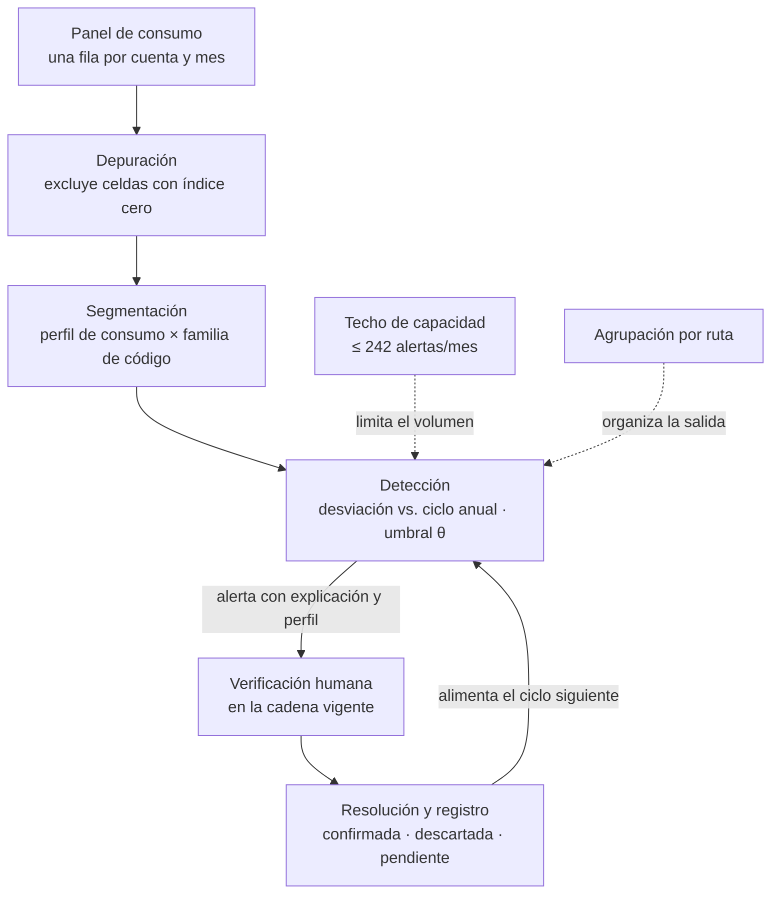

# INFORME FINAL DE INVESTIGACIÓN

> **Modelo institucional de ALSIE — nivel de maestría.**
> **Fuente de la forma:** `instituciones/alsie/guia_ifi_contenido.md` (14 apartados) e `instituciones/alsie/indicadores_revision_ifi.md` (indicadores de maestría).
> **Fuente del contenido:** carpeta `tesis_ds/`. Trazabilidad completa en el **Anexo C**.
> **Estado de la traducción, 5 de noviembre de 2026:** los apartados 1 a 8 y 13 están **completos** —los capítulos I y II se ampliaron el 2 de noviembre (`DEC-130`) con las salvedades de las cifras del diagnóstico y con la etapa de revisión bibliográfica del marco teórico, con el detalle en el **Anexo D**—; el Capítulo I incorporó además la **nota de deriva** de las cifras de reclamos (3 de noviembre, `DEC-134`) y la **nota de alcance** que precisa que la población ODECO son los reclamos de tipo 3 (4 de noviembre, `DEC-142`); el apartado 9 quedó **validado por la tesista el 30 de octubre** y conserva la marca `[PROVISIONAL]` solo por los principios de diseño de `E10`; el apartado 10 se **actualizó el 5 de noviembre**: el gate de construcción se cerró en **6 de 6** —método escrito (`DEC-137`), procedimiento ejecutable agregado al archivo de consultas el 4 de noviembre (commit `04327b5`), primera ejecución sin depuración con 1 732 alertas y **segunda ejecución con la depuración aplicada** (commit `1acbba0`) con **1 515 alertas** —1 402 de A2 y 113 de A1, máximo mensual 217 de A2 en abril y 23 de A1 en marzo, ningún mes por encima de los cupos 218 y 24, ninguna alerta sin ruta ni sin orden— que validó los puntos 2 a 4, con el registro en estado «pendiente» por alerta (punto 5) y el exemplar de tres alertas del listado (punto 6); las etapas `E7e` (construcción y verificación interna) y `E7f` (ficha) **cerraron el 5 de noviembre**; la **muestra de la validación quedó medida** (4 de noviembre: 19 reclamos procedentes con lectura sobre 109 con lectura en la ventana de nueve meses; universo ODECO = tipo 3, 1 062 reclamos y 1 061 con lectura); el apartado 11 tiene **tres de cuatro conclusiones** —la del Capítulo IV espera a los resultados de la validación (`E8`)— y las cinco limitaciones ya escritas; el apartado 12 tiene las recomendaciones derivadas de las conclusiones existentes; el apartado 14 quedó **con el Anexo B completo**: la ficha de la propuesta se escribió el 4 de noviembre (`E7f`), se vuelca íntegra y cerró su etapa el 5 de noviembre. **Decisiones de la tesista del 5 de noviembre de 2026:** las etapas `E8`, `E9` y `E10` **siguen en curso** —`E8` inició su fase formativa **por simulación con datos ya disponibles, sin ir a terreno**, con **dos verificadores ajenos, ambos técnicos de ENDE que no participaron del estudio**; y sus **resultados preliminares** ya volcaron los datos de entrada validados (1 515 alertas depuradas), el **criterio 1 (cobertura) medido en 0 de 19 (0 %)** y el **criterio 3 (carga) como cumplido**, quedando pendientes los criterios 2 y 4—; la carátula queda en **noviembre de 2026**; y la estructura oficial de la propuesta es el **DSRM de Peffers et al. (2007)**. Lo que falta se marca con la causa que lo desbloquea, y **no se rellena con supuestos**.
> **Regla de este documento:** ningún dato entra sin su fuente. Las cifras provienen de `DATOS desde 2022.xlsx`, `DATOS.xlsx`, `CODIGOS_IRREGULARES.xlsx` y de las declaraciones registradas de la tesista.

---

## 1. Carátula

| | |
|:--|:--|
| **Institución que titula** | UNIVERSIDAD AUTÓNOMA DEL BENI "JOSÉ BALLIVIÁN" / ALSIE CONSULTORES PEDAGÓGICOS |
| **Logo** | _Se inserta en el maquetado final._ |
| **Título del trabajo** | **Método de detección y verificación previa a la facturación de lecturas anómalas en distribución eléctrica** |
| **Modalidad y nivel** | Tesis de maestría para optar al grado de Magíster en Ingeniería de Software |
| **Postulante** | Natalia Fabiola Medrano Cambará |
| **Tutor** | Luis Roberto Pérez Rios, Ph.D. |
| **Mes y año de presentación** | Noviembre de 2026 |
| **Ciudad y país** | Cochabamba, Bolivia |

**Control del título contra la guía (reglas 8, 9 y 10):** 15 palabras exactas —el máximo permitido—, sin siglas y sin fórmulas. Describe el contenido y está vinculado al objetivo general.

---

## 2. Agradecimientos

> Expreso mi más sincero agradecimiento a mi familia, cuyo respaldo constante, aliento y comprensión hicieron posible culminar esta etapa de formación avanzada; su presencia ha sido el soporte firme a lo largo de todo este proceso. De manera muy especial, agradezco a mis padres; sus principios, sacrificios y ejemplo de trabajo íntegro me inculcaron la disciplina y el compromiso necesarios para alcanzar este objetivo. Todo lo que soy y logro a nivel personal y profesional encuentra su raíz en sus enseñanzas: este resultado es tan suyo como mío.
>
> A mi pareja, mi profunda gratitud y reconocimiento por su apoyo constante y por el tiempo invaluable brindado a este proyecto. Gracias por escuchar mis ideas, acompañarme en las largas jornadas de trabajo con paciencia y comprensión en los momentos de mayor exigencia, y recordarme siempre el valor de la perseverancia; tu colaboración y aliento fueron indispensables para hacer posible este camino.

> Al tutor de esta investigación, por su rigurosa orientación académica, criterio metodológico y disposición durante el desarrollo de este trabajo.

---

## 3. Dedicatoria

> **A mis padres,**
>
> Por su amor incondicional, su guía constante y los sacrificios silenciosos que forjaron el camino hacia cada una de mis metas. Gracias por inculcarme desde el primer día que la educación, la integridad y el trabajo perseverante son el mayor legado; su ejemplo de vida es y será siempre el cimiento de mis logros personales y profesionales. Esta tesis es, ante todo, el fruto de su esfuerzo compartido. Con admiración y gratitud infinita.

---

## 4. Resumen

> Se estudió la detección de lecturas con consumo atípico previa a la facturación en la distribución de energía eléctrica, con el propósito de sustituir la revisión reactiva por una detección sistemática que no excediera la capacidad del equipo de verificación. Se analizó el histórico de lecturación de una empresa distribuidora nacional correspondiente a los 57 meses comprendidos entre enero de 2022 y septiembre de 2026, y se revisó la literatura sobre detección de anomalías en consumo eléctrico. Se constató que el 0,88 % de las lecturas facturables, esto es 12 300 de 1 389 941 registros, fue marcado con un código de irregularidad, y que la oficina de atención al consumidor recibió 1 053 reclamos en el mismo periodo, de los cuales 174 resultaron procedentes y 136 correspondieron a lecturas marcadas sin código; la revisión bibliográfica no arrojó evidencia de su aplicación previa a la facturación en la literatura consultada. Sobre esa evidencia se propuso un método de detección y verificación previa a la facturación, entendido como propuesta de tipología método, diseñado para operar sobre un panel de consumo con una fila por cuenta y mes, agrupado por ruta de lecturación, y para el que se fijó un procedimiento de calibración del umbral contra el techo de capacidad de 242 alertas mensuales. Se concluyó que era viable incorporar detección sistemática al ciclo de lecturación sin ampliar el equipo de verificación, y quedó pendiente la evaluación del método sobre el histórico completo.

**Control de la guía:** 241 palabras (tope 250) · un solo párrafo · tiempo pasado y voz pasiva · sin siglas · sin tablas ni fórmulas · ubicado justamente antes del índice. Revela tema, objeto, objetivo, metodología y resultados.

---

## 5. Índice

> Se numera a partir de la Introducción (guía, regla 11). No incluye Resumen, Agradecimientos ni Dedicatoria.

- **6. Introducción**
  - 6.1 Problema científico
  - 6.2 Objeto de estudio
  - 6.5 Campo de acción
  - 6.3 Objetivo general
  - 6.4 Objetivos específicos
  - 6.6 Hipótesis
  - 6.7 Aporte teórico
  - 6.8 Significación práctica
  - 6.9 Métodos y técnicas
  - 6.10 Población y muestra
- **7. Capítulo I. Diagnóstico de la investigación**
  - 7.1 Descripción contextual
  - 7.2 Operacionalización de la variable
  - 7.3 Instrumentos aplicados
  - 7.4 Resultados del diagnóstico
  - 7.5 Regularidades del estado actual
- **8. Capítulo II. Marco teórico de la investigación**
  - 8.1 Antecedentes
  - 8.2 Definiciones y concepciones sobre el objeto y el campo
  - 8.3 Categorías conceptuales
  - 8.4 Análisis histórico-lógico del problema
  - 8.5 Soluciones dadas por otras investigaciones
  - 8.6 Valoración crítica y toma de posición
  - 8.7 Estado del arte y brecha identificada
- **9. Capítulo III. Modelo teórico de la investigación**
  - 9.1 Fundamentación epistemológica
  - 9.2 Componentes del modelo
  - 9.3 Relaciones esenciales
  - 9.4 Representación gráfica
  - 9.5 Propiedades del modelo
- **10. Capítulo IV. Propuesta de la investigación**
  - 10.1 Fundamentos teóricos y definición asumida
  - 10.2 Estructura oficial con autor
  - 10.3 Alternativas consideradas y decisión
  - 10.4 Requisitos de la propuesta
  - 10.5 Diseño del método
  - 10.6 Metodología para su aplicación
  - 10.7 Plan de construcción de la propuesta
  - 10.8 Validación
  - 10.9 Matriz de trazabilidad propuesta ↔ solución
  - 10.10 Relación con los capítulos anteriores
- **11. Conclusiones**
- **12. Recomendaciones**
- **13. Referencias bibliográficas**
- **14. Anexos**
  - Anexo A. Instrumentos aplicados
  - Anexo B. Ficha de la propuesta (método)
  - Anexo C. Mapa de equivalencias Design Science → ALSIE
  - Anexo D. Protocolo y cuenta de registros de la revisión bibliográfica

---

## 6. Introducción

*[Tiempo verbal: presente. Extensión: no excede el 10 % del total.]*

La distribución comercial de energía eléctrica es un servicio regulado en el que la lectura del medidor y su facturación constituyen el punto de contacto entre la empresa y el usuario. En ese punto se decide cuánto paga el consumidor y, cuando la lectura registrada no refleja el consumo real, el error se traslada a la factura y reaparece después como reclamo. La presente investigación se ocupa de ese tramo del proceso: la detección de lecturas anómalas **antes** de facturar, en una distribuidora con sistema transaccional propio y un catálogo de códigos de irregularidad impuesto por su ente regulador.

El estudio se desarrolla en la regional de una empresa distribuidora nacional de Bolivia, con **29 750 cuentas** al cierre de septiembre de 2026, cuyo sistema de lecturación y facturación opera sobre una base de datos relacional y conserva el histórico de lecturas desde enero de 2022. La investigadora es administradora de ese sistema, lo que garantiza el acceso a los datos y al código, y a la vez impone una separación explícita entre quien construye la propuesta y quien la evalúa.

### 6.1 Problema científico

En la regional estudiada de la distribuidora, entre enero de 2022 y septiembre de 2026, solo el **0,88 %** de las lecturas facturables lleva un código de irregularidad —12 300 de 1 389 941 registros—, marca que aplica el personal terciarizado en el momento de la lectura. El **99,12 %** restante no se barre en ningún momento: no existe un proceso que recorra el histórico para identificar lecturas cuyo consumo sea incoherente y que no fueron marcadas. La detección que sí existe es manual, no está escrita, carece de umbral numérico y depende de una sola persona —el encargado de facturación—, que compara el consumo del mes con los últimos seis meses y solicita una visita si lo juzga anómalo; de ese proceso resultan **242,2 correcciones manuales por mes** en 2026, sin reporte accesible ni constancia del criterio aplicado. La consecuencia se mide en el ciclo de reclamos: la oficina de atención al consumidor tramitó **1 053 reclamos en 57 meses**, de los cuales **174 resultaron procedentes** y **136 —el 78,16 %— provinieron de lecturas sin código**, es decir, de anomalías que ningún proceso advirtió y que el usuario reclamó **después** de facturar, con plazos perentorios de 3 a 15 días hábiles y silencio administrativo positivo a favor del consumidor. Verificar un caso cuesta entre 3 y 4 horas y, cuando exige visita con respaldo fotográfico, 2 días.

La literatura sobre detección de anomalías en consumo eléctrico trabaja con series de consumo y, en los estudios de fraude, con etiquetas de casos confirmados; el campo está maduro y cuenta con varias revisiones sistemáticas. Sin embargo, no se localizó evidencia sobre **cómo un método que barre el histórico completo —incluidas las lecturas que el lecturador no marcó— se integra a un ciclo de lecturación-facturación sujeto al catálogo de códigos de un ente regulador**, ni bajo qué criterios los verificadores de una distribuidora lo consideran utilizable cuando revisar un caso cuesta entre 3 y 4 horas. Resolver la situación descrita exige, por tanto, un conocimiento que hoy no está disponible: la formalización de esa detección como un método con pasos, roles, criterio escrito, techo de capacidad y registro de resolución, y los principios de diseño que de su aplicación se desprenden.

### 6.2 Objeto de estudio

El objeto de estudio es **la detección y verificación de lecturas anómalas en el ciclo de lecturación y facturación de energía eléctrica**, en la regional de la distribuidora estudiada y en el periodo comprendido entre enero de 2022 y septiembre de 2026, en tanto es allí donde se manifiesta la situación que debe resolverse: la existencia de lecturas con consumo incoherente que no fueron marcadas y que ningún proceso barre antes de facturar.

*Resignificación respecto del paradigma de origen:* en Design Science el objeto era el artefacto construido —el método—; en el modelo institucional el objeto es el **área del conocimiento** donde se manifiesta la situación, y el método pasa a ser el instrumento de estudio y el núcleo de la propuesta (Capítulo IV).

### 6.3 Objetivo general

Diseñar, construir y evaluar un método de detección y verificación previa a la facturación de lecturas anómalas no declaradas en el ciclo de lecturación y facturación de energía eléctrica, y articular los principios de diseño que de su aplicación se desprenden, contribuyendo a la formalización de la detección sistemática en distribuidoras reguladas.

### 6.4 Objetivos específicos

| Capítulo | Objetivo específico |
|:--|:--|
| **I. Diagnóstico** | Caracterizar el estado actual de la detección y verificación de lecturas anómalas en la regional estudiada, mediante indicadores trazables a `tfv_historico_lecturador` y `tfv_reclamo`. |
| **II. Marco teórico** | Sistematizar los fundamentos teóricos de la detección de anomalías en consumo eléctrico y de la conversión de una señal en una decisión dentro de un ciclo regulado. |
| **III. Modelo teórico** | Modelar la detección y verificación de lecturas anómalas no declaradas, precisando sus componentes y relaciones esenciales. |
| **IV. Propuesta** | Elaborar y validar la propuesta que concreta el modelo y resuelve el problema de la detección reactiva. |

### 6.5 Campo de acción

El campo de acción comprende **las propiedades, dimensiones y relaciones esenciales de la detección y verificación de lecturas anómalas no declaradas**, a saber: la segmentación del histórico por perfil de consumo y familia de código; el criterio de detección escrito y reproducible, evaluado en ambas direcciones y contra el propio ciclo anual de cada cuenta; la priorización de las alertas dentro de un techo de capacidad; la agrupación de las alertas por ruta de lecturación; la explicación obligatoria que acompaña a cada alerta; y el registro de resolución que alimenta el ciclo siguiente. Quedan fuera del campo la técnica concreta de aprendizaje automático, el fenómeno del fraude como tal y el proceso de lecturación en sí, que son contexto.

### 6.6 Hipótesis

> **`[PROVISIONAL — validada el 30 de octubre de 2026]`** La hipótesis se construye a partir de las decisiones de diseño ya cerradas (`07a`, `07b`, `07c`), porque los principios de diseño validados (`E10`) aún no existen. **La tesista confirmó la formulación sin ajustes (`DEC-127`).** La marca `[PROVISIONAL]` queda **solo** por `E10` y `E8`.

**Hipótesis general.** Si se aplica un método de detección y verificación que compara el consumo de cada cuenta contra su propio ciclo anual —el mismo mes de los cuatro años anteriores—, con un umbral escrito y calibrado contra un techo de capacidad, y que emite sus alertas agrupadas por ruta con la comparación que las originó, entonces se identifican lecturas anómalas no declaradas que hoy no se detectan, sin exceder la capacidad del equipo de verificación, porque concentra el esfuerzo en las cuentas cuya desviación respecto de su propio patrón estacional es mayor y devuelve al verificador la evidencia necesaria para aceptar o descartar cada alerta.

**Hipótesis específicas (asociadas a los objetivos específicos):**

1. La magnitud y el costo de la detección reactiva actual son medibles con indicadores trazables, y muestran que la mayoría de los reclamos procedentes proviene de lecturas sin código.
2. Un criterio de detección basado en el ciclo anual por cuenta mantiene el volumen de alertas dentro del techo de capacidad, a diferencia de un criterio basado en una ventana móvil de seis meses.
3. Un método con criterio escrito, explicación obligatoria y registro de resolución es aplicable por verificadores que no participaron en su construcción.

*Validada el 30 de octubre de 2026 (`DEC-127`): la tesista confirmó la hipótesis general y las tres específicas **sin ajustes**. Se conserva la marca `[PROVISIONAL]` por una sola causa declarada: los principios de diseño de `E10` y la magnitud medida en `E8` aún no existen.*

### 6.7 Aporte teórico

> **`[PROVISIONAL — validado el 30 de octubre de 2026]`** El aporte se deriva de la contribución reclamada (`03_perfil_ds.md` §10) y de las relaciones del modelo (Capítulo III), porque los principios de diseño (`E10`) aún no existen. **La tesista confirmó el texto sin ajustes (`DEC-127`).**

El aporte teórico consiste en la **formalización de la detección de lecturas anómalas no declaradas como un proceso con componentes y relaciones explícitas** —depuración, segmentación, detección con referencia anual, verificación y registro—, y en las **regularidades** que explican el comportamiento del objeto: que la comparación contra el propio ciclo anual de la cuenta resuelve la estacionalidad sin fuente externa; que la capacidad de verificación opera como techo de viabilidad y no como preferencia; y que la explicabilidad de la alerta es condición de su adopción por el verificador. Estas relaciones no estaban disponibles en el estado del arte, que trata el error de lectura como problema metrológico y no como problema de proceso.

*Validado el 30 de octubre de 2026 (`DEC-127`): la tesista confirmó el aporte **tal como está escrito**. La redacción definitiva en la forma objetivo → contexto → mecanismo → principio queda pendiente de una sola cosa: los principios de `E10`. **La atribución de esa plantilla se resolvió el 2 de noviembre de 2026 (`DEC-131`):** formulación prescriptiva estructurada según la lógica CIMO de Denyer, Tranfield y van Aken (2008) —contexto, intervención, mecanismo y resultado—, con la anatomía del principio de Gregor, Kruse y Seidel (2020), enmarcada en el problema de diseño de Wieringa (2014).*

### 6.8 Significación práctica

> **`[PROVISIONAL — validada el 30 de octubre de 2026]`** La significación se deriva del enlace propuesta ↔ solución (`E9`) y de la evaluación (`E8`), aún pendientes. **La tesista confirmó el texto sin ajustes (`DEC-127`).**

La significación práctica consiste en que la distribuidora puede **incorporar detección sistemática a su ciclo de lecturación sin ampliar su equipo de verificación**, sustituyendo la dependencia de la atención de una sola persona por un criterio escrito y reproducible, y devolviendo al verificador la evidencia para resolver tanto los reclamos procedentes como los improcedentes —que hoy consumen la misma inspección técnica—. En correspondencia con el aporte teórico, la mejora observable es la reducción de la detección reactiva y la formalización del trabajo que hoy se hace a mano.

*Validada el 30 de octubre de 2026 (`DEC-127`): la tesista confirmó la significación **tal como está escrita**. La magnitud de la mejora sigue pendiente de los resultados de `E8`; es el único punto que la separa de ser definitiva.*

### 6.9 Métodos y técnicas

**Métodos teóricos.**
- **Análisis-síntesis:** para descomponer el ciclo de lecturación-facturación en sus componentes y reconstruirlo como método.
- **Histórico-lógico:** para reconstruir la evolución del problema —la ruptura de junio de 2025 y el residual posterior— y del estado del arte.
- **Sistémico:** para tratar el método como un sistema de componentes y relaciones.
- **Modelación:** para construir el modelo teórico del Capítulo III.
- **Revisión bibliográfica con protocolo declarado:** para el marco teórico y el estado del arte (no es una revisión sistemática; se declara como limitación).

**Métodos empíricos.**
- **Análisis de documentos y de bases de datos:** extracción y análisis del histórico de lecturas, reclamos y catálogo de códigos.
- **Observación participante:** la investigadora administra el sistema y describe la cadena de corrección vigente.
- **Entrevista / consulta estructurada:** consultas al personal de la distribuidora sobre tiempos, personal y registro de visitas.
- **Estudio de caso:** la regional de la distribuidora como caso representativo de la clase de contextos.

**Técnicas.**
- Consultas SQL sobre la base de datos transaccional (panel de consumo por cuenta y mes).
- Análisis estadístico descriptivo y cálculo de tasas por 100 000 lecturas.
- Codificación de la cadena de corrección en cinco pasos y cinco roles.
- Calibración del umbral por recorrido del orden de desviaciones hasta el techo de capacidad.

**Vinculación con los objetivos específicos:** el análisis de bases de datos y la observación sirven al objetivo 1 (diagnóstico); la revisión bibliográfica y el análisis-síntesis, al objetivo 2 (marco teórico); la modelación, al objetivo 3 (modelo); y la entrevista, el estudio de caso y la calibración, al objetivo 4 (propuesta y validación).

### 6.10 Población y muestra

**Población:** las **29 750 cuentas** de la regional estudiada al cierre de septiembre de 2026, sujetas al catálogo nacional de códigos de irregularidad. El universo no es fijo —los registros de lectura crecen de 28 355 en enero de 2025 a 29 750 en septiembre de 2026—, de modo que los denominadores se calculan mes a mes.

**Unidades de análisis:** la celda cuenta-mes del panel de consumo (1 485 556 celdas verificadas), las lecturas facturables (1 389 941 en 57 meses) y los reclamos tramitados (1 053 reclamos ODECO con lectura en 57 meses, de los cuales 174 resultaron procedentes). Para la validación, la unidad es el reclamo procedente con lectura dentro de la ventana de detección.

**Población de la validación.** La ventana de detección son los nueve meses de enero a septiembre de 2026 (`DEC-90`). Medida el 4 de noviembre de 2026 (`DEC-139`, `DEC-141`, `DEC-142`): **2 713 reclamos** en la ventana, **109 con lectura**, **1 843 con pronunciamiento procedente** y **19 procedentes con lectura** —el numerador y el denominador de la muestra de cobertura—. La población ODECO se delimitó el mismo día: son los reclamos de **tipo 3** («reclamo directo con suspensión de cobranza»), **1 062 en los 57 meses y 1 061 con lectura**; los tipos 1 y 2 suman 12 835 reclamos con cero lectura. Queda declarada una excepción de 1 en 1 062: un reclamo de tipo 3 sin lectura, no identificado.

**Muestra:** la selección es **analítica, no estadística**. La regional se elige por ser representativa de la clase de contextos —distribuidoras con sistema transaccional propio, histórico tabular de lecturas y catálogo del regulador—, por cuanto comparte las tres condiciones que definen esa clase. La muestra de cobertura sobre la ventana es **censal dentro de su universo**: los 19 reclamos procedentes con lectura de enero a septiembre de 2026, no un subconjunto aleatorio. Para el criterio de aplicabilidad participan **dos verificadores ajenos** al estudio —**ambos técnicos de ENDE que no participaron del estudio**, confirmados por la tesista el 5 de noviembre de 2026—, que resuelven las alertas con solo el método escrito y sin asistencia de la autora; la tesista, como administradora del sistema, diseña y construye pero **no evalúa su propia propuesta**.

Para la trazabilidad completa entre los apartados de este informe y los productos de la investigación, **ver anexo C**.

---

## 7. Capítulo I. Diagnóstico de la investigación

*[Tiempo verbal: resultados en pasado. Primero el análisis y después la tabla o figura; no se repite el mismo dato en tabla y figura.]*

Este capítulo caracteriza el estado actual de la detección y verificación de lecturas anómalas en la regional estudiada. Presenta la descripción contextual, la operacionalización de la variable, los instrumentos aplicados y los resultados de todos ellos, y cierra con las regularidades que definen el estado actual del objeto.

### 7.1 Descripción contextual

La investigación se desarrolla en la regional de una empresa distribuidora de energía eléctrica de Bolivia, cuyo sistema de lecturación y facturación opera sobre una base de datos relacional (PHP/PostgreSQL) y está organizado en regionales. La regional estudiada maneja **29 750 cuentas** al cierre de septiembre de 2026.

El proceso de lecturación y facturación involucra **cinco roles distintos** entre el domicilio y la factura:

| # | Paso | Actor |
|:--|:--|:--|
| 1 | Toma de lecturas en equipos móviles de lecturación | Personal **terciarizado** (externo a la empresa) |
| 2 | Recepción del equipo móvil y descarga de las lecturas al sistema comercial | Personal responsable de lecturación |
| 3 | Revisión de los consumos calculados; si alerta una anomalía, solicita visita al domicilio | **Encargado de facturación** |
| 4 | Desplazamiento al domicilio, respaldo fotográfico del medidor, retorno a oficina | Personal técnico de la empresa (no terciarizado) |
| 5 | Revisión y corrección de la lectura | Encargado de facturación |

El **paso 3 ya es una detección de anomalías**: existe, es manual, no está escrita en ningún documento y depende de una sola persona. La regla que aplica el encargado de facturación —declarada por la tesista— compara el consumo del mes contra el histórico de los **últimos seis meses**, en ambas direcciones (superior: estufas en invierno, aire acondicionado en verano; inferior: viajes, vacaciones). Esa regla **no tiene umbral numérico ni registro de la decisión**.

El entorno regulado impone condiciones que el diagnóstico debe registrar: el catálogo de códigos de irregularidad del ente regulador (48 códigos), los plazos de atención de reclamos de 3 a 15 días hábiles con silencio administrativo positivo a favor del consumidor, y la capacidad del equipo de verificación.

### 7.2 Operacionalización de la variable

**Variable:** detección y verificación de lecturas anómalas no declaradas en el ciclo de lecturación y facturación.

| Dimensión | Definición operativa | Indicador medible | Unidad / fórmula |
|:--|:--|:--|:--|
| **Magnitud de la anomalía no declarada** | Proporción de lecturas facturables sin código de irregularidad | Proporción de lecturas sin código sobre el facturable | % = tipo 1 ÷ (tipo 1 + 2 + 3) |
| **Costo de la detección reactiva** | Reclamos que llegan después de facturar y resultan procedentes | Reclamos procedentes originados en lecturas sin código | N.º y % = procedentes sin código ÷ procedentes |
| **Carga de la detección manual** | Correcciones manuales previas a la facturación | Correcciones manuales mensuales | N.º/mes |
| **Capacidad de verificación** | Volumen de alertas que el equipo puede resolver | Techo de alertas por mes | N.º/mes = correcciones mensuales ÷ 22 días hábiles × 22 |
| **Señal de riesgo del código** | Propensión a generar reclamo procedente según el código | Razón de tasas por 100 000 lecturas | (procedentes con código ÷ facturable con código) ÷ (procedentes sin código ÷ facturable sin código) |

**Definiciones operativas adoptadas** (de `04_marco_teorico.md` §7):

| Término | Definición operativa |
|:--|:--|
| **Anomalía** | Patrón de datos que no se ajusta al comportamiento esperado (Chandola et al., 2009) |
| **Lectura anómala no declarada** | Lectura cuyo consumo difiere de lo esperable para esa cuenta y ese momento del ciclo, según criterio escrito y reproducible, **sin código de irregularidad** |
| **Detección** | Aplicación del criterio a un conjunto de lecturas para emitir una lista priorizada de sospechosas |
| **Verificación** | Acto posterior —revisión en pantalla o visita con fotografía— que confirma o descarta una alerta |
| **Verdad de referencia** | Conjunto de casos cuya condición de anómalo se conoce independientemente del método; aquí se reconstruye con los reclamos procedentes |
| **Capacidad de verificación** | Volumen de alertas que el equipo puede resolver en un periodo sin exceder su carga normal: ≈11 visitas diarias |
| **Aplicabilidad** | Que practicantes que no participaron en la investigación puedan seguir los pasos y obtener los resultados esperados |
| **Efectividad** | Comparación de resultados con y sin el método |

### 7.3 Instrumentos aplicados

Los instrumentos del diagnóstico son de dos tipos: **extracciones de la base de datos** y **consultas estructuradas al personal**. Los ítems de cada instrumento guardan relación exacta con los indicadores de la sección 7.2.

**Instrumento 1 — Extracción del histórico de lecturas, reclamos y catálogo.** Consultas SQL sobre las tablas `tfv_historico_lecturador`, `tfv_lectura`, `tfv_lec_irregular`, `tfv_reclamo`, `tfv_reclamo_lectura`, `tfv_respuesta_reclamo`, `tfv_cobranza`, `tfv_ruta` y `tfv_cliente`, más los archivos consolidados `DATOS.xlsx` y `DATOS desde 2022.xlsx`. Mide: proporción de lecturas con y sin código, reclamos por tipo y procedencia, correcciones manuales y tasas por 100 000 lecturas.

**Instrumento 2 — Consulta sobre el tiempo por corrección manual** (desglosado por rama: revisión en pantalla y visita con fotografía). Mide el indicador de tiempo de verificación. *Respuesta recibida: «el tiempo no está registrado en ningún sistema, no está medido»; se registra como dato no disponible.*

**Instrumento 3 — Consulta sobre las visitas que no terminan en corrección.** Mide la tasa de falsos positivos de la detección manual actual. *Respuesta recibida: «no existe registro de solicitud de visita a domicilio»; se registra como dato no disponible.*

**Instrumento 4 — Consulta sobre el personal que atiende la revisión y la corrección.** Mide la capacidad del equipo. *Respuesta recibida: la revisión se hace por rutas, con 1 a 3 técnicos por oficina y 2 a 3 personas en la visita; las 3 a 4 horas son un máximo y no un promedio; la fuente es estimación declarada del personal.*

**Instrumento 5 — Consulta sobre el catálogo de códigos de irregularidad.** Mide la composición del catálogo. *Resultado: 48 códigos, `id_cod_irre` de 0 a 47, con `desc_cod_irre`, `sw_aviso` y `estado`.*

Los modelos en blanco de los instrumentos se incluyen en el **Anexo A**.

### 7.4 Resultados del diagnóstico

#### 7.4.1 Población y alcance de la extracción

La extracción cubre **enero de 2022 a septiembre de 2026 — 57 meses y cuatro ciclos anuales completos**. La prueba de continuidad entre las dos fuentes —`DATOS.xlsx` (21 meses) y `DATOS desde 2022.xlsx` (57 meses)— reprodujo exactamente las nueve cifras de la primera, de modo que son la misma fuente y la segunda solo amplía su alcance.

| Concepto | Valor | Fuente |
|:--|:--|:--|
| Cuentas de la regional | **29 750** (el universo crece: 28 355 registros en enero de 2025) | `DATOS.xlsx`, Tablas 2 y 3 |
| Lecturas facturables (57 meses) | **1 389 941** | `DATOS desde 2022.xlsx`, hoja `tipo_lectura` |
| Lecturas Tipo 1 (sin código) | **1 377 641 → 99,12 %** | Hoja `tipo_lectura` |
| Lecturas Tipo 2 y 3 (con código) | **12 300 → 0,88 %** | Hoja `tipo_lectura` |
| Lectura Tipo 0 (LC, no facturada) | **177 784 → 11,34 %** del total de lecturas | Hoja `tipo_lectura` |
| Total de lecturas registradas | **1 567 725** | Hoja `tipo_lectura` |

**Tipos de lectura (dominio confirmado):** 0 = LC, lectura de corte (no facturada) · 1 = LN, lectura normal (objeto de investigación) · 2 = LE, lectura estimada · 3 = NE, normal estimada.

#### 7.4.2 Indicador 1 — Reclamos por tipo de lectura y procedencia

El análisis de los reclamos muestra que la mayoría de los reclamos procedentes proviene de lecturas **sin** código, pese a que las lecturas **con** código tienen una tasa de procedencia mucho mayor por lectura.

| Gestión | Meses con dato | Reclamos | Procedentes (sw=1) | Procedentes Tipo 1 | % Tipo 1 de los procedentes |
|:--|--:|--:|--:|--:|--:|
| 2022 | 12 | 104 | 14 | 11 | 78,57 % |
| 2023 | 12 | 326 | 49 | 40 | 81,63 % |
| 2024 | 12 | 309 | 49 | 39 | 79,59 % |
| 2025 | 12 | 213 | 46 | 35 | 76,09 % |
| 2026 | 9 | 101 | 16 | 11 | 68,75 % |
| **Total** | **57** | **1 053** | **174 (16,52 %)** | **136** | **78,16 %** |

*Tabla 1. Reclamos tramitados ante la oficina de atención al consumidor, por gestión y procedencia (enero 2022 – septiembre 2026). Fuente: `DATOS desde 2022.xlsx`, hoja `reclamos`.*

> **Nota de deriva, medida el 3 de noviembre de 2026 (`DEC-134`).** Las cifras de esta sección —1 053 reclamos con lectura, 174 procedentes, 136 de tipo 1 y 78,16 %— se midieron el 25 de octubre de 2026 y se conservan con ese sello. Al volver a medir el 3 de noviembre la base devolvió **177 procedentes con lectura** y **1 061 reclamos con lectura**: **+3 procedentes y +8 con lectura**, sin que la ventana de 57 meses cambiara, que sigue teniendo 13 897 reclamos. Se movieron solo dos cosas: ocho reclamos de la ventana ganaron `id_lectura` —tres procedentes y cinco improcedentes—, y los ocho que tenían lectura sin tipo ya tienen `tipo_lectura`, de modo que el desfase Δ8 registrado en `DEC-65(6)` dejó de existir. **Las tablas `tfv_reclamo` y `tfv_reclamo_lectura` son vivas: la cifra depende del día de la corrida.** La fuente principal de las cifras publicadas es la hoja `DATOS desde 2022.xlsx`, un archivo estático que sigue dando 174; la base de datos era la segunda fuente y coincidió con la hoja el 25 de octubre. Por eso las cifras no se reescriben: se declara la deriva.

> **Nota de alcance, dictada el 4 de noviembre de 2026 (`DEC-142`).** La tesista precisó dos cosas que hasta hoy estaban implícitas. **Primera: ODECO es la «oficina de atención al consumidor»** —en sus palabras; el documento no expande la sigla por cuenta propia—. **Segunda: los reclamos ODECO son los de tipo 3** —«reclamo directo con suspensión de cobranza»—, que son los que relacionan una lectura y por eso suspenden la cobranza, y por eso son también los únicos que tienen fila en la tabla de reclamos con lectura. Medido el 4 de noviembre: **1 062 reclamos de tipo 3 en los 57 meses, 1 061 de ellos con lectura**; los tipos 1 y 2 suman **12 835 reclamos con cero lectura**. **Consecuencia:** la tabla de reclamos contiene **todos** los reclamos —13 897— y la población ODECO es el **tipo 3**, no el total; por eso el **16,52 %** es **174 procedentes sobre 1 053 reclamos ODECO con lectura**, y no se diluye contra los 13 897. **Queda declarada una excepción de 1 en 1 062: un reclamo de tipo 3 sin lectura, no identificado.** La hoja `DATOS desde 2022.xlsx` sigue dando 1 053 / 174 y **no se reescribe**.

**Análisis.** De los 174 reclamos procedentes, **136 (78,16 %)** provinieron de lecturas sin código: auditar solo las lecturas con código habría alcanzado como máximo 38 procedentes y habría dejado sin detectar 136. Sin embargo, las lecturas con código son solo el 0,88 % del facturable y originan el 21,84 % de los procedentes, de modo que presentan una tasa de procedencia por lectura mucho mayor. La señal es **específica de los procedentes**: en la ventana anterior de 21 meses, la razón de tasas de los improcedentes fue de apenas 1,15 × (47,27 frente a 54,27 por 100 000), de modo que el código predice reclamo procedente, no reclamo en general.

| Tasa (procedentes ÷ facturable del tipo, × 100 000) | Tipo 1 · LN | Tipo 2–3 · LE+NE | Razón |
|:--|--:|--:|--:|
| **2022–2026 (57 meses)** | 136/1 377 641 → **9,87** | 38/12 300 → **308,94** | **31,3 ×** |

*Tabla 2. Razón de tasas de procedencia por tipo de lectura (57 meses). Fuente: hojas `reclamos` y `tipo_lectura`.*

**Conclusión del indicador.** Las lecturas con código son **31,3 veces más propensas** a generar un reclamo procedente que las que no lo tienen, pese a ser el 0,88 % del volumen. Tener código es una **señal de riesgo de alta potencia**, no un ámbito suficiente de trabajo. En consecuencia, el método debe barrer el conjunto completo **y** usar la familia de código como variable de priorización.

#### 7.4.3 Indicador 2 — Correcciones manuales previas a la facturación

El indicador más fuerte del diagnóstico no mide un síntoma, sino el trabajo que ya se hace a mano para evitar el problema. La serie completa de correcciones muestra una ruptura estructural en junio de 2025.

| Gestión | Total | Meses | Promedio mensual | % de lecturas |
|:--|--:|--:|--:|--:|
| 2022 | 8 509 | 12 | 709,1 | 3,05 % |
| 2023 | 10 230 | 12 | 852,5 | 3,46 % |
| 2024 | 17 459 | 12 | **1 454,9** | **5,62 %** |
| 2025 | 9 604 | 12 | 800,3 | 2,81 % |
| 2026 (9 m) | 2 180 | 9 | **242,2** | **0,82 %** |
| **Total** | **47 982** | **57** | — | **3,22 %** |

*Tabla 3. Correcciones manuales previas a la facturación (`historico.lecturas_diferentes`), por gestión. Fuente: `DATOS desde 2022.xlsx`, hoja `historico`.*

**Análisis.** Tres lecturas se desprenden de la serie: (1) **2024 fue el peor año**, con 1 454,9 correcciones mensuales y 5,62 % de lecturas diferentes; (2) la caída de 2025 no es un efecto de nivel sino de régimen —de 1 507,4/mes en enero-mayo a 295,3/mes en junio-diciembre, un **−80,4 %**—, coincidente con las capacitaciones al personal de mayo y junio de 2025; (3) **2026 es el mejor año de la serie**, con 0,82 %. El problema ya no es el nivel, sino el **residual**.

**Naturaleza de las correcciones:** son **lecturas mal tomadas** por el personal terciarizado, no estimaciones por impedimento ni correcciones de datos. El cambio queda en el log del sistema, pero no hay un reporte accesible con la fecha y la lectura nueva, ni constancia del criterio ni de la evidencia.

**Capacidad como techo de alertas:** 242 correcciones mensuales ÷ 22 días hábiles ≈ **11 visitas por día**. Esa es la capacidad actual del equipo técnico y el techo que el volumen de alertas no debe exceder.

#### 7.4.4 Indicador 3 — Volumen y carga de los reclamos

| Concepto | Valor (57 meses) |
|:--|--:|
| Reclamos tramitados | **1 053** (≈ 18,5/mes) |
| Procedentes | **174 (16,52 %)** (≈ 3/mes) |
| Improcedentes | **879 (83,48 %)** |

*Tabla 4. Volumen y procedencia de los reclamos (57 meses). Fuente: hoja `reclamos`.*

**Análisis.** Cuatro de cada cinco reclamos se resuelven en contra del usuario, pero consumen la misma inspección técnica que los procedentes. Esto abre un segundo frente de utilidad: además de encontrar lo que no se marcó, el método puede dar al verificador evidencia para resolver improcedentes sin desplazamiento.

#### 7.4.5 Síntesis de los indicadores

| # | Indicador | Línea base | Estado |
|:--|:--|:--|:--|
| 1 | Reclamos procedentes sin código | **136 de 174 (78,16 %)**; razón de tasas **31,3×** | Medido |
| 2 | Reclamos totales y procedencia | **1 053 totales, 174 procedentes (16,52 %)** | Medido |
| 3 | Proporción de lecturas con código | **0,88 %** del facturable | Medido |
| 4 | Correcciones manuales mensuales | 242,2 (2026); 295 (jun–dic 2025) | Medido y explicado |
| 5 | Tiempo de verificación por caso | 3 a 4 h; 2 días con visita | Dato no disponible (estimación declarada) |
| 6 | Visitas que no terminan en corrección | No se conoce | Dato no disponible |
| 7 | Regla de detección actual | Desviación frente a 6 meses, ambas direcciones; sin umbral ni registro | Descrita |

#### 7.4.6 Salvedades de las cifras

**Salvedades que viajan con estas cifras.** Cuatro salvedades declaradas acompañan todos los resultados de este capítulo:

1. **Defecto de dos unidades** en la hoja `historico`, fila de abril de 2025: 28 556 ≠ 27 474 + 1 080. Es la única fila rota de las 57 y afecta el total en 0,00013 %. **Declarado, no corregido.**
2. **Agosto de 2026, cotejado el 6 de octubre de 2026, sin desfase.** Los dos archivos dan las mismas dos filas: cinco reclamos totales (uno procedente y cuatro improcedentes), de los cuales cuatro son de tipo 1. La cifra «8» que circulaba venía de agosto de 2025 y era un error de registro, retirado por `DEC-25`. La convención de publicación se resolvió el mismo día (`DEC-26`): se publica el total (5), con las otras dos cifras al lado y etiquetadas.
3. **Denominadores por gestión, no población fija:** 2026 tiene nueve meses y el universo de cuentas crece; no se puede promediar 2026 contra años completos sin declararlo.
4. **El código de irregularidad sigue sin aparecer** en ninguna de las hojas del archivo consolidado: la segmentación por familia que exige la priorización **sigue sin base de datos**.

### 7.5 Regularidades del estado actual

Del análisis de los resultados se desprenden las siguientes regularidades que definen el estado actual del objeto:

1. **La marca de irregularidad cubre una fracción mínima del facturable y no se barre el resto.** El 99,12 % de las lecturas facturables circula sin código y ningún proceso lo recorre.
2. **La detección existe, pero es informal y personal.** El paso 3 de la cadena ya detecta anomalías, pero sin criterio escrito, sin umbral y sin registro; depende de la atención de una sola persona.
3. **El costo de la omisión se mide en reclamos posteriores a la facturación.** La mayoría de los reclamos procedentes proviene de lecturas sin código, es decir, de anomalías que el proceso no advirtió.
4. **La capacitación de 2025 funcionó y dejó un residual.** El problema no es la inacción, sino el residuo de 242,2 correcciones mensuales que la capacitación no eliminó.
5. **El código de irregularidad es una señal de riesgo, no un ámbito de trabajo.** Las lecturas con código tienen 31,3 veces la tasa de procedencia por lectura, pero son minoría entre los procedentes.
6. **La capacidad de verificación es un límite real.** Cada alerta aceptada termina en un desplazamiento; el techo de ≈11 visitas diarias es el criterio de viabilidad del método.

---

## 8. Capítulo II. Marco teórico de la investigación

*[Tiempo verbal: presente. No es una suma de epígrafes, sino una construcción sistémica que penetra en la esencia del objeto desde la teoría existente.]*

Este capítulo sistematiza los fundamentos teóricos de la detección de anomalías en consumo eléctrico y de la conversión de una señal en una decisión dentro de un ciclo regulado. Conforme a la guía, consta de dos etapas: la **revisión bibliográfica** —método declarado, cuenta de registros y verificación de fuentes, con el detalle completo en el anexo D (ver anexo D)— y la **sistematización teórica**. Se organiza en antecedentes, definiciones y concepciones, categorías conceptuales, análisis histórico-lógico, soluciones dadas por otras investigaciones, valoración crítica y estado del arte.

### 8.1 Antecedentes

**Revisión bibliográfica: método y cuenta de registros.** La revisión se ejecutó con protocolo declarado antes de buscar: consulta a Crossref por cadena de términos y por resolución directa de DOI (2 de octubre de 2026) y, tras declararse la ampliación, repetición con cuenta de registros en OpenAlex y DOAJ —bases que devuelven recuento real— el 5 de octubre de 2026, con las mismas cinco cadenas y los mismos criterios del protocolo original. Las cadenas se escriben **antes** de buscar y la cuenta se llena **en el momento de buscar**. La regla de recuento (`DEC-21`) manda que *identificados* sean los veinte primeros registros por relevancia de cada cadena en cada índice, que la suma cuadre —identificados = eliminados + incluidos— y que el recuento del índice vaya en columna aparte, como diagnóstico, sin entrar en la suma. La criba se declaró a priori: se excluyen publicaciones sin revisión por pares, capítulos de libro, duplicados y registros que no traten detección de anomalías ni pérdidas no técnicas en distribución eléctrica; la calidad de la revista no se pudo verificar sin Scopus ni Web of Science y se anota como salvedad, no como exclusión, porque excluir por un criterio que no se puede comprobar sería peor que no excluir. El detalle de cadenas, tablas por índice, DOIs incluidos y las dudas de verificación está en el **anexo D**.

Las tres corridas del protocolo cuadran por separado y en su total:

| Corrida | Identificados | Eliminados | Incluidos | Trabajos distintos tras deduplicar |
|:--|--:|--:|--:|--:|
| Cinco cadenas del protocolo principal | 58 | 26 | **32** | **28** |
| «Lectura mal tomada», español e inglés | 330 | 308 | **22** | **21** |
| Control interno y auditoría | 60 | 55 | **5** | **5** |
| **Total** | **448** | **389** | **59** | **54** |

*Las tres sumas cuadran por separado —58 = 26 + 32 · 330 = 308 + 22 · 60 = 55 + 5— y el total también: 448 = 389 + 59. Los trabajos distintos se obtienen quitando los repetidos entre cadenas y verificando que las tres corridas no se solapan entre sí, que no se solapan.*

**Fuentes institucionales.** El sondeo de seis fuentes —AETN, SENARECOM, OLADE, CEPAL, ALER y la Agencia Internacional de la Energía— no arrojó ningún registro extraíble, por razones distintas que se declaran una por una: en las cuatro primeras los buscadores se ejecutan en el cliente y devolvieron resultados idénticos con cadena real y cadena nula; de **ALER** —la asociación de entes reguladores— no se localizó la dirección correspondiente, pues las tres direcciones probadas pertenecen a organizaciones distintas; y el buscador de la Agencia Internacional de la Energía devuelve una página genérica cuyos resultados no son extraíbles. Se registra como **0 extraídos, no como 0 existentes**. En la vía académica, el control en Crossref sobre control interno y auditoría produjo 60 identificados = 55 eliminados + 5 incluidos, ninguno sobre auditoría de pérdidas no técnicas.

**Registro de verificación de fuentes.** Las quince referencias del corpus del dominio se verificaron en Crossref el 2 de octubre de 2026 —autoría, título, publicación, volumen, número y páginas—: **15 de 15**. Ninguna se cita sin comprobar. Quedan declaradas cuatro dudas abiertas de verificación en el anexo D, entre ellas el sesgo del corpus hacia Crossref y la atribución de la plantilla objetivo → contexto → mecanismo → principio, que está con el tutor desde el paquete del 30 de octubre de 2026.

**En el mundo.** La detección de anomalías en consumo eléctrico y las pérdidas no técnicas son campos maduros. Tres revisiones sistemáticas o comprehensivas en seis años lo confirman: Saeed et al. (2020) clasifican los métodos de detección de pérdidas no técnicas por algoritmos, características extraídas y métricas de evaluación, y comparan las categorías basada en datos, basada en red e híbrida; Yadav y Kumar (2022) revisan la detección de pérdidas no técnicas y robo de energía a partir de datos de medidor inteligente e inteligencia artificial; y Zhang et al. (2026) revisan la detección de anomalías y reparación de datos en medidores inteligentes. Un campo con tres revisiones en seis años es un campo maduro en su problema y en sus soluciones.

**En la región.** De Oliveira Ventura et al. (2020) proponen una forma de comparar soluciones a las pérdidas no técnicas de electricidad **en Sudamérica**, publicada en *Utilities Policy*, una revista de política y regulación. Henriques et al. (2020) proponen monitorizar las pérdidas **técnicas** para mejorar la estimación y detección de las **no técnicas** en sistemas de baja tensión. Existe, por tanto, trabajo regional y existe el vínculo con la regulación.

**En el país.** La búsqueda con protocolo declarado —58 identificados, 32 incluidos, 28 trabajos distintos— **no encontró ningún trabajo de distribuidora boliviana ni del marco del ente regulador boliviano**. Se registra como **vacío de búsqueda confirmado con método reproducible**, no como constatación de inexistencia.

### 8.2 Definiciones y concepciones sobre el objeto y el campo

**Qué es una anomalía.** Chandola et al. (2009) definen una anomalía como un patrón de datos que no se ajusta al comportamiento esperado de la mayoría de los datos, y distinguen tres tipos: **anomalía de punto** (un registro individual que se aparta del resto), **anomalía contextual** (un registro anómalo solo en función del contexto —tiempo, estación, categoría—) y **anomalía colectiva** (un conjunto de registros cuyo comportamiento conjunto es anómalo). Para series temporales, el tipo relevante es la **subsecuencia anómala**. El caso de este estudio es fundamentalmente **contextual**: 500 kWh son normales en julio y anómalos en abril para la misma cuenta.

**Qué es una pérdida no técnica.** Carr y Thomson (2022) definen la pérdida no técnica de electricidad como un conjunto que **comprende robo, fraude, impago e irregularidades de facturación**. La definición es decisiva: la irregularidad de facturación está dentro del campo, y el problema de este estudio —lecturas mal tomadas y no barridas— cae en ese componente, no únicamente en el de fraude. El mismo trabajo señala que la mayor proporción de pérdidas no técnicas proviene de grandes usuarios, empresas estatales y hogares de mejor posición económica, y no del usuario residencial de bajos recursos que ocupa la percepción pública.

**Qué es un método como artefacto.** March y Smith (1995) identificaron cuatro tipos de artefacto en la investigación sobre sistemas de información —constructos, modelos, métodos e instanciaciones—; Hevner et al. (2004) los adoptaron como núcleo de los siete principios del paradigma y establecieron que **la evaluación apropiada depende del tipo de artefacto producido**. Un método se evalúa por **aplicabilidad** (¿pueden los practicantes seguir los pasos?) y **efectividad** (resultados con y sin el método).

### 8.3 Categorías conceptuales

Las categorías que estructuran el objeto y el campo son:

- **Anomalía contextual y subsecuencia anómala** (Chandola et al., 2009): el marco de la detección.
- **Pérdida no técnica e irregularidad de facturación** (Carr y Thomson, 2022): el marco del dominio.
- **Desequilibrio de clases y métrica precisión-exhaustividad** (Saito y Rehmsmeier, 2015): el marco de la evaluación.
- **Falacia de la tasa base y costo de la alerta** (Axelsson, 2000): el marco de la viabilidad.
- **Explicabilidad de la alerta** (Nwafor et al., 2023; Noorchenarboo y Grolinger, 2025): el marco de la verificación humana.
- **Priorización de la inspección** (Guerrero et al., 2018; Massaferro et al., 2020; Xia et al., 2020): el marco de la decisión.
- **Perfilado previo a la detección** (Piscitelli et al., 2026): el marco de la segmentación.

### 8.4 Análisis histórico-lógico del problema

La evolución del problema en el contexto estudiado muestra una ruptura estructural en junio de 2025. Las correcciones manuales pasaron de 1 507,4 mensuales (enero-mayo de 2025) a 295,3 (junio-diciembre de 2025), una caída del 80,4 %, coincidente con las capacitaciones al personal terciarizado de mayo y junio de 2025. La atribución es **declarativa, no experimental**: la capacitación coincide en el tiempo con la caída, pero no se ha aislado ninguna otra variable. La consecuencia lógica es que la gestión 2025 no sirve como línea base única —mezcla dos regímenes— y que la base utilizable es la posterior a la capacitación (295 y 242,2). El problema real es el **residual** que la capacitación no eliminó.

En el plano teórico, la evolución del campo muestra que la detección de anomalías y las pérdidas no técnicas pasaron de enfoques basados en red a enfoques basados en datos y a enfoques híbridos, con un desplazamiento hacia el medidor inteligente de alta frecuencia. Este estudio, sin embargo, dispone de una **lectura mensual tabular**, lo que condiciona qué características se pueden construir, qué etiquetas hacen falta y qué se puede prometer.

### 8.5 Soluciones dadas por otras investigaciones

| Trabajo | Qué hace | Qué deja fuera |
|:--|:--|:--|
| Guerrero et al. (2018) | Reduce pérdidas no técnicas mejorando la exactitud de las inspecciones en una empresa de distribución | No describe el vínculo con un ciclo de lecturación-facturación ni con un catálogo regulatorio |
| Massaferro et al. (2020) | Formula la detección de fraude para maximizar el retorno económico de la inspección | Optimiza el retorno, no la integración procesal ni la trazabilidad de la decisión |
| Xia et al. (2020) | Algoritmo de inspección por evaluación de sospecha en red inteligente | La salida sigue siendo una priorización para otro agente, no un método completo con roles |
| Piscitelli et al. (2026) | Proceso analítico de perfilado de carga y detección a nivel de medidor | Requiere series de alta frecuencia, no lectura mensual tabular |
| Nwafor et al. (2023); Noorchenarboo y Grolinger (2025) | Explican la detección de anomalías en consumo | No integran la explicación en un proceso de verificación con roles |

El campo **ya sabe** que detectar no basta y que hay que decidir a quién inspeccionar bajo restricción. Lo que este estudio hace es llevar ese problema a su forma **procesal**: qué pasos, qué roles, qué criterio escrito, qué registro de resolución, dentro de una cadena que ya existe con cinco roles.

**Comparación por dimensión con las exigencias de este problema.** La diferencia entre lo que hacen las soluciones existentes y lo que exige este caso, con la fuente que sostiene cada exigencia:

| Dimensión | Lo que hacen las soluciones existentes | Lo que exige este problema | Fuente de la exigencia |
|:--|:--|:--|:--|
| **Origen del dato** | Medidor inteligente de alta frecuencia | Lectura **mensual** tabular del histórico de lecturas | Saeed et al. (2020); Yadav y Kumar (2022); esquema de datos confirmado |
| **Etiqueta** | Casos confirmados de fraude, o ausencia total de etiquetas | 174 reclamos procedentes en 57 meses, posteriores a la facturación | Hoja `reclamos` del archivo consolidado |
| **Objetivo** | Detectar robo, fraude o pérdida no técnica | Detectar **lectura anómala no declarada**, incluida la lectura mal tomada, no solo el fraude | Carr y Thomson (2022); definición operativa del marco teórico |
| **Universo de trabajo** | Cuenta contra red, sin marca previa | **99,12 %** sin código y **0,88 %** con código, coexistiendo en el mismo barrido | Hoja `tipo_lectura` del archivo consolidado |
| **Salida** | Puntuación o clasificación binaria | **Lista priorizada con techo de volumen**: ≈11 visitas diarias, cada alerta acatada es un desplazamiento | Axelsson (2000); diagnóstico de la investigación |
| **Explicación de la alerta** | Campo en expansión, no universal | **Obligatoria**: sin la comparación que originó la alerta, el verificador no puede aceptarla ni descartarla | Nwafor et al. (2023); Noorchenarboo y Grolinger (2025) |
| **Integración en el proceso** | Generalmente no descrita: el modelo es el final del artículo | El método **es el proceso**: pasos, roles, criterios de entrada y salida, registro de resolución | March y Smith (1995) |
| **Evaluación** | Exactitud, F1, AUC sobre conjunto de prueba | Aplicabilidad con verificadores ajenos + efectividad retrospectiva + carga dentro de capacidad | Saito y Rehmsmeier (2015); Venable et al. (2016) |
| **Punto de comparación** | Ausente o conjunto de control artificial | La **capacitación de mayo–junio de 2025**, que ya redujo el volumen un 80 % | Declaración de la tesista, 1 de octubre de 2026 |

### 8.6 Valoración crítica y toma de posición

**Sobre la métrica.** Saito y Rehmsmeier (2015) demuestran que, ante conjuntos desequilibrados, la gráfica precisión-exhaustividad es más informativa que la curva ROC. **Toma de posición:** los criterios de éxito 1 y 2 de este estudio —cobertura de reclamos procedentes y falsos positivos— son, en terminología del campo, exhaustividad y (1 − precisión); **queda descartada la exactitud (accuracy)** como criterio, porque en este conjunto sería engañosa.

**Sobre la viabilidad.** Axelsson (2000) documentó la falacia de la tasa base: cuando la proporción de casos verdaderos es baja, un detector con una tasa de falsos positivos aparentemente pequeña produce una mayoría de alarmas falsas. **Toma de posición:** el criterio de carga de verificación **no es un criterio de comodidad, es el criterio de viabilidad del artefacto**. Un método que encontrara todo pero emitiera 500 alertas mensuales sería inútil en este contexto.

**Sobre la explicabilidad.** Nwafor et al. (2023) y Noorchenarboo y Grolinger (2025) confirman que una alerta que no se explica no se adopta. **Toma de posición:** cada alerta debe acompañarse de la comparación concreta que la originó, y la resolución debe registrarse con su criterio y su evidencia.

**Sobre el nivel de la contribución.** Gregor y Hevner (2013) proponen juzgar la contribución por el estado del conocimiento en el dominio del problema y en el dominio de la solución. Aquí el dominio del problema es **escaso** y el dominio de la solución es **abundante**. **Toma de posición:** la contribución **no puede ser una técnica nueva de detección**, sino la formalización del problema y sus principios de diseño con condiciones de contorno explícitas.

**Sobre el alcance del marco.** Se aplicó una **prueba de eliminación**: si al retirar una sección del marco el diseño del método no cambia, esa sección es decorativa y se elimina. Se evaluaron diecisiete secciones: **quince se conservan y dos se eliminan** —auditoría y control interno, y el marco regulatorio como sección teórica—. La eliminación de auditoría y control interno se cerró por decisión explícita tras dos búsquedas con cuenta de registros que no rindieron fuente pertinente y seis fuentes institucionales no consultables: **no se afirma que no exista, se afirma que lo académico no rindió fuente y que lo institucional no fue consultable**.

### 8.7 Estado del arte y brecha identificada

La literatura sobre detección de anomalías y pérdidas no técnicas en distribución eléctrica ha resuelto **cómo puntuar una lectura** y ha reconocido **que inspeccionar exige priorizar**. No se localizó trabajo que documente **cómo convertir esa puntuación en una decisión operativa dentro de un ciclo de lecturación-facturación sujeto a un catálogo regulatorio de irregularidades**, cuando concurren cuatro condiciones medidas en este caso:

1. **Etiquetas escasas y retardadas:** la única verdad de referencia disponible son reclamos de usuarios llegados después de facturar.
2. **Costo de la alerta asimétrico y no recuperable:** cada alerta acatada consume una visita que no se recupera.
3. **Alternativa vigente ya eficaz:** la capacitación de mayo-junio de 2025 redujo las correcciones un 80 %, de modo que el problema real es el residual.
4. **Universo segmentado por el regulador:** el 99,12 % del facturable circula sin código y ningún proceso lo barre.

La brecha se enuncia como **diferencia de enfoque demostrada**, no como no-hallazgo: (a) el error de lectura está en la literatura como **problema metrológico** —los 20 trabajos en inglés que lo tratan responden a cómo el medidor mide mal, por interferencia electromagnética, armónicas y mecanismo de conteo, y ninguno lo trata como categoría de proceso—; (b) **«lectura mal tomada» no es una categoría de la literatura consultada** —0 en español sobre 164 registros cribados, de 330 identificados que dejaron 21 trabajos distintos—; (c) **tampoco es objeto de auditoría ni de control interno** —60 identificados, 5 incluidos, ninguno sobre auditoría de pérdidas no técnicas, y 0 de 20 en la cadena específica—. Lo que falta no es literatura sobre detección ni sobre errores de lectura, sino sobre **la conversión de una señal en una decisión dentro de un ciclo regulado**.

**Búsquedas sin resultado y su estado.** Registrar los vacíos es parte del protocolo; en ninguna de estas filas se afirma que algo no exista, solo que esta búsqueda no lo encontró:

| Búsqueda sin resultado | Interpretación | Estado |
|:--|:--|:--|
| Auditoría y control interno aplicados a distribuidoras reguladas | Control académico: 60 identificados → 5 incluidos, ninguno sobre pérdidas no técnicas; la cadena específica dio 0 de 20. Las seis fuentes institucionales no se pudieron buscar | **Cerrada con la limitación escrita** (`DEC-34`): no se afirma que no exista, se afirma que lo académico no rindió fuente y que lo institucional no fue consultable. El tema pasó a condición de contorno documentada |
| Atención de reclamos ante entes reguladores de electricidad | Mismos resultados no pertinentes; no corrió en esta corrida | Queda pendiente; no bloquea el estado del arte |
| Trabajos de distribuidoras bolivianas o del marco del ente regulador | Repetido con cuenta de registros: 58 identificados → 32 incluidos → 28 trabajos distintos, ninguno de distribuidora boliviana | **Vacío de búsqueda confirmado** con método reproducible |
| Artefactos comerciales y de código abierto de detección en lecturación | No se buscó; requiere método distinto | **Diferido a después de la defensa de propuesta** (decisión del asesor, 2 de octubre de 2026); declarado como alcance no cubierto en esta versión |
| Categoría de «lectura mal tomada» como anomalía | Buscada en español e inglés, dos índices: 330 identificados → 21 trabajos distintos, 0 en español de 164 registros cribados | El vacío pasó a **constatación** y la brecha se reformuló (`DEC-35`) |

**Limitación declarada:** esta búsqueda **no es una revisión sistemática** —una sola revisora, sin doble criba independiente ni conteos de flujo—, y SciELO, IEEE Xplore y BVS no fueron consultables. Se declara como limitación de acceso, no como ausencia.

---

## 9. Capítulo III. Modelo teórico de la investigación

> **`[PROVISIONAL — requiere E10]`** Este capítulo es el que ALSIE exige y que el paradigma de origen no produce como tal. Se construye a partir del diseño del artefacto (`07c_diseno_artefacto.md`) y de los requisitos (`07b_requisitos.md`). **Los principios de diseño validados (`E10`) aún no existen**, de modo que el modelo se ofrece como construcción provisional y se pide su validación. La representación gráfica se entrega como diagrama Mermaid y debe convertirse en figura con título y nota APA 7.

### 9.1 Fundamentación epistemológica

El modelo se sustenta en el paradigma de la **ciencia del diseño** y en sus tres ciclos (Hevner, 2007): el **ciclo de relevancia**, que importa del entorno el catálogo de códigos, los plazos regulatorios, los cinco roles de la cadena y la capacidad de verificación; el **ciclo de rigor**, que importa el conocimiento del campo (marco teórico y estado del arte); y el **ciclo de diseño**, que construye y evalúa. El modelo se apoya además en la distinción entre el **ciclo de ingeniería** y el **ciclo de investigación** (Wieringa, 2014): el primero puede cerrarse con éxito sin que el segundo genere contribución, de modo que el modelo debe explicitar qué conocimiento transferible produce.

La **ley fundamental de la profesión** que el modelo asume es que la detección de una anomalía solo tiene valor si se convierte en una decisión operativa dentro del ciclo regulado; una señal que no se traduce en una acción verificable no modifica el comportamiento del objeto.

### 9.2 Componentes del modelo

El modelo se compone de cinco componentes esenciales, cada uno con su definición:

| Componente | Definición | Origen |
|:--|:--|:--|
| **Depuración** | Sanitización determinista del panel: toda celda del universo de detección con índice de contador en cero se excluye del cálculo y del listado de alertas. | `07c` §3.6 |
| **Segmentación** | Caracterización previa que asigna a cada cuenta un perfil de consumo (cuatro bandas por cuartiles) y una familia de código (no facturada, sin código, con código), y que viaja con la alerta. | `07c` §3.3 |
| **Detección** | Comparación del consumo observado contra la referencia del propio ciclo anual de la cuenta (mediana de los cuatro años previos), con un umbral escrito y calibrado contra el techo de capacidad. | `07c` §3.1; `07b` §4 |
| **Verificación** | Acto humano que confirma o descarta la alerta, dentro de la cadena vigente, con la comparación que la originó a la vista. | `07b` R4, R5 |
| **Resolución y registro** | Cierre de cada alerta como confirmada, descartada o pendiente, con su criterio y su evidencia, alimentando el ciclo siguiente. | `07b` R5 |

### 9.3 Relaciones esenciales

Las relaciones entre los componentes son las siguientes:

1. **Depuración → Segmentación → Detección.** El orden es **deducido y no supuesto**: si la segmentación no cambia cuáles celdas tienen valor, tampoco puede rescatar una celda que la depuración ya excluyó. Es el único orden que evita clasificar celdas que después se excluyen.
2. **Detección → Verificación.** Toda alerta lleva la comparación que la originó (contra qué referencia, en qué dirección, cuánto se desvió) y el perfil de la cuenta; sin esa explicación, el verificador no puede adoptarla.
3. **Verificación → Resolución y registro → Detección.** El registro de resolución alimenta el ciclo siguiente: sin registro, la alerta no cuenta como emitida.
4. **Capacidad → Detección.** El techo de capacidad (≤ 242 alertas/mes) limita el volumen de la detección: si el criterio produce más alertas, no se sube el techo, se sube el umbral.
5. **Segmentación → Detección (relación de contexto, no de decisión).** La segmentación no fija el umbral ni sustituye la referencia; solo caracteriza.

### 9.4 Representación gráfica

**Figura 1**

*Componentes y relaciones esenciales del modelo de detección y verificación de lecturas anómalas no declaradas*

*Nota.* Diagrama en bloque del ciclo completo del modelo: el panel de consumo alimenta la depuración, que alimenta la segmentación y la detección; la detección emite la alerta con explicación y perfil a la verificación humana, cuya resolución y registro alimentan el ciclo siguiente. El techo de capacidad (≤ 242 alertas/mes) limita el volumen de la detección y la agrupación por ruta organiza su salida. Elaboración propia.

### 9.5 Propiedades del modelo

| Propiedad | ¿Aplica? | En qué sentido |
|:--|:--|:--|
| **Sistémico** | Sí | Los cinco componentes forman un sistema con retroalimentación (el registro alimenta la detección). |
| **Multifactorial** | Sí | La detección depende de la desviación, el perfil, la familia de código y la capacidad. |
| **Procesal** | Sí | El modelo es un proceso con pasos, roles y productos de trabajo. |
| **Dinámico** | Sí | El umbral se recalibra cuando cambia el dato; el registro modifica el ciclo siguiente. |
| **Flexible** | Sí | Admite la regla de contingencia para cuentas con historial corto. |
| **Comunicativo** | Sí | La explicación obligatoria de la alerta es una propiedad comunicativa del modelo. |
| **Interdisciplinario** | Sí | Integra detección de anomalías, gestión de procesos y regulación del servicio. |
| **Personológico** | Parcial | El modelo reconoce el papel del verificador y su criterio, pero no modela la persona. |
| **Complejo** | Sí | Concurren etiquetas escasas, costo asimétrico, alternativa vigente y universo segmentado. |

*Validado el 30 de octubre de 2026 (`DEC-127`): la tesista confirmó **los 5 componentes, las 5 relaciones y las 9 propiedades tal como están escritos**. El capítulo conserva la marca `[PROVISIONAL]` por una sola causa: la aportación de los principios de diseño de `E10`.*

---

## 10. Capítulo IV. Propuesta de la investigación

> **`[PARCIAL]`** Este capítulo concreta el modelo del Capítulo III y constituye la solución del problema. Se vuelca el material de `07a`, `07b`, `07c`, del plan de construcción (`07d`, abierto el 30 de octubre de 2026, `DEC-123`; gate **6 de 6 cerrado el 5 de noviembre** según `00_estado.md`: método escrito `DEC-137`, ejecución depurada con 1 515 alertas validando los puntos 2 a 4, registro por alerta y exemplar de tres alertas para los puntos 5 y 6), del diseño de la validación (`08_evaluacion.md`, muestra medida el 4 de noviembre), de la matriz de trazabilidad (`09_enlace_solucion.md`) y de la ficha (`07f`, volcada al Anexo B el 5 de noviembre). Las etapas `E7e` y `E7f` **cerraron el 5 de noviembre**. Siguen pendientes los resultados de la evaluación (`E8`, en curso desde el 5 de noviembre: formativa por simulación con datos ya disponibles, sin ir a terreno), el cierre de la matriz (`E9`) y los principios de diseño (`E10`).

### 10.1 Fundamentos teóricos y definición asumida

La propuesta se sustenta en los fundamentos del Capítulo II: la definición de anomalía contextual (Chandola et al., 2009), la noción de pérdida no técnica que incluye la irregularidad de facturación (Carr y Thomson, 2022), la métrica precisión-exhaustividad bajo desequilibrio (Saito y Rehmsmeier, 2015), la falacia de la tasa base (Axelsson, 2000), la explicabilidad como requisito (Nwafor et al., 2023; Noorchenarboo y Grolinger, 2025) y el perfilado previo a la detección (Piscitelli et al., 2026).

**Definición asumida de la propuesta.** Se asume que la propuesta es un **método**: un conjunto ordenado de pasos, roles, entradas, salidas, precondiciones, criterios de entrada y salida y productos de trabajo, que formaliza la detección y verificación de lecturas anómalas no declaradas y la integra a la cadena vigente.

### 10.2 Estructura oficial con autor

**Estructura asumida: el proceso DSRM de Peffers et al. (2007)** —identificación del problema, objetivos de la solución, diseño y desarrollo, demostración, evaluación y comunicación—, sobre el que se organiza la elaboración de la propuesta. Es una estructura reconocida en la literatura de investigación en ciencias de la información, con autor y publicada en revista con revisión por pares, y su elección fue confirmada por la tesista el 5 de noviembre de 2026. Los pasos del método construido —depuración, segmentación, fórmula, contingencia, cupos, ruta, alerta y registro— se presentan en §10.5 como la concreción del diseño y desarrollo de ese proceso, y su validación en §10.8 corresponde a la fase de demostración y evaluación del mismo marco.

### 10.3 Alternativas consideradas y decisión

Se compararon cuatro alternativas de técnica de detección, todas no supervisadas salvo la A4, y todas compatibles con el dato mensual tabular:

| Alternativa | Descripción | Resultado |
|:--|:--|:--|
| **A1** — Ventana móvil de 6 meses con umbral escrito | Formaliza la regla vigente | **Descartada como criterio principal** (falla estacionalidad); **conservada como regla de contingencia** |
| **A2** — Ciclo anual por cuenta | Compara contra el mismo mes de los años previos | **ELEGIDA como criterio principal** |
| **A3** — Normalidad por segmento | Compara contra el patrón del segmento | **Reclasificada como paso previo del método**, no como alternativa |
| **A4** — Clasificador supervisado | Entrena con los reclamos procedentes | **Descartada** (exige corpus etiquetado; solo hay 174 etiquetas retardadas) |

**Decisión.** Se elige **A2 —ciclo anual por cuenta—** como criterio principal, con **A1** como regla de contingencia declarada para cuentas con menos de cuatro ciclos anuales completos, y **A3** como paso previo obligatorio del método. La tipología se mantiene en **método**.

**Justificación.** A2 es la única alternativa que cumple los cuatro filtros sin salvedad: dato mensual tabular, no exige corpus etiquetado, salida con techo de capacidad y salida agrupable por ruta; resuelve la estacionalidad con dato propio (57 meses y cuatro ciclos completos); supera la barra real, que es la capacitación de 2025; y mantiene el artefacto como método.

### 10.4 Requisitos de la propuesta

Los requisitos se agrupan en los cuatro momentos del método y se trazan al problema:

| Momento | Requisitos |
|:--|:--|
| **Segmentación** | R7 (la segmentación precede a la detección), R9 (precondiciones de entrada) |
| **Detección** | R1 (criterio escrito y reproducible), R2 (capacidad como techo), R6 (priorización), R8 (regla de contingencia) |
| **Verificación** | R3 (alertas agrupadas por ruta), R4 (cada alerta lleva su explicación) |
| **Resolución y registro** | R5 (toda alerta termina en un registro) |

**Requisitos destacados:**

- **R1.2** — El método compara el consumo de la cuenta contra su propio ciclo anual (el mismo mes de los años anteriores).
- **R2.1** — El método no puede emitir más de **242 alertas por mes** (≈ 11 por día). El techo se reparte: A2 recibe 218 y A1 recibe 24 (218 + 24 = 242).
- **R3.1** — La salida es un listado de alertas **agrupadas por ruta**, nunca cuentas sueltas.
- **R4.1** — Toda alerta declara contra qué referencia se comparó, en qué dirección se desvió y cuánto.
- **R5.1** — Cada alerta cierra con confirmada, descartada o pendiente, sin estado vacío.
- **R10.1** — El equipo técnico sigue el método sin asistencia de la autora.

### 10.5 Diseño del método

**Precondiciones de entrada.** El método recibe el histórico crudo dentro de una ventana fija (enero de 2022 a septiembre de 2026) y lo depura él mismo. El panel resultante tiene **una fila por cuenta y mes**: 1 485 556 celdas, 30 411 cuentas, 57 meses.

**Paso 1 — Depuración.** Toda celda del universo de detección con índice de contador en cero se excluye del cálculo de desviación y del listado de alertas; se registran cuántas y de cuántas cuentas. El historial de 2022 a 2025 no se limpia. En la corrida del 30 de octubre de 2026 se excluyeron **541 celdas de 411 cuentas**, de modo que el universo calculable pasó de 183 541 a 183 000 celdas y de 22 978 a 22 966 cuentas (`DEC-100`, `DEC-101`).

**Paso 2 — Segmentación.** Se calcula, antes de la detección, el perfil de consumo de cada cuenta (mediana mensual sobre 57 meses, cuatro bandas por cuartiles: 0–26 · 27–69 · 70–135 · >135) y su familia de código (no facturada · lectura normal sin código · con código). El perfil viaja con la alerta.

**Paso 3 — Detección.** Para cada cuenta y cada mes de 2026, se calcula la referencia como la **mediana** de los consumos de esa misma cuenta en ese mismo mes de 2022, 2023, 2024 y 2025, y la desviación como `|consumo_observado − referencia| / referencia`. Se alerta si la desviación supera el umbral `θ`, calibrado recorriendo el orden de desviaciones hasta el cupo de alertas. **El umbral quedó fijado el 30 de octubre de 2026 (`DEC-121`) en dos valores** —ambos el máximo de los nueve cortes mensuales, no el mínimo, porque el mínimo habría podido superar el techo en algún mes—: **`θ_A2` = 39,67** para las cuentas con los cuatro ciclos previos y **`θ_A1` = 495,36** para las de historial corto (valores exactos: 39,6666666666667 y 495,362260343088; `DEC-119`, `DEC-120`). Las cuentas con menos de cuatro ciclos caen en la regla de contingencia A1 (ventana de 6 meses).

**Paso 4 — Verificación.** Las alertas se agrupan por ruta y se ordenan por severidad. Cada alerta lleva la comparación que la originó y el perfil de la cuenta. El verificador confirma o descarta.

**Paso 5 — Resolución y registro.** Cada alerta cierra con su criterio y su evidencia; el registro alimenta el ciclo siguiente.

**Roles y productos de trabajo.** El método se integra a la cadena vigente de cinco roles (personal terciarizado, responsable de lecturación, encargado de facturación, personal técnico, personal de respuesta al ODECO). El producto de trabajo central es el listado de alertas agrupadas por ruta, con su explicación y su registro de resolución.

### 10.6 Metodología para su aplicación

La aplicación del método comprende: (1) la construcción del panel de consumo por cuenta y mes; (2) la depuración y la segmentación; (3) el cálculo de la referencia anual y de las desviaciones; (4) la calibración del umbral contra el techo de capacidad; (5) la emisión de las alertas agrupadas por ruta; (6) la verificación humana; y (7) el registro de resolución. La calibración del umbral se realiza en dos cupos —218 alertas para A2 y 24 para A1— sobre los nueve meses de 2026.

### 10.7 Plan de construcción de la propuesta

> **Estado:** plan abierto el 30 de octubre de 2026 (`DEC-123`); el **método escrito** se produjo el 3 de noviembre y cerró el punto 1 del gate (`DEC-137`); el **procedimiento ejecutable** se agregó al archivo de consultas el 4 de noviembre (commit `04327b5`) y se ejecutó dos veces el 5 de noviembre: primero sin depuración (1 732 alertas) y después con la depuración aplicada (commit `1acbba0`, 1 515 alertas), lo que validó los puntos 2 a 4. **La construcción y verificación interna (`E7e`) y la ficha (`E7f`) cerraron el 5 de noviembre**, y el gate de construcción quedó en **6 de 6** según `00_estado.md`. *Salvedad de trazabilidad: `07d_construccion.md` conserva su tabla de gate en 1 de 6 por su última actualización del 3 de noviembre; el cierre de los puntos 2 a 6 está registrado en la tabla de etapas de `00_estado.md`.*

**Qué se construye.** El método, escrito y ejecutable. El requisito R10.1 —y con él el criterio 4 fijado en `DEC-112`— exige que el equipo técnico siga el método sin asistencia de la autora, y el diseño precisa que el verificador resuelve cada alerta usando solo el método escrito. Hasta esta etapa existen la fórmula, los dos umbrales, la regla de contingencia y el techo, pero **no un documento que una persona ajena pueda abrir y seguir**: eso es lo que se construye.

**Lo que la construcción no hace.** No revisa el diseño —si la construcción lo exigiera, se reabre el diseño y se registra, sin improvisar sobre la marcha—; no recalibra el umbral —`θ_A2` y `θ_A1` están verificados y volcados (`DEC-119`, `DEC-120`)—; no mide cobertura, falsos positivos ni aplicabilidad —eso es la validación (§10.8): quien construye no se evalúa a sí mismo—; no cambia el panel —cerrado con cierre obligatorio el 30 de septiembre de 2026 (`DEC-69`, `R9.2`)—; y si la corrección del panel incorpora una fila, la consulta del panel se rehace antes de construir (`DEC-75`).

**Insumos recibidos ya cerrados.** La construcción recibe del diseño los siguientes valores, ninguno de los cuales se recalcula ni se cuestiona en esta etapa:

| Insumo | Valor recibido | Dónde quedó fijado |
|:--|:--|:--|
| Panel de trabajo | 1 485 556 celdas, 30 411 cuentas, 57 meses, una fila por cuenta y mes | `A2.3.b`, `DEC-80` — `R9.1`, `R9.2` |
| Universo de detección | Los nueve meses de 2026; los otros 48 no reciben desviación | `DEC-90` — `07c` §3.1 |
| Regla de colapso | Manda la fecha más reciente; desempata por identificador de lectura más alto | `DEC-75` |
| Depuración | 541 celdas de 411 cuentas excluidas; universo calculable 183 541 → 183 000 celdas y 22 978 → 22 966 cuentas | `DEC-100`, `DEC-101` — `07c` §3.2, §3.6 |
| Segmentación | Perfil: cuatro bandas 0–26 · 27–69 · 70–135 · más de 135. Familia: tres bandas —no facturada 15 075 · normal sin código 167 036 · con código 1 430— | `DEC-104`, `DEC-105` — `07c` §3.3 |
| Rol de la segmentación | Caracterización previa que viaja con la alerta; no fija el umbral ni sustituye la referencia | `DEC-103` |
| Referencia | Mediana de los cuatro ciclos del mismo mes (2022–2025); referencia positiva | `DEC-90` — `07c` §3.1 |
| Contingencia A1 | Historial menor de cuatro ciclos; ventana de los meses previos que existan, hasta seis; media sin celdas con lectura en cero; media positiva | `R8.1`, `DEC-115`, `DEC-116` — `07c` §3.4 |
| Umbrales | `θ_A2` = 39,67 · `θ_A1` = 495,36 — ambos el máximo de nueve cortes | `DEC-119`, `DEC-120` — `DEC-121` |
| Techo | 242 = 218 (A2) + 24 (A1), reserva fija, inviolable | `R2.1`, `R2.5`, `DEC-114` |
| Rutas | 58 rutas; ninguna cuenta sin ruta; identificador de la tabla de rutas | `CONTROL 6`, `DEC-74` — `R3.4` |
| Registro de salida | Tres estados —confirmada · descartada · pendiente—, con criterio y evidencia | `R5.1`, `R5.2` |

**Los cuatro entregables.**

1. **El método escrito.** El documento que el verificador del criterio 4 va a usar sin la autora al lado. No es un resumen del diseño: es el procedimiento en el orden en que se ejecuta, con la fórmula, las reglas, los dos umbrales, el techo y las declaraciones, y con la referencia a cada requisito que obliga a cada paso. Su condición es la R1.4, que exige que la referencia sea recalculable a mano por un verificador que no participó del estudio, y el criterio 4 (`DEC-112`), que exige el 100 % de las alertas de la muestra resueltas con este documento solo: un método que solo su autora puede seguir no es un método. Los ocho pasos de la calibración del umbral son la columna del documento; la construcción los ejecuta como procedimiento del método —con los umbrales ya fijados, sobre el universo de detección, produciendo el listado de alertas— y no como calibración del estudio. El orden de ejecución, demostrado en el diseño, es depuración → segmentación → fórmula, y dentro de la fórmula el reparto por ruta y la priorización son parte del método y no un agregado posterior (`R3.2`, `R6`).
2. **El procedimiento ejecutable.** Las consultas que ejecutan el método sobre el panel. Las dos corridas de calibración ya existen y no se rehacen; la nueva consulta produce el listado de alertas, que es una salida distinta: no devuelve umbrales, devuelve alertas con sus declaraciones, su ruta, su orden y su registro. Tres condiciones comprobables: ningún mes supera 218 alertas de A2 ni 24 de A1 (`R2.1`, `R2.5`, `DEC-114`); el listado reproduce los 1 406 de A2 y los 114 de A1 ya medidos (`DEC-119`, `DEC-120`) —condición aún no cumplida, porque la primera ejecución no aplicó la depuración—; y ninguna alerta queda sin ruta ni sin orden (`R3.1`, `R6.1`).
3. **El listado de alertas con sus declaraciones.** La salida del método, campo por campo: cuenta y mes; referencia usada, con qué meses la formaron y cuántos había; dirección y magnitud de la desviación; código de irregularidad si la cuenta tenía; contingencia declarada si cayó en A1; segmentación como caracterización que viaja; ruta; orden de severidad; y registro. Cuatro puntos que la construcción tiene que poder mostrar: la agrupación por ruta es parte del método (`R3.2`) y cada grupo lleva número de cuentas y estimación de tiempo (`R3.3`); la prioridad opera dentro de la ruta, no a nivel global (`R6.3`); si el mes supera el techo se descarta la cola del orden y no el orden (`R6.2`); y ninguna alerta usa un acrónimo que el verificador no pueda leer en el sistema (`R4.5`).
4. **El registro.** El lugar donde cada alerta cierra. Su regla es la que desbloquea el criterio 2 del estudio: hoy la línea base de falsos positivos es inmedible porque la revisión en pantalla no tiene denominador registrado (`DEC-43`), y ese vacío lo llena el método, no el estudio —por eso el registro es entregable de construcción y no trámite posterior—. Regla mínima: sin registro, la alerta no cuenta como emitida (`R5.3`), y el registro de las descartadas es obligatorio (`R5.4`).

**Mínimo producto viable (MPV).** En una propuesta que es un método, la pregunta no es qué versión reducida se construye, sino cuánto mínimo tiene que existir para que un ajeno produzca una alerta correcta sin la autora. El MPV son tres piezas juntas, y ninguna funciona sola: (i) el método escrito, que un verificador lee y sigue el procedimiento hasta el final; (ii) una alerta completa, que sale del procedimiento con todos los campos del listado; y (iii) el registro, donde la alerta cierra en uno de los tres estados con criterio y evidencia. Si falta alguna: sin el método escrito no hay artefacto sino un resultado; sin la alerta completa no se puede evaluar la R4 ni el criterio 4; sin el registro no se puede medir el criterio 2. El MPV no incluye las 1 520 alertas de los nueve meses: el método tiene que poder producirlas, pero el MPV se prueba con una alerta completa verificable a mano (`R1.4`) y la escalabilidad se comprueba después, con el listado completo.

**Criterio de suficiencia.** Suficiencia no es completitud: completo sería tener el método calibrado, ejecutado, evaluado y rediseñado; suficiente es tener lo mínimo que hace falta para que la validación pueda ejecutarse sin que la evaluación se coma la construcción. El criterio es el que fijó el diseño y no se inventa uno nuevo: **100 % de las alertas de la muestra resueltas por un verificador ajeno usando solo el método escrito** (`DEC-112`, `R10.1`). Ese es el número contra el cual el MPV tiene que estar dimensionado, y el que decide cuándo la construcción basta. Hay una segunda condición, no escrita en el gate pero decisora: la construcción basta cuando el método escrito existe como documento que la autora no necesita para seguirlo.

**Gate de cierre de la construcción.** Se cierra punto por punto y por evidencia, no por intención; ningún punto se cierra con la afirmación de que ya está pensado, sino con el documento o la salida que lo demuestra:

| # | Punto | Estado |
|--:|:--|:--|
| 1 | El método está escrito como procedimiento que un verificador ajeno pueda seguir sin la autora (`R10.1`, `R1.4`) | **CUMPLIDO** el 3 de noviembre de 2026 — evidencia: el método escrito, 370 líneas y 9 secciones (`DEC-137`) |
| 2 | El procedimiento ejecutable produce el listado de los nueve meses con los dos umbrales, dentro de los cupos 218 y 24 (`R2.1`, `R2.5`) | **CUMPLIDO** el 5 de noviembre de 2026 — ejecución con la depuración aplicada (commit `1acbba0`): 1 515 alertas, 1 402 de A2 y 113 de A1, ningún mes sobre los cupos |
| 3 | Cada alerta lleva sus declaraciones —referencia, ventana, dirección y magnitud, código, contingencia, segmentación— (`R4.1`–`R4.5`, `DEC-103`) | **CUMPLIDO** el 5 de noviembre de 2026 — ninguna alerta sin ruta ni sin orden en la ejecución depurada |
| 4 | Las alertas salen agrupadas por ruta, con número de cuentas y estimación de tiempo, y la prioridad opera dentro de la ruta (`R3.1`–`R3.4`, `R6.3`) | **CUMPLIDO** el 5 de noviembre de 2026 (`00_estado.md`) — ruta asignada en todas las alertas de la ejecución depurada; máximo mensual 217 de A2 (abril) y 23 de A1 (marzo) |
| 5 | El registro está construido: tres estados, criterio y evidencia; sin registro la alerta no cuenta como emitida (`R5.1`–`R5.4`) | **CUMPLIDO** el 5 de noviembre de 2026 (`00_estado.md`) — registro en el listado, con estado `pendiente` declarado por alerta |
| 6 | El exemplar está escrito: tres alertas trabajadas que un verificador puede recalcular a mano (`R1.4`, criterio 4) | **CUMPLIDO** el 5 de noviembre de 2026 (`00_estado.md`) — exemplar de tres alertas tomadas del listado |

**Estado del gate: 6 de 6 al 5 de noviembre de 2026, según la tabla de etapas de `00_estado.md`.** El punto 1 se cerró por evidencia el 3 de noviembre (`DEC-137`): su evidencia es un documento, no una salida de consulta, que es la única vía que `DEC-125` abrió para ese punto. Los puntos 2 a 4 se validaron el 5 de noviembre con la ejecución que ya aplica la depuración de 541 celdas de 411 cuentas (`DEC-101`, commit `1acbba0`) y se cerraron con ella; los puntos 5 y 6 se cerraron el mismo día con el registro por alerta y el exemplar de tres alertas del listado. *Salvedad de trazabilidad: `07d_construccion.md`, cuya tabla de gate se volcó aquí, conserva el estado del 3 de noviembre (1 de 6); el cierre completo consta en `00_estado.md`.*

**Dos ejecuciones del procedimiento (5 de noviembre de 2026).** La **primera**, sin depuración, produjo **1 732 alertas —1 619 de A2 y 113 de A1—** sobre los nueve meses de 2026: ningún mes superó los cupos de 218 (A2) ni 24 (A1), **ninguna alerta quedó sin ruta ni sin orden**, y los nueve meses quedaron medidos; sus totales difieren de los de calibración —1 406 de A2, 114 de A1, 1 520 combinado (`DEC-119`, `DEC-120`)— precisamente porque esa corrida no aplicaba la depuración. La **segunda**, con la depuración aplicada (commit `1acbba0`), produjo **1 515 alertas —1 402 de A2 y 113 de A1—**, con máximo mensual de **217 de A2 en abril** y **23 de A1 en marzo**, **cero alertas sin ruta y cero sin orden**, y es la que sostiene el cierre de los puntos 2 a 4. Ambas corridas se registraron en `00_estado.md` como validación de la tesista.

**Decisiones de construcción registradas.** Tres preguntas de la etapa quedaron resueltas el 30 de octubre de 2026: (a) la estimación de tiempo de cada grupo de ruta se declara como **tope** y no como multiplicación —2 a 3 técnicos y 3 a 4 horas como tope por caso—, porque convertir el techo a horas da un resultado falso y el tope sí cumple la R3.3 y es verificable (`DEC-126`); (b) el exemplar son **tres alertas**: una de A2 normal, una de A1 que declara la contingencia y una con código de irregularidad (`DEC-125`); y (c) el método escrito vive en **archivo propio** (`DEC-125`). Quedan declaradas, no resueltas: la condición del panel —si la corrección del 7.e entra una fila, la consulta se rehace antes de construir (`DEC-75`)— y la carencia de referencias construidas sobre ciclos con lectura en cero, 6 004 grupos, el 1,71 % del total, que el diseño eligió no corregir (`DEC-101`, `DEC-111`).

### 10.8 Validación

> **`[EN CURSO — E8, iniciada el 5 de noviembre de 2026; diseño desde el 30 de octubre (DEC-122); muestra medida el 4 de noviembre; resultados preliminares de la simulación el 5 de noviembre]`** El diseño de la validación está fijado en todos sus términos y su muestra ya está medida —19 reclamos procedentes con lectura sobre 109 con lectura en la ventana de nueve meses (`DEC-139`, `DEC-142`)—, de modo que el punto 2 del gate está cumplido, y el prerequisito del gate quedó satisfecho el 5 de noviembre con el cierre de `E7e` y `E7f`. Los puntos 3 a 6 dependen de la ejecución de las fases y del artefacto construido (§10.7); la sección de resultados de la simulación ya volcó los datos de entrada validados, el criterio 1 medido en **0 de 19 (0 %)** y el criterio 3 como cumplido. **Decisión de la tesista del 5 de noviembre de 2026:** la fase formativa de campo se ejecuta **por simulación con datos ya disponibles, sin ir a terreno**, y los cuatro criterios se miden **con dos verificadores ajenos, ambos técnicos de ENDE que no participaron del estudio**. La conclusión del Capítulo IV (§11) se redactará con sus resultados cuando las fases estén ejecutadas. No se fija aquí ningún umbral nuevo: los cuatro criterios se fijaron antes de construir, que es la condición que impuso el documento de delimitación.

**Qué se evalúa.** El método completo —rama A2, contingencia A1, segmentación como caracterización previa (`DEC-103`), depuración (`DEC-101`, `DEC-116`) y sus dos umbrales ya fijados (`DEC-121`)— ejecutado sobre el panel real de la regional y escrito como procedimiento, no como código de la autora.

**Contra qué — la verdad de referencia.** Los reclamos con pronunciamiento procedente: el campo de procedencia que vive en la tabla de respuestas a reclamos y se enlaza por identificador de reclamo (`DEC-61`), con cardinalidad 1:1 confirmada —14 291 filas, máximo uno por reclamo, sin reclamos con varios pronunciamientos ni valores discrepantes (`DEC-64`)—. Las cifras centrales —174 procedentes, 136 en el tipo de lectura 1, 78,16 %, 1 053 reclamos ODECO con lectura— se reproducen desde dos orígenes independientes: la hoja de cálculo y la base de datos (`DEC-64`, `DEC-65`, 25 de octubre de 2026), y la población ODECO quedó delimitada el 4 de noviembre como los reclamos de tipo 3 (`DEC-142`).

**Por qué es una evaluación conservadora.** El reclamo es una queja posterior a la facturación: marca lo que ya fracasó, no lo que el método debió encontrar en su momento. Si el método alertó sobre un caso que además llegó a reclamo, encontró algo que el proceso vigente no vio; si no alertó, no hay falsa alarma que exculpar, porque el caso no generó costo.

**Con qué métricas — y con cuáles no.** Precisión y exhaustividad, nunca exactitud (decisión del 2 de octubre de 2026 sobre Saito y Rehmsmeier, 2015); y la carga se mide contra el techo del criterio 3 a la luz de la falacia de la tasa base (Axelsson, 2000).

**Propósito y estilo.** Formativa —detecta problemas y origina rediseño— y luego sumativa —sustenta la contribución—; ambas en estilo naturalista, en campo, con el equipo real de la distribuidora, según la estrategia FEDS (Venable et al., 2016).

**Los cuatro criterios, con su valor y su fuente.** Los cuatro se fijaron antes de construir y no se vuelven a decidir en esta etapa:

| # | Criterio | Valor fijado — antes de construir | Fuente |
|:--|:--|:--|:--|
| 1 | Cobertura retrospectiva | proporción de reclamos procedentes cuya lectura habría alertado el método; ventana: los nueve meses de 2026 | `02_delimitacion.md` §1; `DEC-61`, `DEC-64`, `DEC-65`, `DEC-90` |
| 2 | Falsos positivos | se evalúa **sin comparación** contra el proceso manual —es inmedible—; el comparador secundario declarado es el canal de reclamos, 16,52 % | `DEC-43`; umbral = `θ`, `DEC-121` |
| 3 | Carga de verificación | ≤ 242 alertas/mes, repartidas 218 (A2) + 24 (A1) | `DEC-45`, `DEC-114`, `DEC-121` |
| 4 | Aplicabilidad | 100 % de las alertas que el método produce, resueltas por un verificador que no participó del estudio, usando solo el método escrito y sin asistencia de la autora | `DEC-112`; procedimiento en `07c` §3.5 |

**Sobre el criterio 2 y el umbral.** El umbral numérico del criterio 2 **ya está fijado**: es `θ`, con sus dos valores (`θ_A2` = 39,67 y `θ_A1` = 495,36), calibrados y verificados el 30 de octubre de 2026 (`DEC-121`). Lo que falta para el criterio 2 es su **medición** en la evaluación, no su calibración. La precisión global del proceso manual actual es inmedible, porque la revisión en pantalla —donde nace la mayor parte de las correcciones— no tiene denominador registrado (`DEC-43`); por eso el criterio se fija sin comparación contra el proceso manual y el método se evalúa contra su propio criterio.

**Medición ya disponible de la carga.** El barrido combinado de A2 y A1 sobre los nueve meses de 2026 produjo **1 520 alertas** —1 406 de A2 y 114 de A1—, con un máximo de **229 en abril** y **ningún mes por encima del techo de 242** (30 de octubre de 2026, `DEC-124`). Es la medición previa que respalda el criterio 3 y la R2.1; la verificación definitiva se hará con el listado del método construido. **Resultado de la simulación del 5 de noviembre** (`08_evaluacion.md` §6): con la ejecución depurada —1 515 alertas, máximo mensual total **228 en abril**— el criterio 3 quedó medido como **cumplido** frente al techo de 242.

**La muestra, medida.** La detección corre sobre los nueve meses de enero a septiembre de 2026 (`DEC-90`) y sobre el panel completo de la regional —1 485 556 celdas (`A2.3.b`, `DEC-80`)—, con los dos umbrales ya fijados. El numerador y el denominador de la muestra de cobertura quedaron medidos el 4 de noviembre de 2026 (`DEC-139`, `DEC-140`, `DEC-142`): **19 reclamos procedentes con lectura sobre 109 reclamos con lectura** en la ventana —17,4 % de los que tienen lectura—, dentro de un universo de **2 713 reclamos y 1 843 procedentes**. La consulta que produjo esas cifras reprodujo sus diecisiete columnas de autocalculeo sin una diferencia. **Dos advertencias que viajan con la muestra:** (i) la proporción 19/109 **no es la cobertura del método** —presentarla como tal sería un error prohibido por el registro de la decisión—, porque el método aún no se ejecutó sobre esos casos; la cobertura del método sobre esa muestra se midió después, el 5 de noviembre, en **0 de 19 (0 %)** —ninguno de los 19 reclamos procedentes con lectura aparece en el listado de 1 515 alertas depuradas—, y el resultado queda registrado en la tabla de resultados de esta sección; y (ii) el comparador del criterio 2 sigue siendo el 16,52 % del canal de reclamos, hoy descrito como 174 procedentes sobre 1 053 reclamos ODECO con lectura (`DEC-142`).

**Las dos fases, con el cronograma propio de la tesis.**

| Fase | Ventana | Qué produce |
|:--|:--|:--|
| Formativa de campo | 9–15 de noviembre de 2026 | problemas del método en uso real |
| Rediseño documentado | 16–18 de noviembre de 2026 — mínimo no negociable | versión corregida del método, con qué cambió y por qué |
| Sumativa de campo | 19–24 de noviembre de 2026 | las mediciones que sostienen la contribución |

**Modo de ejecución decidido el 5 de noviembre de 2026 (`00_estado.md`).** La fase formativa se corre **por simulación con datos ya disponibles, sin ir a terreno**, decisión de la tesista registrada el mismo día; los cuatro criterios se miden **con dos verificadores ajenos, ambos técnicos de ENDE que no participaron del estudio**. El calendario de arriba es el diseño volcado de `08_evaluacion.md`; el modo de ejecución no altera sus ventanas ni sus productos.

**Resultados preliminares de la formativa por simulación (5 de noviembre de 2026, `08_evaluacion.md` §6).** La formativa se ejecuta por simulación con los datos ya disponibles, sin ir a terreno: el método escrito se aplica sobre el panel de los nueve meses de 2026 usando la consulta SQL depurada (`sql_a2_extraccion.sql`, commit `1acbba0`). **Datos de entrada validados:** listado de **1 515 alertas depuradas** (1 402 de A2 y 113 de A1); ningún mes supera 218 de A2 ni 24 de A1 (máximo A2 = 217 en abril, máximo A1 = 23 en marzo); cero alertas sin ruta y cero sin orden; nueve meses medidos (enero a septiembre de 2026). **Lectura preliminar de las mediciones:** el criterio 1 (cobertura retrospectiva) se midió en **0 de 19 (0 %)** —ninguno de los 19 reclamos procedentes con lectura de la ventana aparece en el listado de 1 515 alertas— y el criterio 3 (carga) quedó **cumplido** (máximo mensual 228 frente al techo de 242); los criterios 2 y 4 siguen pendientes. Este es el resultado de la fase **formativa**, cuyo propósito es detectar problemas y originar rediseño, no un veredicto definitivo: la conclusión del Capítulo IV se redactará con el ciclo completo. Las mediciones, según la tabla de resultados de esa sección:

| # | Criterio | Valor fijado | Resultado de la simulación | Estado |
|:--|:--|:--|:--|:--|
| 1 | Cobertura retrospectiva | proporción de reclamos procedentes cuya lectura habría alertado | **0 de 19 (0 %)** —los 19 reclamos procedentes con lectura de la ventana no aparecen en el listado de 1 515 alertas depuradas— | medido |
| 2 | Falsos positivos | comparador secundario: 16,52 % (174 de 1 053) | pendiente | pendiente |
| 3 | Carga de verificación | ≤ 242 alertas/mes = 218 (A2) + 24 (A1) | cumplido (máximo 228 en abril) | ✅ |
| 4 | Aplicabilidad | 100 % resueltas por verificador ajeno | pendiente (verificador ajeno: personal técnico de la oficina de ENDE) | pendiente |

**Verificadores ajenos:** **dos, ambos técnicos de la oficina de ENDE que no participaron del estudio** (`08_evaluacion.md` §6, respuesta 3a de la tesista, complementada con la confirmación de los dos verificadores). **Qué falta para cerrar la formativa:** registrar el resultado del criterio 2 —cuántas de las 1 515 alertas son verdaderos positivos y cuántos falsos positivos—, para lo cual la consulta SQL ya está preparada en el archivo de consultas (`sql_a2_extraccion.sql`, commit `23f61bf`); que los verificadores ajenos resuelvan las alertas usando solo el método escrito (criterio 4); y volcar los resultados en el punto 3 del gate de esta etapa.

**Riesgo declarado:** si la formativa se retrasa, el rediseño se recorta y la tesis pierde el ciclo que sostiene los principios de diseño; cualquier deslizamiento superior a tres días obliga a recortar alcance en la construcción, no a eliminar el rediseño (`03_perfil_ds.md` L124).

**Gate de la validación.** Se cierra cuando se cumplan seis cosas:

1. **Prerequisito:** el método está construido —construcción y verificación cerradas—. ✅ cumplido el 5 de noviembre de 2026: `E7e` y `E7f` cerraron y el gate de construcción quedó en 6 de 6 (`00_estado.md`). Sin el método construido no hay evaluación que ejecutar.
2. **La muestra está medida:** ✅ cumplido el 4 de noviembre de 2026 — reclamos procedentes de enero a septiembre de 2026 contados con su consulta: 19 con lectura sobre 109 (`DEC-139`, `DEC-140`, `DEC-142`).
3. **La evaluación formativa se ejecutó y su resultado se volcó**, con los cuatro criterios medidos. **En curso:** `08_evaluacion.md` §6 ya registra los datos de entrada validados, el **criterio 1 medido en 0 de 19 (0 %)** y el **criterio 3 como cumplido** (máximo 228 en abril frente al techo de 242); faltan los criterios 2 y 4.
4. **El rediseño quedó documentado** —qué cambió, por qué, y con qué versión—.
5. **La evaluación sumativa se ejecutó y su resultado se volcó.**
6. **El criterio 4 se midió** —100 % de las alertas resueltas por verificador ajeno— y su valor se escribió en el criterio 4 del documento de delimitación, que hoy dice «Medición pendiente de E7f/E8».

**Lo que esta etapa no hace.** No fija umbrales —los cuatro criterios se fijaron antes de construir—; no construye —eso es la etapa de construcción y verificación—; y no redacta los principios de diseño —eso es la etapa de contribución, y se deriva del ciclo completo formativa → rediseño → sumativa, no de una sola corrida (`04_marco_teorico.md` §109)—.

### 10.9 Matriz de trazabilidad propuesta ↔ solución

> **`[PENDIENTE — E9, en su diseño desde el 30 de octubre de 2026 (DEC-122)]`** La matriz se llena con los resultados de la evaluación: una matriz llenada antes de medir sería una lista de intenciones. Esta etapa demuestra, sección por sección, que cada promesa de la propuesta tiene su asiento en la solución y que cada hallazgo de la solución responde a algo que la propuesta preguntó.

**Qué enlaza contra qué.** Del lado de la promesa: las trece secciones de la propuesta, que es el documento entregado el 5 de octubre de 2026 y actualizado a 57 meses (`DEC-27`, `DEC-32`). Del lado de la solución: las etapas que la produjeron —alternativas, requisitos, diseño, construcción y ficha, evaluación— y sus mediciones, no solo sus documentos. Y el tercer lado, el de los requisitos: cada requisito del método con su evidencia y su estado.

**Matriz de secciones — estado al 30 de octubre de 2026.**

| § propuesta | Qué prometía | Dónde se respondió | Estado |
|:--|:--|:--|:--|
| 1. Título | título del trabajo | `DEC-77`: 15 palabras, sin siglas | cerrada |
| 2. Planteamiento | el problema con sus cifras | `02_delimitacion.md` §1; `06_diagnostico.md` | cerrada |
| 3. Objetivos | objetivo general y específicos | oración de contribución del gate de E3 (26 de septiembre) | cerrada |
| 4. Pregunta | las preguntas de investigación | `DEC-75`: P1–P4 | cerrada |
| 5. Objeto y tipología | qué es el artefacto | método con exemplar (`DEC-70`) | cerrada |
| 6. Campo de acción | dónde se aplica | regional: 29 750 cuentas | cerrada |
| 7. Propuesta y contribución | qué se aporta | alternativas → diseño + principios de la etapa de contribución | en curso — `E10` pendiente |
| 8. Marco teórico | el marco | `04_marco_teorico.md` | cerrada |
| 9. Estado del arte | la brecha | `05_estado_del_arte.md` (brecha definitiva, `DEC-35`) | cerrada |
| 10. Diseño metodológico | cómo se evaluará | gate de requisitos 4/4 + gate de diseño 6/6 + umbrales (`DEC-121`); validación en §10.8 | en curso — `E8` pendiente |
| 11. Cronograma | las fechas | `00_estado.md`; desvíos declarados (`DEC-88`, `DEC-91`) | con desvíos declarados |
| 12. Referencias | las fuentes | 22 entradas rastreables, ninguna inventada | cerrada |
| 13. Anexo: artefacto previsto | el artefacto | plan de construcción (§10.7) y ficha (Anexo B) | **cerrada** — ficha escrita el 4 nov (`E7f`) y volcada al Anexo B el 5 nov |

**Matriz de requisitos.** Pendiente: se llena leyendo el archivo de requisitos entero y casando cada requisito con su evidencia —medida o declarada—, junto con su problema de diseño, la alternativa descartada, la decisión de diseño, el componente, el indicador, la verificación interna, la evidencia de evaluación, el cumplimiento y la limitación. No se transcribe de memoria: una matriz con un requisito mal citado es peor que una matriz vacía, y el historial del proyecto ya registró dos errores de verificación contra la propia memoria (`DEC-44`, `DEC-89`).

**Gate de la matriz.** Se cierra cuando se cumplan cuatro cosas: (1) las trece secciones de la propuesta tienen su contraparte identificada, con la tabla anterior completa y sin huecos sin declarar; (2) los requisitos están casados con su evidencia, con el estado real de cada uno; (3) ninguna cifra de la propuesta quedó sin su consulta —barrido en las dos direcciones, cifra vieja arrastrada y cifra nueva sin fuente, al modo del barrido de `DEC-38`—; y (4) los huecos están declarados, no tapados: lo que siga en curso al momento de cerrar aparece escrito como tal.

**Lo que esta etapa no hace.** No produce conocimiento nuevo —la contribución es de la etapa de contribución—; no corrige la propuesta entregada —lo que se envió el 5 de octubre se envió, y los cambios viven en la versión en curso (`DEC-11`, `DEC-27`)—; y no se llena con estimaciones: cada celda o tiene su fuente o queda declarada como pendiente.

### 10.10 Relación con los capítulos anteriores

La propuesta concreta el modelo del Capítulo III: cada componente del modelo (depuración, segmentación, detección, verificación, resolución) se materializa en un paso del método. Se sustenta en el marco teórico del Capítulo II y responde al diagnóstico del Capítulo I: el método barre el histórico completo, prioriza las lecturas sospechosas y las deriva a verificación dentro de la cadena vigente, reduciendo la dependencia de la detección reactiva. **Constituye la solución del problema planteado.**

---

## 11. Conclusiones

> **`[TRES DE CUATRO]`** La guía exige **mínimo una conclusión por capítulo** (`guia_ifi_contenido.md` L366), **en términos de resultados y no de sugerencias** (`L368`), breves, concretas, objetivas y precisas (`L372`, `L374`). El 30 de octubre de 2026 se redactaron las tres primeras **con los resultados ya medidos** —sus cifras están publicadas con fuente en §7.4, §7.5 y §8.7 de este informe—. **La del Capítulo IV no se redacta, y no por falta de tiempo:** su objetivo específico es «elaborar y validar», y la validación (`E8`) todavía no ocurrió, de modo que escribirla sería afirmar un resultado inexistente.

**Conclusión del Capítulo I (Diagnóstico).** De los **1 053 reclamos** tramitados en 57 meses, solo **174 (16,52 %)** resultaron procedentes y **136 de esos 174 (78,16 %)** provinieron de lecturas sin código, pese a que las lecturas con código son apenas el **0,88 %** del facturable. Sobre la revisión que ya se hace a mano se midieron **47 982 correcciones manuales** en el mismo periodo, con un residuo de **242,2 correcciones mensuales en 2026** —el 0,82 % de las lecturas— que la capacitación de 2025 no eliminó. **Se concluye que el problema no es la ausencia de detección, sino su informalidad:** existe un paso que detecta, pero sin criterio escrito, sin umbral y sin registro, y no barre el **99,12 %** del facturable que circula sin código.

**Conclusión del Capítulo II (Marco teórico).** La sistematización de los fundamentos arroja una **brecha de enfoque demostrada y no un no-hallazgo:** la literatura consultada resuelve **cómo puntuar una lectura** y reconoce que inspeccionar exige priorizar, pero no documenta **cómo convertir esa puntuación en una decisión operativa dentro de un ciclo de lecturación-facturación sujeto a plazo regulatorio**. El resultado se sostiene en cuatro condiciones que concurren y que ninguna solución reportada resuelve a la vez —etiquetas escasas y retardadas, costo de la alerta asimétrico y no recuperable, alternativa vigente ya eficaz, y universo segmentado por el regulador—, y en que el error de lectura aparece en esa literatura como **problema metrológico y no como problema de proceso**.

**Conclusión del Capítulo III (Modelo teórico).** El modelo **precisa los componentes y las relaciones que el objetivo específico pedía:** **cinco componentes** —depuración, segmentación, detección, verificación, y resolución y registro—, **cinco relaciones** esenciales entre ellos y **nueve propiedades** que describen su comportamiento. El hallazgo de mayor alcance es que **el orden de los dos primeros componentes queda deducido y no supuesto:** si la segmentación no cambia cuáles celdas tienen valor, tampoco puede rescatar una que la depuración ya excluyó. El modelo asume además la capacidad de verificación como **techo de viabilidad —242 alertas por mes—** y no como preferencia de operación.

**Conclusión del Capítulo IV (Propuesta).** *[PENDIENTE — E8]* — se formulará con los resultados de la evaluación del método: cobertura de reclamos procedentes, falsos positivos, carga de verificación dentro de la capacidad del equipo, y aplicabilidad sin asistencia de la autora. **Es la única conclusión que falta, y esta es su causa exacta.**

**Limitaciones del estudio.** ALSIE no tiene apartado propio de limitaciones; se declaran aquí, al cierre de las conclusiones, porque acotan lo que los resultados establecen. Son cinco las ya escritas: (1) la detección corre sobre una **ventana de nueve meses** —enero a septiembre de 2026— y no sobre los 57 meses del histórico (`DEC-91`); (2) las celdas con **lectura en cero quedan excluidas del cálculo** de la media de la contingencia, excluidas del cálculo y no depuradas del histórico (`DEC-116`); (3) **6 004 grupos de referencia —el 1,71 % del total— se construyen sobre dos o más ciclos con lectura en cero**, de modo que su mediana no es robusta, decisión que el diseño eligió declarar y no corregir (`DEC-101`, `DEC-111`); (4) el estado del arte tiene alcance de **búsqueda preliminar y no de revisión sistemática** (`DEC-35`); y (5) las **limitaciones de acceso** a las fuentes SciELO, IEEE Xplore y BVS, no consultables en la ventana de búsqueda (`DEC-20`, `DEC-23`). Se agregarán las que la evaluación de campo produzca, en particular la propia de una evaluación conservadora por la naturaleza de la etiqueta.

---

## 12. Recomendaciones

> **`[DERIVADAS DE LAS TRES CONCLUSIONES QUE EXISTEN]`** La guía pide sugerencias viables (`guia_ifi_contenido.md` L378 y L390), con relación estrecha al problema científico (`L386`) y relación con las conclusiones (`L394`). Se redactaron el 30 de octubre de 2026 a partir de las tres conclusiones que sí tienen resultado; **las que se deriven de la evaluación (`E8`) y de los principios de diseño (`E10`) se añadirán al cerrarlas.**

1. **Incorporar la detección por ciclo anual al ciclo de lecturación ordinario, sobre el universo que hoy no se barre.** El 99,12 % del facturable circula sin código y ningún proceso lo recorre; la recomendación es convertir la detección en paso fijo de la rutina, no en auditoría excepcional. *(De la conclusión del Capítulo I.)*
2. **Cerrar cada alerta con su criterio y su evidencia registrados.** La conclusión del Capítulo I muestra que lo que falta no es detectar, sino registrar: se recomienda que ninguna alerta quede sin estado confirmada, descartada o pendiente. *(De la conclusión del Capítulo I.)*
3. **Tratar las 242 alertas mensuales como techo de viabilidad y no como meta de producción.** La capacidad medida equivale a unas 11 visitas diarias; si el criterio llegara a ese tope, se recomienda subir el umbral y no ampliar el volumen. *(De la conclusión del Capítulo III.)*
4. **Completar la evaluación de campo antes de extender el método.** Se recomienda ejecutar los ciclos formativo y sumativo previstos y recién entonces considerar su aplicación en contextos semejantes. *(De las conclusiones del Capítulo II y del Capítulo III; se completará con la del Capítulo IV.)*

---

## 13. Referencias bibliográficas

*[APA 7. Correspondencia bidireccional cita ↔ referencia. Las 25 entradas fueron verificadas: 24 contra Crossref por DOI —3 de ellas el 2 de noviembre de 2026, con contenido confirmado además en OpenAlex (`DEC-131`)— y 1 (Hevner, 2007) en AISeL.]*

van Aken, J. E. (2004). Management research based on the paradigm of the design sciences: The quest for field-tested and grounded technological rules. *Journal of Management Studies*, *41*(2), 219–246. https://doi.org/10.1111/j.1467-6486.2004.00430.x

Axelsson, S. (2000). The base-rate fallacy and the difficulty of intrusion detection. *ACM Transactions on Information and System Security*, *3*(3), 186–205. https://doi.org/10.1145/357830.357849

Carr, D., & Thomson, M. (2022). Non-Technical Electricity Losses. *Energies*, *15*(6), 2218. https://doi.org/10.3390/en15062218

Chandola, V., Banerjee, A., & Kumar, V. (2009). Anomaly detection: A survey. *ACM Computing Surveys*, *41*(3), 1–58. https://doi.org/10.1145/1541880.1541882

Denyer, D., Tranfield, D., & van Aken, J. E. (2008). Developing design propositions through research synthesis. *Organization Studies*, *29*(3), 393–413. https://doi.org/10.1177/0170840607088020

Gregor, S., & Hevner, A. R. (2013). Positioning and presenting design science research for maximum impact. *MIS Quarterly*, *37*(2), 337–355. https://doi.org/10.25300/MISQ/2013/37.2.01

Gregor, S., Kruse, L. C., & Seidel, S. (2020). Research perspectives: The anatomy of a design principle. *Journal of the Association for Information Systems*, *21*(6), 1622–1652. https://doi.org/10.17705/1jais.00649

Guerrero, J. I., Monedero, I., Biscarri, F., Biscarri, J., Millán, R., & León, C. (2018). Non-technical losses reduction by improving the inspections accuracy in a power utility. *IEEE Transactions on Power Systems*, *33*(2), 1209–1218. https://doi.org/10.1109/TPWRS.2017.2721435

Henriques, H. O., Corrêa, R. L. S., Fortes, M. Z., Borba, B. S. M. C., & Ferreira, V. H. (2020). Monitoring technical losses to improve non-technical losses estimation and detection in LV distribution systems. *Measurement*, *161*, 107840. https://doi.org/10.1016/j.measurement.2020.107840

Hevner, A. R., March, S. T., Park, J., & Ram, S. (2004). Design science in information systems research. *MIS Quarterly*, *28*(1), 75–105. https://doi.org/10.2307/25148625

Hevner, A. R. (2007). A three cycle view of design science research. *Scandinavian Journal of Information Systems*, *19*(2), Artículo 4. https://aisel.aisnet.org/sjis/vol19/iss2/4

March, S. T., & Smith, G. F. (1995). Design and natural science research on information technology. *Decision Support Systems*, *15*(4), 251–266. https://doi.org/10.1016/0167-9236(94)00041-2

Massaferro, P., Di Martino, J. M., & Fernández, A. (2020). Fraud detection in electric power distribution: An approach that maximizes the economic return. *IEEE Transactions on Power Systems*, *35*(1), 703–710. https://doi.org/10.1109/TPWRS.2019.2928276

Noorchenarboo, M., & Grolinger, K. (2025). Explaining deep learning-based anomaly detection in energy consumption data by focusing on contextually relevant data. *Energy and Buildings*, *328*, 115177. https://doi.org/10.1016/j.enbuild.2024.115177

Nwafor, O. N., Okafor, E., Aboushady, A. A., Nwafor, C., & Zhou, C. (2023). Explainable artificial intelligence for prediction of non-technical losses in electricity distribution networks. *IEEE Access*, *11*, 73104–73115. https://doi.org/10.1109/ACCESS.2023.3295688

de Oliveira Ventura, L., Melo, J. D., Padilha-Feltrin, A., Fernández-Gutiérrez, J. P., Sánchez Zuleta, C. C., & Piedrahita Escobar, C. C. (2020). A new way for comparing solutions to non-technical electricity losses in South America. *Utilities Policy*, *67*, 101113. https://doi.org/10.1016/j.jup.2020.101113

Peffers, K., Tuunanen, T., Rothenberger, M. A., & Chatterjee, S. (2007). A design science research methodology for information systems research. *Journal of Management Information Systems*, *24*(3), 45–77. https://doi.org/10.2753/MIS0742-1222240302

Piscitelli, M. S., Buscemi, G., Roselli, C., Marrasso, E., Pallotta, G., & Capozzoli, A. (2026). A novel data-analytics based process for load profiling and meter-level anomaly detection in building energy consumption time series. *Energy and Buildings*, *368*, 117829. https://doi.org/10.1016/j.enbuild.2026.117829

Saeed, M. S., Mustafa, M. W., Hamadneh, N. N., Alshammari, N. A., Sheikh, U. U., Jumani, T. A., Khalid, S. B. A., & Khan, I. (2020). Detection of non-technical losses in power utilities — A comprehensive systematic review. *Energies*, *13*(18), 4727. https://doi.org/10.3390/en13184727

Saito, T., & Rehmsmeier, M. (2015). The precision-recall plot is more informative than the ROC plot when evaluating binary classifiers on imbalanced datasets. *PLOS ONE*, *10*(3), e0118432. https://doi.org/10.1371/journal.pone.0118432

Venable, J., Pries-Heje, J., & Baskerville, R. (2016). FEDS: A framework for evaluation in design science research. *European Journal of Information Systems*, *25*(1), 77–89. https://doi.org/10.1057/ejis.2014.36

Wieringa, R. J. (2014). *Design science methodology for information systems and software engineering*. Springer. https://doi.org/10.1007/978-3-662-43839-8

Xia, X., Xiao, Y., & Liang, W. (2020). SAI: A suspicion assessment-based inspection algorithm to detect malicious users in smart grid. *IEEE Transactions on Information Forensics and Security*, *15*, 361–374. https://doi.org/10.1109/TIFS.2019.2921232

Yadav, R., & Kumar, Y. (2022). The detection of non-technical losses and electricity theft by smart meter data and artificial intelligence in the context of electric distribution utilities: A comprehensive review. *International Journal of Computing and Digital Systems*, *12*(1), 731–740. https://doi.org/10.12785/ijcds/120160

Zhang, B., Lin, G., Zheng, K., & Du, J. (2026). Anomaly detection and data repair for smart meter data in smart cities: A comprehensive review and future perspectives. *Sensors*, *26*(16), 5122. https://doi.org/10.3390/s26165122

---

## 14. Anexos

### Anexo A. Instrumentos aplicados

**Instrumento 1 — Extracción del histórico de lecturas, reclamos y catálogo.** Consultas SQL sobre las tablas `tfv_historico_lecturador`, `tfv_lectura`, `tfv_lec_irregular`, `tfv_reclamo`, `tfv_reclamo_lectura`, `tfv_respuesta_reclamo`, `tfv_cobranza`, `tfv_ruta` y `tfv_cliente`. Especificación completa en `consultas_base_datos.md` y `sql_a2_extraccion.sql`.

**Instrumento 2 — Consulta sobre el tiempo por corrección manual.** Modelo en blanco:

> **Asunto:** Seguimiento — tiempo por corrección manual de lectura, desglosado por rama
>
> Necesito el **tiempo promedio por corrección**, separado en dos ramas: (a) revisión en pantalla; (b) visita con fotografía. Para cada rama: (1) el tiempo promedio por corrección; (2) cuántas correcciones corresponden a cada rama; (3) el periodo exacto y la fuente. Si el tiempo no está registrado, indíquelo así.

**Instrumento 3 — Consulta sobre las visitas que no terminan en corrección.** Modelo en blanco:

> **Asunto:** Consulta — visitas al domicilio que no terminan en cambio de lectura
>
> (1) ¿Existe registro de solicitudes de visita al domicilio? Si existe: (2) total de solicitudes; (3) cuántas terminaron con cambio de lectura; (4) cuántas sin cambio; (5) periodo y fuente. Si el dato no existe, indíquelo así y no lo estime.

**Instrumento 4 — Consulta sobre el personal que atiende la revisión y la corrección.** Modelo en blanco:

> **Asunto:** Consulta — personal que atiende la revisión y corrección de lecturas
>
> (1) Cuántas personas trabajan en la revisión en pantalla; (2) cuántas en la corrección y visita; (3) si las 3 a 4 horas por caso son horas-hombre o tiempo transcurrido; (4) periodo y fuente de cada dato.

**Instrumento 5 — Consulta sobre el catálogo de códigos de irregularidad.** Extracción de `tfv_codigo_irregular`: 48 códigos, `id_cod_irre` de 0 a 47, con `desc_cod_irre`, `sw_aviso` y `estado`.

### Anexo B. Ficha de la propuesta (método)

> **Ficha reproducible de la propuesta**, escrita el 4 de noviembre de 2026 a partir de la plantilla institucional de ficha. Debe permitir que otro investigador entienda y reproduzca la propuesta sin acceso a la tesista. Fuente: `tesis_ds/07f_ficha_artefacto.md`.

**Identificación**

- **Nombre de la propuesta:** Método de detección y verificación previa a la facturación de lecturas anómalas no declaradas
- **Tipología** (constructo / modelo / método / instanciación / marco / composición): **método** (`DEC-70`)
- **Tesis y contexto:** Maestría en Ingeniería de Software, tutor Luis Roberto Pérez Rios, Ph.D. ENDE, distribuidora comercial de energía eléctrica regulada por la AETN, Bolivia. Panel de 1 485 556 celdas cuenta-mes, 30 411 cuentas, 57 meses (enero de 2022 a septiembre de 2026). Producción en Markdown y APA 7.

**Problema que resuelve**

- **Situación:** una lectura con consumo incoherente puede no llevar código de irregularidad y ningún proceso la barre antes de facturar. La irregularidad se advierte después, cuando el usuario reclama, con plazos perentorios de 3 a 15 días hábiles y silencio administrativo positivo a favor del consumidor si la empresa no contesta (`02_delimitacion.md` §1).
- **Clase de problema y contexto:** detección de anomalías en lecturación y facturación de energía eléctrica, método no supervisado (no existe corpus etiquetado; solo 174 etiquetas retardadas), distribución comercial regulada, verificación previa a la facturación.

**Requisitos**

| Propiedad | Tipo (funcional/contextual) | Métrica | Fuente en el problema | Prioridad |
|:--|:--|:--|:--|:--|
| R1 | Criterio escrito y reproducible | La referencia es recalculable a mano por un verificador ajeno | `07b_requisitos.md` R1, `R1.4` | Funcional |
| R2 | Capacidad como techo, no como objetivo | ≤ 242 alertas/mes = 218 (`A2`) + 24 (`A1`) | `07b_requisitos.md` R2, `DEC-114` | Contextual |
| R3 | Alertas agrupadas por ruta | Cada grupo lleva número de cuentas y estimación de tiempo | `07b_requisitos.md` R3, `DEC-74` | Funcional |
| R4 | Cada alerta lleva su explicación | Cuenta y mes, referencia, dirección y magnitud, código, contingencia, segmentación, ruta, orden, registro | `07b_requisitos.md` R4, `DEC-103` | Funcional |
| R5 | Toda alerta termina en un registro | Tres estados: confirmada / descartada / pendiente, sin estado vacío | `07b_requisitos.md` R5, `DEC-43` | Funcional |
| R6 | Priorización es parte del método | Prioridad opera dentro de la ruta, no a nivel global; si el mes supera el techo se descarta la cola del orden | `07b_requisitos.md` R6, `DEC-45` | Funcional |
| R7 | Segmentación precede a la detección | Cuatro bandas de perfil y tres de familia como caracterización previa | `07b_requisitos.md` R7, `DEC-104`, `DEC-105` | Funcional |
| R8 | Regla de contingencia | Historial menor de cuatro ciclos; media de hasta seis meses previos con lectura distinta de cero | `07b_requisitos.md` R8, `DEC-115`, `DEC-116` | Funcional |
| R9 | Precondiciones de entrada | E1 a E5 del método escrito (`07d_metodo_escrito.md` §2) | `07b_requisitos.md` R9 | Contextual |
| R10 | Aplicabilidad | El equipo técnico sigue el método sin asistencia de la autora; 100 % de las alertas de la muestra resueltas por verificador ajeno usando solo el método escrito | `07b_requisitos.md` R10, `DEC-112` | Funcional |

**Diseño**

- **Componentes y relaciones:** depuración → segmentación → fórmula. La depuración excluye celdas y cuentas; la segmentación caracteriza (cuatro bandas de perfil, tres de familia) sin fijar el umbral; la fórmula calcula la referencia (mediana de los cuatro ciclos 2022–2025, referencia positiva), la desviación, aplica la contingencia A1 si el historial es menor de cuatro ciclos, aplica los umbrales `θ_A2` y `θ_A1` dentro de los cupos, agrupa por ruta y prioriza dentro de la ruta por severidad.
- **Diagrama:** no existe aún; queda pendiente para la validación.

**Decisiones de diseño**

| Decisión | Alternativas consideradas | Justificación | Evidencia o base de conocimiento |
|:--|:--|:--|:--|
| Tipología método | constructo, modelo, marco, composición | La tesista eligió método en la etapa de delimitación; fija el diseño, la verificación interna y el método de evaluación | `DEC-70`, `00_estado.md` |
| Referencia = mediana de 4 ciclos | media, moda, umbral fijo | Recalculable a mano por un verificador ajeno | `DEC-90` P3 = (b), `DEC-96` |
| Umbral calibrado por capacidad | umbral único global decidido a gusto | El umbral se calibra contra la capacidad real del equipo, no se elige a gusto | `07b` §4.2, `DEC-119`, `DEC-120` |
| Contingencia A1 | excluir celdas con historial menor de cuatro ciclos | Un año con 8 meses cuenta para los 8 meses que tiene; no se deja sin cobertura a cuentas nuevas | `DEC-110`, `DEC-111`, `DEC-115`, `DEC-116` |
| Techo 242 = 218 + 24 | techo único o por canal | Reparto fijo e inviolable entre A2 y A1 | `DEC-114`, `R2.1`, `R2.5` |
| Ventana de detección: nueve meses de 2026 | 57 meses | La detección corre solo sobre enero–septiembre de 2026; los otros 48 meses quedan fuera del universo | `DEC-90` P1 = (a) |
| Exemplar = tres alertas | una, cinco, todas | Una de A2 normal, una de A1 con la contingencia, y una con código de irregularidad | `DEC-125` |

**Versiones**

| Versión | Pregunta de diseño | Qué reveló | Qué cambió |
|:--|:--|:--|:--|
| 1 (4 nov 2026) | ¿Cómo documentar el método para que un verificador ajeno lo siga sin la autora? | El método escrito cumple el punto 1 del gate de construcción (`DEC-137`) | Versión inicial; no hay cambios previos |

**Verificación interna**

- **Técnicas aplicadas:** la verificación interna (`E7e`) consiste en la consistencia del método escrito: fórmulas completas (`07d_metodo_escrito.md` §4), cupos respetados por diseño (`DEC-114`), trazabilidad de R1 a R10 en §9 del método escrito, y autocalculeos 1 a 9 cerrados y A a D pendientes (`07d_metodo_escrito.md` §7).
- **Resultados:** punto 1 del gate de construcción cerrado (método escrito, `DEC-137`); puntos 2 a 4 cerrados el 5 de noviembre con la ejecución depurada del procedimiento (1 515 alertas, ninguna sin ruta ni sin orden, commit `1acbba0`); puntos 5 y 6 cerrados el mismo día con el registro por alerta y el exemplar de tres alertas; **gate de construcción en 6 de 6 y etapas `E7e` y `E7f` cerradas el 5 de noviembre** (`00_estado.md`) (§10.7).
- **Correcciones realizadas:** ninguna hasta el cierre de esta ficha.

**Uso**

- **Precondiciones:** E1 a E5 del método escrito (`07d_metodo_escrito.md` §2): ventana fija enero 2022 – septiembre 2026, cierre obligatorio 30/09/2026, el panel no viene con fila por cuenta y mes, catálogo de 48 códigos de irregularidad, identificador de ruta en la tabla de rutas, y tablas vivas con sello de fecha.
- **Instrucciones de uso:** ejecutar los 12 pasos en orden (`07d_metodo_escrito.md` §3): fijar ventana, construir panel, depurar, segmentar, calcular referencia, calcular desviación, aplicar contingencia A1, aplicar umbrales dentro de cupos, agrupar por ruta, priorizar dentro de la ruta, emitir alerta con sus declaraciones, registrar la resolución.

**Limitaciones conocidas**

| Límite | Alcance |
|:--|:--|
| Referencia construida sobre ciclos con lectura en cero | 1,71 % de los grupos (6 004 de 350 443) se construyen sobre dos o más ciclos con lectura en cero; su mediana no es robusta (`DEC-100`) |
| Banda superior de perfil sin techo | Va de 135 hasta el máximo del panel; rango interno de más de siete mil veces (`DEC-104`) |
| Banda «con código» pequeña | 1 430 celdas, 0,78 %; no se fusiona con otra (`DEC-105`) |
| Cortes de perfil medidos antes de la depuración | La medición de cuartiles corrió sobre el panel sin depurar (`07c` §3.6) |
| 48 de 57 meses sin desviación | La detección corre solo sobre 2026 (`DEC-90`) |
| Techo 242 sostenible solo mientras 2026 siga en régimen vigente | En 2025 el promedio era 800,3/mes (`DEC-45`) |

**Relación con la base de conocimiento**

- **Teorías, principios o resultados que fundamentan la propuesta:** formulación prescriptiva estructurada según la lógica CIMO de Denyer, Tranfield y van Aken (2008) —contexto, intervención, mecanismo y resultado—, con la anatomía del principio de Gregor, Kruse y Seidel (2020), enmarcada en el problema de diseño de Wieringa (2014) (`DEC-131`). van Aken (2004) como fuente de la plantilla objetivo → contexto → mecanismo → principio (`DEC-131`).

### Anexo C. Mapa de equivalencias Design Science → ALSIE

> **Ver anexo C.** El mapa completo —tabla de equivalencias terminológicas y mapa apartado por apartado con trazabilidad a archivos concretos de `tesis_ds/`— se reproduce a continuación y se mantiene también como archivo de trabajo en `entrega_alsie/mapeo_ds_alsie.md`. **Actualizado el 5 de noviembre de 2026** con los estados de construcción, validación y ficha; el detalle por archivo fuente y la lista de vacíos abiertos están en el archivo de trabajo.

**C.1 Equivalencias terminológicas**

| Design Science (`tesis_ds/`) | ALSIE (IFI) |
|:--|:--|
| Problema de investigación (brecha de conocimiento) | Problema científico — componente de conocimiento |
| Problema de diseño (contexto, problema, costo) | Problema científico — situación real, población afectada y lugar |
| Solución conceptual | Avance de la solución dentro de la propuesta |
| Artefacto (constructo, modelo, método, instanciación, marco) | Propuesta (Capítulo IV) y, en parte, Modelo teórico (Capítulo III) |
| Objeto de estudio de Design Science (el artefacto) | Objeto de estudio (área del conocimiento donde se manifiesta la situación) |
| Clase de contextos del problema | Campo de acción (parte esencial del objeto) |
| Principios de diseño (objetivo, contexto, mecanismo, principio) | Aporte teórico y Modelo teórico |
| Contribución al conocimiento | Aporte teórico |
| Utilidad y enlace propuesta ↔ solución | Significación práctica |
| Ciclos de evaluación (formativa y sumativa) | Validación dentro de la Propuesta (Capítulo IV) y base de las Conclusiones |
| Condiciones de contorno y amenazas a la validez | Limitaciones y Recomendaciones |
| Proceso DSRM y estrategias FEDS | Métodos y técnicas (Introducción) |

**C.2 Mapa apartado por apartado**

| Apartado del IFI | Fuente en `tesis_ds/` | Estado |
|:--|:--|:--|
| 1. Carátula | `ifi_informe_final.md` §1 | Listo |
| 2. Agradecimientos | `ifi_informe_final.md` §2 | Listo |
| 3. Dedicatoria | `ifi_informe_final.md` §3 | Listo |
| 4. Resumen | `ifi_informe_final.md` §4 | Listo |
| 5. Índice | Estructura del IFI | Generado |
| 6. Introducción | `01`, `02`, `03`, `06` | Validado por la tesista 30 oct (`DEC-127`); `[PROVISIONAL]` por `E8` y `E10` |
| 7. Capítulo I. Diagnóstico | `06_diagnostico.md` | Listo; salvedades volcadas 2 nov (`DEC-130`); nota de deriva 3 nov (`DEC-134`) y nota de alcance ODECO 4 nov (`DEC-142`) añadidas el 5 nov |
| 8. Capítulo II. Marco teórico | `04_marco_teorico.md`, `05_estado_del_arte.md` | Listo; revisión bibliográfica —método, cuenta, vacíos y verificación— volcada 2 nov (`DEC-130`), detalle en Anexo D |
| 9. Capítulo III. Modelo teórico | `07c`, `07b` (+ `10` `[vacío]`) | Validado por la tesista 30 oct (`DEC-127`); `[PROVISIONAL]` por principios de `E10` |
| 10. Capítulo IV. Propuesta | `07a`, `07b`, `07c`, `07d`, `07d_metodo_escrito`, `07e`, `07f`, `08`, `09` | **Actualizado 5 nov**: gate de construcción **6 de 6 cerrado** (ejecución depurada, 1 515 alertas, commit `1acbba0`; registro por alerta y exemplar de tres alertas), etapas `E7e` y `E7f` cerradas, muestra de validación medida (`DEC-139`/`DEC-142`), ficha en el Anexo B; parcial por los resultados de `E8`, el cierre de `E9` y los principios de `E10` |
| 11. Conclusiones | `06`, `04`, `05`, `07c`, `07b` (+ `08` y `10` para limitaciones) | **Tres de cuatro** (`DEC-127`); la del Cap. IV espera a los resultados de la validación (`E8`); limitaciones volcadas de `10` §4 |
| 12. Recomendaciones | `06`, `04`, `05`, `07c` (+ `08`, `10` `[vacío]`) | **Redactadas** (`DEC-127`); faltan las de `E8` y `E10` |
| 13. Referencias | `propuesta_borrador_v1.md` §12 | Listo |
| 14. Anexos | `06`, `07f`, `05` (protocolo), este mapa | **Anexo B completo desde el 5 nov** (ficha escrita el 4 nov en `E7f`); Anexo D volcado 2 nov (`DEC-130`) |

### Anexo D. Protocolo y cuenta de registros de la revisión bibliográfica

> **Material de sustento de la revisión bibliográfica del Capítulo II.** Se reproduce aquí el protocolo de búsqueda, lo que no se buscó, las cadenas declaradas antes de cada corrida, la cuenta de registros completa —con tablas por índice y DOIs incluidos— y el registro de verificación de fuentes, tal como quedaron en `tesis_ds/05_estado_del_arte.md`.

**D.1 Protocolo de búsqueda, versión 1 (2 de octubre de 2026)**

| Elemento | Descripción |
|:--|:--|
| **Fecha** | 2 de octubre de 2026 |
| **Base consultada** | Crossref (API pública, `api.crossref.org`) |
| **Ampliación** | Intentada el 3–4 de octubre sin cuenta de registros (`DEC-1`/`DEC-13`): se repitió con cuenta el 5 de octubre en OpenAlex y DOAJ. Scopus y Web of Science fuera de alcance (`DEC-8`) |
| **Limitación de acceso a IEEE Xplore** | Sin acceso institucional (`DEC-6`): se consultó sobre metadatos y resúmenes públicos. Si un registro no permite evaluar los criterios de inclusión, se excluye y se cuenta como excluido, no se da por incluido |
| **Tipo de consulta** | (a) búsqueda bibliográfica por cadena de términos con orden por relevancia; (b) resolución directa por DOI |
| **Filtros aplicados** | Artículos de revista; desde 2015 salvo para los trabajos canónicos de referencia; sin filtro de idioma |
| **Cadenas usadas** | `non-technical losses detection electricity distribution review` · `electricity theft detection smart meter machine learning unsupervised` · `smart meter data anomaly detection review energy consumption` · `regulation incentives non-technical losses distribution utility tariff auditing` · `electricity distribution consumer complaints ombudsman regulation service quality` |
| **Criterio de inclusión** | Que trate detección de anomalías o pérdidas no técnicas en distribución eléctrica, **o** los aspectos metodológicos de detección (métrica, desequilibrio, explicabilidad, priorización de inspección), con revisión por pares |
| **Criterio de exclusión** | Publicaciones de editoriales sin revisión por pares; actas de congresos de divulgación; metadatos incompletos; resultados sin relación con el problema |
| **Criterio de calidad** | Revisión sistemática, artículo de revista de difusión indexada, o trabajo de una comunidad técnica reconocida (IEEE/ACM) |
| **Extracción** | Autoría, año, título, publicación, volumen, número, páginas, DOI |
| **Total incorporado** | **15 trabajos**: 6 del eléctrico como fenómeno (antecedentes del concepto) y 9 de detección e inspección. Más los 7 de Design Science del marco teórico → **22 entradas en total**. Los materiales internos de Design Science no se citan (`DEC-4`) |

**D.2 Lo que no se hizo — y lo que se hizo sin registrar**

Está declarado porque condiciona la fuerza de las afirmaciones de la revisión. Dos cosas se intentaron el 3 y 4 de octubre —la ampliación `DEC-1` y la búsqueda `DEC-3`—, pero ninguna dejó registro, así que a los efectos del documento no ocurrieron (`DEC-13`):

- **No se consultaron** IEEE Xplore, Scopus, Web of Science, SciELO ni LILACS en la búsqueda preliminar del 2 de octubre. La ausencia de resultados en Sudamérica y en contextos regulados andinos fue, por tanto, un vacío de búsqueda, no una constatación. La ampliación se intentó el 3–4 de octubre —IEEE Xplore sobre metadatos y resúmenes por no haber acceso institucional, más SciELO y LILACS abiertos—, pero no dejó cuenta de registros, así que se repitió el 5 de octubre. **Scopus y Web of Science quedan fuera de alcance** (`DEC-8`).
- **No se buscó** artefactos comerciales ni de código abierto para detección de anomalías en lecturación y facturación: es una búsqueda con método distinto (directorios de producto, documentación de implantes en distribuidoras, repositorios). **Decisión del asesor, 2 de octubre de 2026:** se difiere a después de la defensa de propuesta, en la fase de construcción, y se declara como alcance no cubierto en esta versión.
- **No se aplicó** doble criba independiente ni medida de acuerdo entre revisores: con una sola revisora no es posible. Se declara como limitación, no se corrige en este ciclo.
- **No se calcularon** números de flujo tipo PRISMA en la primera pasada: no había conteo reproducible. La ampliación decidida los produjo —véase D.4—.

**Consecuencia metodológica.** Las afirmaciones de brecha se escribieron como provisionales y así estuvieron marcadas en el borrador. La condición se cumplió el 5 de octubre de 2026 con la repetición con cuenta de registros, y la tesista resolvió el 7 de octubre ampliar la brecha (`DEC-35`): la sección de brecha dejó de llevar la nota de provisionalidad. **Lo que sigue siendo limitación declarada y no provisionalidad:** que esto no es una revisión sistemática —una sola revisora, sin doble criba independiente ni conteos de flujo—, y que SciELO, IEEE Xplore y BVS no fueron consultables (`DEC-20`).

**D.3 Cadenas declaradas antes de repetir**

*Regla de esta sección:* un conteo sin su cadena y su base declaradas no es reproducible. Las cadenas se escriben **antes** de buscar y la cuenta se llena **en el momento de buscar**.

**Corrida principal (`DEC-14`).** Vía de conteo: OpenAlex y DOAJ (`DEC-20`, 5 de octubre de 2026), reutilizando las cinco cadenas y los tres criterios del protocolo v1 sin ningún cambio. Se declara lo que no se pudo consultar:

| Base | Qué pasó el 5 de octubre de 2026 | Estado |
|:--|:--|:--|
| **IEEE Xplore** | HTTP 200 pero carcasa sin resultados —los resultados los pinta JavaScript— y sin acceso institucional (`DEC-6`) | No consultada directamente |
| **SciELO** (`search.scielo.org`) | 403 en dos intentos | No consultada directamente |
| **SciELO**, interfaz antigua | Responde, pero el control `q=energia` también devolvió «sin resultados»: no parsea la consulta, así que su «0» sería un recuento falso | Descartada por control |
| **LILACS / BVS** | 403 en ambas direcciones probadas; además, es una base de ciencias de la salud (`DEC-19`) | Fuera del protocolo |
| **OpenAlex** (`api.openalex.org`) | Devuelve `meta.count` real y filtra por texto de título y resumen, revista, año y tipo | Vía de conteo |
| **DOAJ** (`doaj.org/api`) | Devuelve `total` real; indexa revistas de acceso abierto, incluidas SciELO | Vía de conteo |

**Regla de recuento (`DEC-21`):** *identificados* = los 20 primeros por relevancia de cada cadena en cada índice, cribados con los criterios del protocolo. La suma debe cuadrar: identificados = eliminados + incluidos. El recuento del índice va en columna aparte, como diagnóstico, y no entra en la suma.

**Corrida de la categoría (`DEC-16`).** «Lectura mal tomada» en las mismas bases, con los mismos criterios y sin filtro de idioma. Términos declarados:

| Español | Inglés |
|:--|:--|
| `lectura mal tomada` · `lectura incorrecta` · `lectura errónea` · `error de lectura` · `medida errónea` | `meter reading error` · `incorrect meter reading` · `reading error` · `meter misreading` · `reading acquisition error` |

**Corrida de control interno y auditoría (`DEC-15`).** Fuentes institucionales con la URL comprobada en el sondeo del 5 de octubre: **AETN** — `aetn.gob.bo` (la que figuraba en el protocolo, `aetn.org.bo`, no resuelve) · **SENARECOM** — `www.senarecom.gob.bo` · **OLADE** — `olade.org` / `olacde.org` · **CEPAL** — `cepal.org` · **ALER** — no localizada: `aler.org` es la de educación radiofónica, `aler-energia.org` es la de renovables lusófonas, `aler.org.uy` no resuelve · **Agencia Internacional de la Energía** — `iea.org`. Cadenas académicas: `control interno auditoría pérdidas no técnicas distribución eléctrica regulador` · `non-technical losses internal audit electricity distribution regulator` · `incentivos tarifarios auditoría distribuidora pérdidas energía regulación`. Criterio de calidad (`DEC-18`): se aceptan fuentes no académicas —informes de entes reguladores y organismos internacionales—, porque los entes reguladores no publican en revistas con revisión por pares; se escribió antes de buscar y se cuenta aparte de las académicas. Criterio de inclusión: que trate control, auditoría o fiscalización de pérdidas no técnicas, incentivos tarifarios o atención de reclamos en distribuidoras reguladas.

**D.4 Cuenta de registros (5 de octubre de 2026, llenada en el momento de buscar)**

**Corrida principal · OpenAlex** — `filter=title_and_abstract.search`, 05:23–05:24 UTC:

| Cadena | Recuento del índice | Identificados | Eliminados | Motivo dominante de exclusión | Incluidos |
|:--|--:|--:|--:|:--|--:|
| 1 · `non-technical losses detection electricity distribution review` | 36 | 20 | 5 | 1 disertación · 2 Zenodo · 2 capítulos de libro | 15 |
| 2 · `electricity theft detection smart meter machine learning unsupervised` | 14 | 14 | 4 | 2 Zenodo · 1 duplicado · 1 dataset | 10 |
| 3 · `smart meter data anomaly detection review energy consumption` | 23 | 20 | 16 | 6 fuera de tema · 4 preprint/repositorio · 4 informes de revisión · 1 editorial · 1 sin DOI | 4 |
| 4 · `regulation incentives non-technical losses distribution utility tariff auditing` | **0** | 0 | 0 | — | 0 |
| 5 · `electricity distribution consumer complaints ombudsman regulation service quality` | **0** | 0 | 0 | — | 0 |
| **Total** | **73** | **54** | **25** | | **29** |

**Corrida principal · DOAJ** — `/api/search/articles`, 05:24–05:25 UTC:

| Cadena | Recuento del índice | Identificados | Eliminados | Motivo dominante de exclusión | Incluidos |
|:--|--:|--:|--:|:--|--:|
| 1 | 3 | 3 | 0 | — | 3 |
| 2 | **0** | 0 | 0 | — | 0 |
| 3 | 1 | 1 | 1 | pronóstico de carga, no detección | 0 |
| 4 | **0** | 0 | 0 | — | 0 |
| 5 | **0** | 0 | 0 | — | 0 |
| **Total** | **4** | **4** | **1** | | **3** |

**DOIs incluidos de la corrida principal** (lista reproducible):

- *Cadena 1, OpenAlex (15):* `10.12785/ijcds/120160` · `10.1016/j.rser.2017.05.193` · `10.1016/j.epsr.2018.01.005` · `10.3390/en13184727` · `10.47852/bonviewaia62026686` · `10.1109/tdc.2012.6281652` · `10.3390/app15073517` · `10.1016/j.rser.2017.10.040` · `10.1515/ijeeps-2015-0206` · `10.3390/en19163877` · `10.65525/jrtee.v2i1.18` · `10.63282/3050-9246.ijetcsit-v4i3p120` · `10.11591/ijape.v11.i2.pp109-119` · `10.1007/s11831-024-10137-z` · `10.17323/2587-814x.2025.4.68.87`
- *Cadena 2, OpenAlex (10):* `10.1109/pesgm40551.2019.8973564` · `10.1109/sgc49328.2019.9056579` · `10.1109/aupec66173.2025.11219523` · `10.1109/tps-isa62245.2024.00018` · `10.22214/ijraset.2026.84787` · `10.1109/greentech56823.2023.10173841` · `10.3390/app14209308` · `10.1109/sasg68584.2025.11365375` · `10.1109/isitia66279.2025.11137434` · `10.32604/cmc.2019.06497`
- *Cadena 3, OpenAlex (4):* `10.1016/j.apenergy.2021.116601` · `10.11591/eei.v10i1.2026` · `10.1109/smartgencon56628.2022.10084068` · `10.17323/2587-814x.2025.4.68.87`

**Deduplicación.** `10.17323/2587-814x.2025.4.68.87` aparece en las cadenas 1 y 3 → −1. DOAJ no añade nada nuevo: sus tres incluidos ya estaban en la cadena 1 de OpenAlex. *Esto también es un resultado: la cobertura de acceso abierto de DOAJ sobre este tema está entera dentro de OpenAlex.* **Total de la corrida principal tras deduplicar: 28 trabajos distintos** (29 de OpenAlex − 1 repetido; DOAJ suma 0). Se cribaron 58 registros; entraron 32 antes de deduplicar.

**Corrida de la categoría · OpenAlex** — `title_and_abstract.search`, 05:30–05:33 UTC, veinte primeros por relevancia de cada cadena:

| Cadena | Recuento del índice | Identificados | Eliminados | Motivo dominante de exclusión | Incluidos |
|:--|--:|--:|--:|:--|--:|
| Español `lectura mal tomada` | 16 | 16 | 16 | 8 literatura/filosofía · 3 disertaciones · 2 veterinaria · 3 otros | 0 |
| Español `lectura incorrecta` | 147 | 20 | 20 | 12 lectura/educación · 4 Zenodo · 2 medicina · 2 otros | 0 |
| Español `lectura errónea` | 75 | 20 | 20 | 16 literatura/filosofía · 1 libro · 3 otros | 0 |
| Español `error de lectura` | 2 227 | 20 | 20 | 13 lingüística/educación · 3 disertaciones · 1 capítulo · 3 otros | 0 |
| Español `medida errónea` | 287 | 20 | 20 | 18 temas ajenos · 2 estimación de estado en transmisión (además, sin DOI) | 0 |
| **Subtotal español** | **2 752** | **96** | **96** | | **0** |
| Inglés `meter reading error` | 2 436 | 20 | 12 | 8 informes de revisión · 3 agua/gas · 1 preprint | 8 |
| Inglés `incorrect meter reading` | 175 | 20 | 16 | 3 Zenodo · 7 agua/gas/otros · 4 sin DOI · 2 automática de lectura | 4 |
| Inglés `reading error` | 56 504 | 20 | 20 | 16 psicolingüística/dislexia · 2 capítulos · 2 otros | 0 |
| Inglés `meter misreading` | 79 | 20 | 12 | 4 otros medidores · 3 automatización de lectura · 5 fuera de tema | 8 |
| Inglés `reading acquisition error` | 1 951 | 20 | 20 | 18 adquisición lectora/medicina · 2 capítulos | 0 |
| **Subtotal inglés** | **61 145** | **100** | **80** | | **20** |
| **Total OpenAlex** | **63 897** | **196** | **176** | | **20** |

**Corrida de la categoría · DOAJ** — 05:34 UTC:

| Cadena | Recuento del índice | Identificados | Eliminados | Incluidos |
|:--|--:|--:|--:|--:|
| `lectura mal tomada` | 0 | 0 | 0 | 0 |
| `lectura incorrecta` | 8 | 8 | 8 | 0 |
| `lectura errónea` | 22 | 20 | 20 | 0 |
| `error de lectura` | 72 | 20 | 20 | 0 |
| `medida errónea` | 31 | 20 | 20 | 0 |
| `meter reading error` | 58 | 20 | 19 | 1 |
| `incorrect meter reading` | 4 | 4 | 4 | 0 |
| `reading error` | 1 282 | 20 | 20 | 0 |
| `meter misreading` | 2 | 2 | 2 | 0 |
| `reading acquisition error` | 39 | 20 | 19 | 1 |
| **Total DOAJ** | **1 518** | **134** | **132** | **2** |

**Total de la corrida de la categoría: 330 identificados = 308 eliminados + 22 incluidos.** Tras deduplicar `10.23960/jitet.v12i1.3776` —aparece en dos cadenas— **quedan 21 trabajos distintos.**

**DOIs incluidos (21):** `10.1109/iceec.2004.1374588` · `10.1109/emceurope.2019.8872006` · `10.1109/cpem.2018.8501256` · `10.1109/cpem.2018.8501197` · `10.1007/bf00813099` · `10.35534/rwc.0201002c` · `10.52626/joge.v3i2.47` · `10.23960/jitet.v12i1.3776` · `10.1109/inmic48123.2019.9022772` · `10.1049/icp.2021.1987` · `10.1007/s41403-022-00362-y` · `10.23919/emctokyo.2019.8893903` · `10.1109/emceurope.2019.8871469` · `10.1109/apemc49932.2021.9597172` · `10.1109/tpwrd.2022.3149727` · `10.1109/emceurope.2019.8871982` · `10.1109/emceurope.2018.8485024` · `10.1109/emc/si/pi/emceurope52599.2021.9559296` · `10.1109/emc/si/pi/emceurope52599.2021.9559376` · `10.1109/ACCESS.2024.3471669` · `10.3390/s26165122`

*Estos 21 son candidatos al corpus, no corpus: entran al corpus solo cuando sus metadatos se verifican uno a uno.*

> **Hallazgo de la corrida de la categoría.** En español, **0 de 164 registros cribados** corresponde a la categoría. El término «lectura mal tomada» no existe como categoría en la literatura consultada: en español devuelve exclusivamente literatura, lingüística y pedagogía; en DOAJ ni siquiera devuelve un registro. En inglés hay 21 trabajos, pero tratan el error de lectura de medidor como problema metrológico —interferencia electromagnética, armónicas, mecanismo de conteo, sensibilidad bajo carga no senoidal— y no como categoría operativa: una lectura mal tomada por una persona que el proceso no advierte. **Ese es exactamente el hueco que el estudio ocupa**, constatado y no solo supuesto.

**Corrida de control interno · fuentes institucionales** — sondeo del 5 de octubre de 2026. Ninguna de las seis arrojó resultado extraíble, por razones distintas:

| Fuente | URL usada | Qué pasó | Identificados |
|:--|:--|:--|--:|
| **AETN** | `aetn.gob.bo` — la del protocolo, `aetn.org.bo`, no resuelve | HTTP 200. La página es idéntica para cualquier consulta: comparando el conjunto de enlaces con una cadena real y con una nula, solo cambia la URL del feed RSS, que devuelve 0 elementos en ambos casos | **0 extraídos** |
| **SENARECOM** | `www.senarecom.gob.bo` — el dominio desnudo falla por certificado | Mismo comportamiento: enlaces idénticos con cadena real y nula; feed con 0 elementos | **0 extraídos** |
| **OLADE** | `olade.org` / `olacde.org` | Misma prueba: 3 enlaces distintos y los tres son el propio feed; resultados pintados por JavaScript | **0 extraídos** |
| **CEPAL** | `cepal.org/es/search?query=` | Buscador existe (HTTP 200), pero cero enlaces diferentes entre cadena real y nula → los resultados se pintan en el cliente | **0 extraídos** |
| **ALER** | **No se localizó** | `aler.org` = Asociación Latinoamericana de Educación Radiofónica; `aler-energia.org` = asociación lusófona de renovables; `aler.org.uy` → DNS no resuelve. Las tres son organizaciones distintas de la de entes reguladores | **No consultada** |
| **Agencia Internacional de la Energía** | `iea.org/search?q=` | HTTP 200, título genérico: buscador de cliente, resultados no extraíbles | **0 extraídos** |
| **Intento alternativo: DuckDuckGo `site:`** | — | Método inválido: el control nulo devolvió exactamente lo mismo que la cadena real (ignora el resto de la consulta); y las cuatro consultas siguientes devolvieron 0 por límite de uso | **0** |
| **Subtotal no académicas** | | | **0** |

**Corrida de control interno · control académico en Crossref** (`type:journal-article`, orden por relevancia, 5 de octubre de 2026):

| Cadena | Corpus (no coincidencias) | Identificados | Eliminados | Motivo dominante | Incluidos |
|:--|--:|--:|--:|:--|--:|
| `control interno auditoría pérdidas no técnicas distribución eléctrica regulador` | 1 679 661 | 20 | 20 | 20 contabilidad y auditoría presupuestaria, ninguno sobre pérdidas ni distribución eléctrica | 0 |
| `non-technical losses internal audit electricity distribution regulator` | 3 056 479 | 20 | 18 | 16 algoritmos de detección · 2 mitigación técnica | 2 |
| `incentivos tarifarios auditoría distribuidora energía regulación` | 9 688 | 20 | 17 | 12 ajenos · 3 generación renovable · 2 gestión de proyectos | 3 |
| **Total académicas** | — | **60** | **55** | | **5** |

**Total de la corrida de control: 60 identificados = 55 eliminados + 5 incluidos.**

**DOIs incluidos (5):** `10.1049/icp.2023.0334` *(Electric energy distribution — control of NTL)* · `10.1016/j.jup.2012.05.004` *(prepayment billing to reduce NTL, Utilities Policy)* · `10.12660/rda.v226.2001.47249` *(distribuidora y racionamiento)* · `10.11117/22361766.40.01.06` *(tarifas en distribución de energía eléctrica)* · `10.1080/02646811.2018.1558966` *(Tratado de Regulación de la Energía)*

> **Lectura de la corrida de control.** Ninguno de los cinco trató auditoría o control interno aplicado a pérdidas no técnicas: tres son de tarifas y regulación, uno de control de pérdidas, uno de facturación prepago. La cadena `control interno auditoría…` devolvió 0 incluidos en 20. Las seis fuentes institucionales, en cambio, no se pudieron buscar —no que no tengan nada, sino que sus buscadores se ejecutan en el cliente y no devolvieron lectura posible—. Por eso el tema no se cierra con «no existe», sino con esta limitación escrita.

**Cuenta total de las tres corridas: 448 identificados = 389 eliminados + 59 incluidos → 54 trabajos distintos** (las tres sumas cuadran por separado y en su total; los trabajos distintos se obtienen quitando los repetidos entre cadenas —`10.17323/2587-814x.2025.4.68.87` y `10.23960/jitet.v12i1.3776`— y verificando que las tres corridas no se solapan entre sí, que no se solapan).

**D.5 Registro de verificación de fuentes**

**Método.** Consulta a la API de Crossref el 2 de octubre de 2026, primero por cadena de términos y luego por resolución directa de DOI, comprobando en cada caso autoría, título, publicación, volumen, número y páginas.

**Resultado.** **15 de 15** entradas del corpus del dominio verificadas. Ninguna se cita sin comprobar.

**Fuentes descartadas durante la búsqueda** por no superar el criterio de calidad o por no guardarse relación con el problema: revisiones de editoriales sin revisión por pares, artículos de congresos sin índice, y cinco trabajos localizados pero cuyo contenido no correspondía a la cadena usada.

**Dudas abiertas de verificación.**

1. Hevner (2007): sin rango de páginas confirmado en fuente abierta — se cita el número de artículo; no bloquea.
2. Discrepancia 75–105 / 75–106 en Hevner et al. (2004) → resuelta el 2 de octubre de 2026 (`DEC-5`): se conserva 75–105.
3. El corpus del dominio está sesgado hacia Crossref: los trabajos de IEEE localizados fueron los que aparecieron en las referencias cruzadas de las revisiones MDPI, no el resultado de una búsqueda en IEEE Xplore. El sesgo se da por superado solo con el conteo de registros de la ampliación, que está volcado en D.4.
4. ~~Plantilla objetivo → contexto → mecanismo → principio: `[por verificar]` el capítulo y la página de Wieringa (2014). **Con el tutor desde el paquete del 30 de octubre de 2026** (`DEC-117`).~~ **Resuelta el 2 de noviembre de 2026 (`DEC-131`), sin respuesta del tutor: la atribución a Wieringa era errónea.** Se declara como formulación prescriptiva según la lógica CIMO de Denyer, Tranfield y van Aken (2008), con la anatomía de Gregor, Kruse y Seidel (2020), enmarcada en el problema de diseño de Wieringa (2014). **Las páginas de Wieringa se omiten** por no haberse podido verificar.

---

*Documento generado por el agente `traductor-alsie` el 29 de octubre de 2026; actualizado el 2 de noviembre de 2026 (`DEC-130`) y el 5 de noviembre de 2026 —gate de construcción cerrado en 6 de 6, etapas `E7e`/`E7f` cerradas, `E8` en curso por simulación con datos disponibles con resultados preliminares (criterio 1 en 0 de 19 y criterio 3 cumplido), figura del modelo en APA 7, muestra, ficha, carátula, estructura oficial y verificadores—. Trazabilidad completa en `entrega_alsie/mapeo_ds_alsie.md`; verificación en `entrega_alsie/autoevaluacion_indicadores.md`.*
